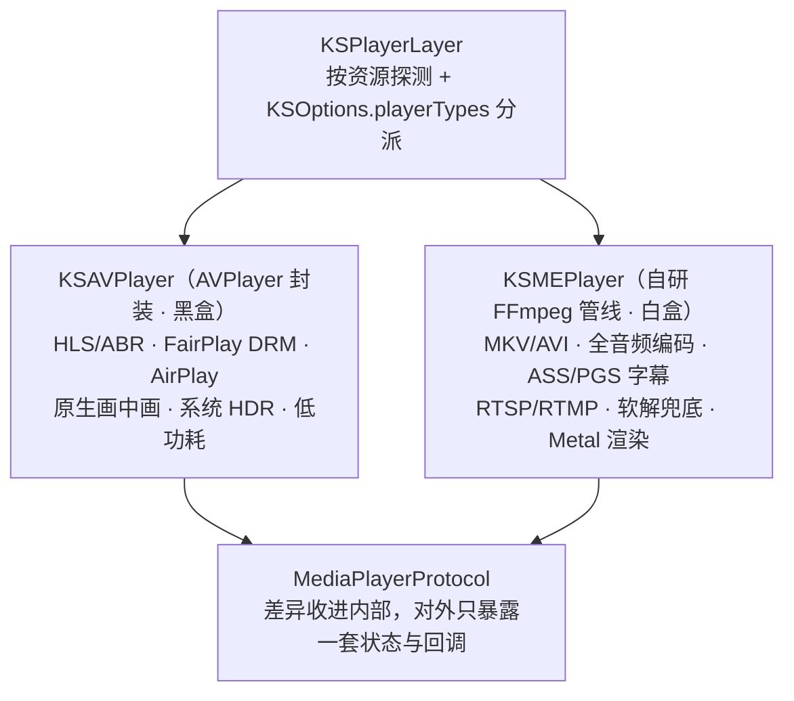
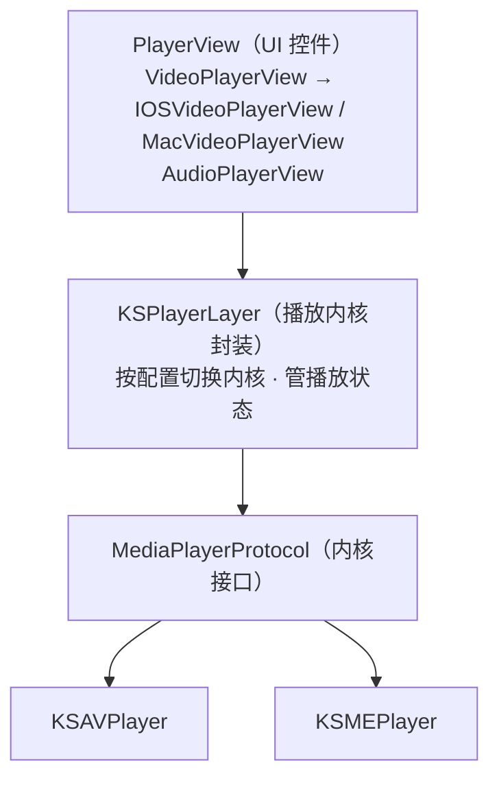
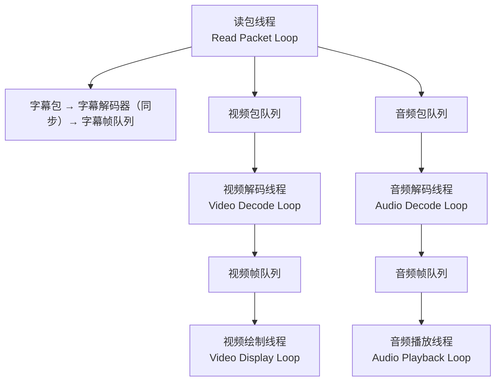
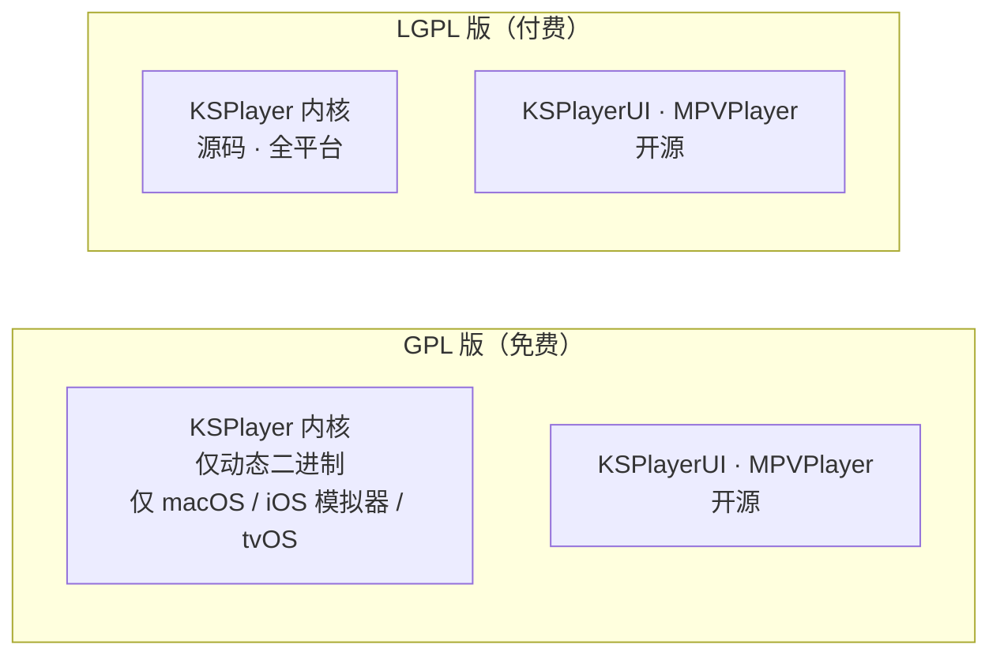

# KSPlayer 设计思想与整体评估

> **评估对象**：`git@github.com:kingslay/KSPlayer.git`
> **快照**：branch `main` · HEAD `01dba13`（2026-10-10）· `git describe = 2.3.4-71-g01dba13` · 849 commits · 最新 tag `2.3.4`
> **本地 clone**：`/Users/tango/Developments/KSPlayer`
> **评估日期**：2026-10-13
>
> 本文中所有数字与引文都来自该快照的实测（`git` 命令、源码、`.swiftinterface`、issue #811），非推测。标注「需复核」的项表示上游滚动分支可能已变更。

---

## 一、怎么读这份文档

分三层，按需取用：

| 层 | 章节 | 解决什么问题 |
| --- | --- | --- |
| **认识层** | 二、三 | KSPlayer 是什么？它的设计**思想**（8 条）是什么？为什么这么设计？ |
| **取用层** | 四、五 | 哪些能抄、哪些不能抄？每条都给了「证据 → 可迁移的抽象」 |
| **施工层** | 六、七、八 | 子模块考证、整体判断、对我们项目的直接结论 |

---

## 二、事实基线

### 2.1 定位与基本盘

| 维度 | 事实 |
| --- | --- |
| 定位 | 基于 AVPlayer + FFmpeg 的纯 Swift 音视频**播放框架**（不是 App） |
| 平台 | iOS 13+ / macCatalyst 14+ / macOS 10.15+ / tvOS 13+ / visionOS 1+ |
| 工具链 | `swift-tools-version:6.2`，`swiftLanguageModes: [.v5, .v6]` 双模式并存 |
| 授权 | 默认 **GPL**；商业用 **LGPL**（付费）；另有更宽松的商业授权（联系作者） |
| 模块 | `KSPlayer`（核心，**二进制**）· `KSPlayerUI`（UI，开源）· `MPVPlayer`（libmpv 内核，开源） |
| 开源部分规模 | 34 个 `.swift` / 13,671 行（`KSPlayerUI` 29 文件 · `MPVPlayer` 5 文件） |
| 社区 | 主要作者 `kintan` 542 commits + `kingslay` 245 commits，其余为社区零散贡献 |

### 2.2 一个必须知道的结构性事实：开源 ≠ 可读

仓库里能读到的只有 **UI 层 + MPV 内核接入层**。真正的播放内核是 **99 MB 的预编译 xcframework**，以 `.binaryTarget` 分发：

```swift
.binaryTarget(name: "KSPlayer", path: "Sources/KSPlayer.xcframework")
```

| 问题 | 答案 |
| --- | --- |
| 有几个 slice？ | **3 个**：`ios-arm64_x86_64-simulator`、`macos-arm64_x86_64`、`tvos-arm64` |
| 有 iOS **真机** slice 吗？ | ❌ **没有** `ios-arm64`。README 原文：「Dynamic Binary, only macOS、iSimulator、tvOS」 |
| 有 visionOS slice 吗？ | ❌ 没有（虽然 `Package.swift` 声明了 visionOS 平台） |
| 能拿到 `KSMEPlayer` 源码吗？ | ❌ 不能。它在二进制里 |

**这条事实有一个反直觉的推论**：`Sources/MPVPlayer/` 虽然是**开源文件**，但它**无法独立编译** —— 它挂在同一个闭源二进制上：

| `MPVPlayer` 用到的符号 | 实际定义位置 |
| --- | --- |
| `MetalView` | **闭源二进制**（`public class MetalView : UIKit.UIView`，见 `.swiftinterface` L2677） |
| `KSPlayerLayer` / `KSPlayerLayerDelegate` | **闭源二进制**（`.swiftinterface` L298 / L543） |
| `KSOptions` / `KSLog` / `DynamicInfo` / `FormatContext` | **闭源二进制** |
| `MediaPlayerProtocol` / `MediaPlayerDelegate` / `MediaLoadState` | **闭源二进制** |

> **所以"抄 MPVPlayer 两个文件"是抄不动的** —— 你至少要自己补一套协议层 + 一个 `CAMetalLayer` 的 View。

### 2.3 交付物形态

| 证据 | 含义 |
| --- | --- |
| README 里 GPL / LGPL 的**模块对照表** | 授权差异按**模块**切，不按功能切 |
| README 里「一次性付费特性」12 项 + 「免费特性」10 项 | 功能也分档，且默认不实现：视频超分、进度条预览、预缓存、蓝光 ISO、原生 Dolby Atmos… |
| 导流到 App Store 的 TracyPlayer | 框架是引流入口，App 是变现出口 |
| `Documents/PrivacyPolicy.md`、`Terms.md`、`privacy.html`、`terms.html` | 上架合规材料提前入仓 |

---

## 三、设计思想（8 条）

### 思想 1｜把「会变的部分」关进协议里

`MediaPlayerProtocol` 是整套设计的枢纽。文档原文：

> 「通过抽象的 `MediaPlayerProtocol` 将真正负责播放的 `KSAVPlayer`、`KSMEPlayer` 屏蔽起来……如果需要接入别的播放器内核，如 ijkplayer，那只要为 ijkplayer 实现 `MediaPlayerProtocol` 接口即可。」

**关键在于它不止是"接口"，还是一个运行时注册表**（从 `.swiftinterface` 实测）：

```swift
public static var playerTypes: [any MediaPlayerProtocol.Type]     // 可注册多个
public static var firstPlayerType: any MediaPlayerProtocol.Type   // 首选
public static var secondPlayerType: (any MediaPlayerProtocol.Type)? // 备选 / fallback
public static var playerLayerType: KSPlayerLayer.Type
```

**这条设计思想的价值可以用一件事来证明**：`MPVPlayer`（libmpv 内核）是 **2024-05-02** 才加进来的 —— 也就是双内核已经跑了很久之后，作者往注册表里塞了**第三个**内核，而**上层一行没改**。

> **可迁移的抽象**：把"多实现"的扩展点做成**注册表 + 协议**，而不是 `switch`。这样"将来加一条腿"的成本是 O(新增实现)，不是 O(重构)。

### 思想 2｜能力取并集，而不是取交集

AVPlayer 是**黑盒**（解码/渲染在系统里，无法注入、拿不到帧），FFmpeg 是**白盒**（全可控，但全部要自己维护）。任何单一内核都必然在某一维度残缺，所以用**互补**而不是**二选一**。



但**真正驱动这个设计的不是能力，是成本**。三个实际动因按重要性排序：

| # | 动因 | 具体含义 |
| --- | --- | --- |
| 1 | **成本只在"需要时"才付** | 80% 的日常内容（mp4 / HLS）走 AVPlayer，**完全不消耗自研解码管线的 bug 预算**。这条是最贵的路，所以把它的触发频率压到最低。 |
| 2 | **法务与体积** | AVPlayer 路径**不需要链接 FFmpeg** ⇒ 存在一个「不含 FFmpeg 的构建」：体积小、授权干净。**这是 GPL/LGPL 两档卖法能成立的前提。** |
| 3 | **失败降级 + 可扩展** | `secondPlayerType` 天然是 fallback；`playerTypes` 是注册表 ⇒ 见思想 1。 |

> **可迁移的抽象**：当两个方案各自有不可替代的强项时，**别选一个**。先问"能不能让它们的成本只在需要时才付"。

### 思想 3｜以「层」为单位解耦，每一层都能单独用



README 原文：「它包含 UI 控件模块、字幕模块、播放器内核模块。**这些模块都是解耦的**，可以通过 pod 按需接入。」

> **可迁移的抽象**：解耦的检验标准是「**能不能只拿一层用**」，不是「有没有分文件」。

### 思想 4｜用「队列深度」做线程背压，而不是 sleep / 轮询

`KSMEPlayer` 有 **5 条线程**，全部是生产者-消费者：



背压由 `CircularBuffer` 承担，语义（引自原理文档）：

| 操作 | 行为 |
| --- | --- |
| `put` | 队列满且未限制长度 → **双倍扩容**；限制长度 → 阻塞当前线程，直到队列只剩 1/2 数据，用 `NSCondition` 唤醒。**目的是避免频繁加锁。** |
| `pop(wait,where)` | `wait=true` 无数据则阻塞等唤醒；`wait=false` 直接返回空 |
| `search(where)` | **只读不移动游标**，专给字幕用 |

还有一条容易漏掉的设计：**`CircularBuffer` 支持排序** —— 因为视频可能非顺序解码（B 帧），必须按 PTS 重排，否则画面来回抖动。

至于"为什么音视频要异步解码"，文档给的理由很实在：不只是解码耗时长，**更因为解码后的数据帧比数据包大好几倍，必须控制帧队列的大小**。

> **可迁移的抽象**：① 用队列深度当背压信号，比 semaphore / 轮询睡眠更好推理；② `search(where)` 这种「不消费的遍历」是字幕这类「重复查询同一时间窗口」需求的正确抽象。

### 思想 5｜渲染路径按「内容特性」分派

`MetalPlayView` 内部按参数决定走哪条后端：

| 后端 | 换来的能力 |
| --- | --- |
| `AVSampleBufferDisplayLayer` | **HDR** |
| `Metal` | **360° 全景视频**、自定义滤镜/着色 |

> **可迁移的抽象**：一个"输出层"抽象下允许两条渲染后端共存，用**内容属性**做 dispatch，而不是赌一种方案能覆盖全部。

### 思想 6｜时钟要能降级

音视频同步优先用**音频时钟**；无音轨、或音轨数据播完时，**回落到视频时钟**。接口是 `OutputRenderSourceDelegate`，实现类是 `MEPlayerItem`。

> **可迁移的抽象**：同步时钟不要写成"唯一真值"，要能降级。

### 思想 7｜授权边界与二进制边界同构

这是全局最容易被忽略、但影响最深远的"设计"：



注意 GPL 版**故意不给 iOS 真机 slice** —— 这不是疏漏，是**闸门**：免费用户能开发、能看 demo，但没法把"自带内核的 App"发到真机。

> **可迁移的抽象**：开源项目的变现可以**用构建产物的形状来实现**，而不是靠运行时校验或授权码。代价是学习者的体验（你只能学 UI，学不到内核）。

### 思想 8｜用图讲并发，用"踩坑记"讲平台差异

`Documents/` 里有：

- `KSPlayer原理详解.md` —— 整体架构图 + KSMEPlayer 组织图 + 运作流程图（3 张 PNG），把 5 线程、协议表、队列语义讲成表格
- `AVPlayer踩坑记.md` —— AVPlayer 的坑单独成篇
- `6.png`、隐私政策、服务条款

源码注释里还保留了只有实测才知道的反直觉事实（`KSVideoPlayer.swift`）：

```
/// iOS tvOS真机先调用onDisappear在调用dismantleUIView，但是模拟器就反过来了。
/// macOS先调用onDisappear在调用dismantleNSView
/// macOS会在第一次退出播放器界面就销毁对象，tvOS要在第二次退出销毁，iOS要在第三次调用才会销毁
/// 在SplitView模式下，第二次进入会先调用makeUIView，然后在调用之前的dismantleUIView...
```

> **可迁移的抽象**：并发/解码这类"看不见的复杂度"要靠**时序图 + 表格**交付；生命周期顺序这类"只能实测"的知识要写在**代码旁边**，而不是 wiki 里。

---

## 四、长处（值得抄）9 条

每条给出：**是什么 → 证据 → 可迁移的抽象**。

| # | 长处 | 证据 | 可迁移的抽象 |
| --- | --- | --- | --- |
| 1 | 协议 + 运行时注册表的内核抽象 | `KSOptions.playerTypes` / `firstPlayerType` / `secondPlayerType` | 扩展点做成注册表，加实现不重构上层 |
| 2 | 双内核能力互补 | README「自动切换 KSAVPlayer 和 KSMEPlayer」 | 能力不可替代时不选一，让成本按需支付 |
| 3 | 四层解耦且每层可独用 | README「可以通过 pod 按需接入」 | 解耦标准 = 能否只拿一层用 |
| 4 | 自研环形队列 + 队列深度背压 | `CircularBuffer` 的 `put`/`pop(wait,where)`/`search(where)`；支持排序 | 背压用深度信号；提供"不消费遍历" |
| 5 | 渲染后端按内容特性分派 | `MetalPlayView`：`AVSampleBufferDisplayLayer`(HDR) vs `Metal`(全景) | 输出层抽象下并存两条后端 |
| 6 | 同步时钟可降级 | 音频时钟优先 → 无音轨回落视频时钟 | 时钟别写死唯一真值 |
| 7 | 授权按模块切，且闸门用构建产物表达 | GPL 只给二进制、无 iOS 真机 slice | 变现可以用产物形状实现 |
| 8 | 文档 = 图 + 表 + 踩坑记 | `KSPlayer原理详解.md`、`AVPlayer踩坑记.md` | 看不见的复杂度靠图交付 |
| 9 | 工程卫生基线干净 | 公开源码 `TODO/FIXME/HACK` = **0**、`fatalError`/`try!` = **0**、`print(` = **1**；有 `.swiftformat`、`.spi.yml` | 13k 行并发代码做到零 TODO 不容易 |

### 顺带一提：它的手势交互设计值得单独看

README 列出的交互约定（这套是移动端播放器的行业惯例，自建时可直接沿用）：

| 手势 | 位置 | 效果 |
| --- | --- | --- |
| 上下滑动 | **右半屏** | 调节屏幕亮度 |
| 上下滑动 | **左半屏** | 调节音量 |
| 左右滑动 | 全屏 | 调节播放进度 |

（模拟器调不了亮度/音量，只能真机验证。）

---

## 五、短处（不要抄）15 条

### P0 — 结构性问题，一开始就别复制

| # | 问题 | 证据 | 影响 |
| --- | --- | --- | --- |
| 1 | **核心闭源 + 二进制分发，且刻意不给 iOS 真机 slice** | xcframework 只有 3 个 slice，无 `ios-arm64`、无 visionOS | 免费用户**无法上真机**；学习场景极不友好 |
| 2 | **测试近乎为零，CI 的 test 步骤被注释** | `Tests/` 仅 1 文件 / 8 个 `@Test`，全部只断言 `KSPlayerResource` 的构造；workflow 里 `# - name: Test` 被注释 | 解码/缓冲/同步/seek **零回归网**；并发代码全靠人肉 |
| 3 | **target 上挂 `unsafeFlags`，切断"被依赖"能力** | `Package.swift` 中 `MPVPlayer` / `KSPlayerUI` / testTarget 都有 `-experimental-package-interface-load` | SwiftPM 策略下，使用 `unsafeFlags` 的包**无法被其他包当作依赖消费** |
| 4 | **`Package.swift` 用命令式代码 + 环境变量做构建变体** | `ProcessInfo.processInfo.environment["dynamicFrameWork"] == nil ? .static : .dynamic` | 开关不可发现、不可声明式表达、IDE 里行为随环境漂移 |
| 5 | **99 MB 二进制入库** | `Sources/KSPlayer.xcframework` 直接进 git | 仓库随版本线性膨胀；应改 `.binaryTarget(url:checksum:)` 挂 release asset，或 Git LFS |

### P1 — 代码与工程

| # | 问题 | 证据 |
| --- | --- | --- |
| 6 | **巨型单文件** | `SettingsView.swift` 2147 行 · `IOSVideoPlayerView.swift` 2116 行 · `MPVOption.swift` 1504 行 · `VideoPlayerView.swift` 790 行 · `VideoControllerView.swift` 771 行 · `MPVProperty.swift` 691 行 · `AppKitExtend.swift` 501 行 |
| 7 | **同一个播放器 UI 写了三套** | `IOSVideoPlayerView`(UIKit 2116 行) + `MacVideoPlayerView`(AppKit 212 行) + `SwiftUI/` 16 文件；框架混用：SwiftUI 16 / UIKit 18 / AppKit 12 文件 |
| 8 | **平台分支爆炸** | 55 处 `#if os(...)` |
| 9 | **毫秒级 `@Published` 推时间** | `ControllerTimeModel` 注释原文：「**这是一个频繁变化的model。View要少用这个**」；`player(currentTime:)` 每次回调都可能写 `@Published` ⇒ 打爆 SwiftUI 重绘 |
| 10 | **平台行为差异只活在源码注释里** | `KSVideoPlayer.swift` 里 4 条"真机/模拟器/macOS/tvOS 先后顺序不同"注释，没有上提到 `Documents/` |
| 11 | **`.gitmodules` 残留空文件** | HEAD 里是 **0 字节**，且 `gitignore` 还留着 `FFmpegKit` | 

### P2 — 卫生与可信度

| # | 问题 | 证据 |
| --- | --- | --- |
| 12 | **README 的 build badge 是硬编码静态图** | `https://img.shields.io/badge/build-%20passing%20-blue.svg` —— 写死的 "passing"，不连 CI 状态 |
| 13 | **CI 覆盖面窄** | 仅在 `push release` 触发；iOS / tvOS / xrOS 构建命令全被注释；只有 macOS 上 `swift build`，且 runner 是 `macos-26`（需复核） |
| 14 | **主打性能但无性能门槛** | README 强调「首屏秒开」「8K / 120fps」「监控首屏耗时、缓冲次数」，但没有 benchmark，也没有性能回归门 |
| 15 | **无 CHANGELOG / 版本语义不可读** | 大量 commit message 就是 `update`；只有 tag 序列（至 `2.3.4`），没有变更说明 |

---

## 六、附录：submodule 考证

**结论先说：这个仓库现在没有任何 git submodule。** `git submodule status` 无输出；`.gitmodules` 是一个 **0 字节空文件**（历史残留）。

### 6.1 历史沿革

`.gitmodules` 一共被改过 5 次，始终只声明**一个** submodule：`FFmpegKit`。

| 提交 | 时间 | `.gitmodules` 内容 |
| --- | --- | --- |
| `2bf2df6` init | 2023-02-19 | `path=FFmpegKit` · `url=https://github.com/kingslay/FFmpegKit` · `branch=main` |
| `eb951f7` | — | 改为 `url=git@github.com:TracyPlayer/FFmpegKit.git` · `branch=lgpl` |
| `27b5092` | — | 改为 `url=git@github.com:kingslay/FFmpegKit.git` · `branch=lgpl` |
| `37e3720` | — | 改回 `https` URL · `branch=main` |
| **`4e3bf3e`** | **2024-10-22** | **整段删除**（message：`remove submodule fix #811`，同时删掉 `FFmpegKit` gitlink） |

### 6.2 为什么要删 —— issue #811 的因果链

Issue [#811 "Installing via SPM as a package dependency fails"](https://github.com/kingslay/KSPlayer/issues/811)（2024-09-04 开、2024-10-22 关）中的关键日志：

```
Checking out main (c2d461f)
Couldn't update repository submodules:
    Submodule 'FFmpegKit' (git@github.com:kingslay/FFmpegKit.git) registered for path 'FFmpegKit'
    Cloning into '.../SourcePackages/checkouts/KSPlayer/FFmpegKit'...
    Host key verification failed.
fatal: Could not read from remote repository.
Failed to clone 'FFmpegKit'. Retry scheduled
```

**两层原因，第二层才是致命的：**

1. **表层**：`.gitmodules` 里写的是 **SSH URL（`git@github.com:...`）**。SPM 在 `SourcePackages` 里 checkout 时若遇到 submodule 会去 clone 它，普通用户没配 GitHub SSH key ⇒ `Host key verification failed`。作者 2024-10-03 先把 URL 改成 https 试图救场，用户反馈仍不行。

2. **深层**：`Package.swift` 里有一段**兄弟目录约定**，与 SPM 的沙盒互相矛盾 ——

   ```swift
   var ffmpegKitPath = FileManager.default.currentDirectoryPath + "/../FFmpegKit"
   ```

   它期望你把 `FFmpegKit` clone 在 `KSPlayer` 旁边。但在 SPM 的 checkout 沙盒里 `currentDirectoryPath` 返回空串（作者自己在注释里写了：「spm FileManager.default.currentDirectoryPath返回的空字符」），于是退化成"在 checkout 目录里找 submodule"。**两套"取依赖"的机制在此互相打架。**

最终作者选择**彻底删掉 submodule**，改用 SPM 依赖。

### 6.3 现行依赖机制（替代方案）

```swift
let ffmpegKitPath = <KSPlayer 同级>/FFmpegKit
if FileManager.default.fileExists(atPath: ffmpegKitPath + "/Package.swift") {
    package.dependencies += [.package(path: ffmpegKitPath)]           // ① 本地源码优先
} else {
    package.dependencies += [.package(url: "https://github.com/kingslay/FFmpegKit.git", from: "9.0.2")]  // ② 远端兜底
}
```

配合 `.gitignore` 里的 `FFmpegKit` 一行 —— 本地那份源码不会被提交。**这就是"既能改依赖源码、又能被别人直接吃包"的标准写法。**

### 6.4 四条硬规则（从这段历史直接得出）

1. **`.gitmodules` 里永远写 https，不写 `git@`**（除非私有仓库 + 全部消费者都有 key）
2. **不要用 submodule 装大二进制依赖**（FFmpeg / OpenSSL 这类）。要么 SPM `.package(url:)`，要么 `.binaryTarget(url:checksum:)`
3. **想同时支持"我改源码"和"别人直接吃包"，用 `package(path:)` 条件分支 + gitignore**（可直接照抄 KSPlayer）
4. **不要依赖 `FileManager.currentDirectoryPath` 推路径**（SPM 里它是空串）。要用 `#filePath`，并处理 `/checkouts/` 场景

---

## 七、整体认识

### 7.1 三句话

1. **KSPlayer 的设计思想是成熟的，工程实现是欠债的。** 它的协议抽象、双内核分派、队列背压、指令分层的每一个决定都站得住；但测试近乎为零、巨型文件、三套 UI、CI 残缺，说明它把有限的精力几乎全投给了"功能广度"。
2. **它真正的产品是一个商业 App（TracyPlayer），框架是获客渠道。** 这一点解释了为什么核心闭源、不给 iOS 真机 slice —— 那是有意的漏斗，不是技术债。
3. **它是一个优秀的"思想样本"，一个糟糕的"抄写模板"。** 抄它的边界设计（协议 + 注册表 + 分层），不要抄它的范围和文件组织。

### 7.2 三张判断表

**能抄（思想层）**

| 抄什么 | 具体形态 |
| --- | --- |
| 协议 + 注册表的扩展点 | `MediaPlayerProtocol` + `playerTypes` |
| 队列深度做背压 | `CircularBuffer` 的 `put` 阻塞语义 |
| 不消费的遍历接口 | `search(where)` 给字幕用 |
| 输出层多后端分派 | 按 HDR / 全景 / 普通选渲染路径 |
| 时钟可降级 | 音频时钟优先、视频时钟回落 |
| 依赖管理写法 | `package(path:)` 条件分支 + gitignore |

**不能抄（实现层）**

| 别抄什么 | 替代做法 |
| --- | --- |
| 双内核（对自用场景） | 单内核 + 立好抽象边界 |
| 三套 UI（UIKit/AppKit/SwiftUI） | 一套 SwiftUI，iOS/macOS 通用 |
| 巨型单文件 | 单文件软上限 400–500 行 |
| 满屏 `#if os` | 按平台拆目录（`iOS/` `macOS/` `Shared/`） |
| 毫秒级 `@Published` | 0.2–1 s 粒度 + `AsyncStream` |
| 二进制入库 / `unsafeFlags` | `.binaryTarget(url:checksum:)`；保持 `Package.swift` 声明式 |
| 无测试 + 注释掉的 CI | 内核与 UI 物理隔离 ⇒ 内核可单测 + CI 多 destination |

**必须自己补（KSPlayer 没给答案的）**

| 缺口 | 说明 |
| --- | --- |
| 直播（RTMP/RTSP/低延迟） | 文档只提了一句"支持"，**没有任何实现细节或策略说明** |
| 性能工程 | 主打首屏秒开 / 8K / 120fps，但无 benchmark、无回归门、无调优方法论 |
| 可观测性 | 有 `bufferedCount` / `consumeTime` 回调，但没有成体系的指标定义与采集 |
| 测试方法学 | 播放器怎么测、测什么，仓库里没有任何示范 |

---

## 八、对自建播放器的直接结论

| # | 结论 | 依据 |
| --- | --- | --- |
| 1 | **抄边界，不抄范围** | 见 7.2 三张表 |
| 2 | **内核与 UI 必须编译期隔离** | 这是唯一能保住可测性的手段（KSPlayer 反例：1 个测试文件） |
| 3 | **依赖管理照抄它的 `package(path:)` 写法** | 见 6.3、6.4 |
| 4 | **别碰 submodule + 大二进制** | 见第六章整段 |
| 5 | **第一天就立扩展点，但只实现一个内核** | 思想 1（`MPVPlayer` 零成本接入的证明） |
| 6 | **显式写下"有意放弃"清单** | 见思想 2 的反面：选了单内核就必须接受 AirPlay / DRM / 原生 PiP / 系统 HDR 的缺失 |
| 7 | **文档按"图 + 表 + 踩坑记"三段交付** | 思想 8 |

> 具体技术选型的决策结论见 [`02-自建播放器决策记录.md`](02-自建播放器决策记录.md)。
