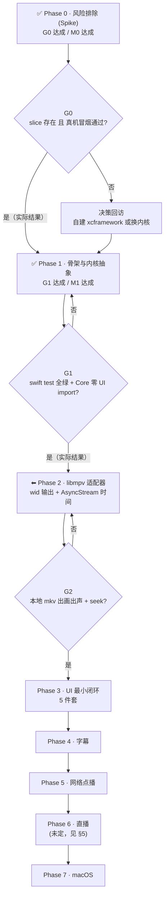

# 自建播放器 · 路线图

> **前置阅读**：[`01-KSPlayer-设计思想与整体评估.md`](01-KSPlayer-设计思想与整体评估.md)（认识）· [`02-自建播放器决策记录.md`](02-自建播放器决策记录.md)（约束）  
> **路线图日期**：2026-10-13（**2026-10-13 修订：G0 达成、M0 达成、Phase 0 关闭；G1 达成、M1 达成、Phase 1 关闭**）  
> **规模标记**：`S` ≈ 一次专注投入 · `M` ≈ 数轮迭代 · `L` ≈ 需要拆成多张 ticket

---

## 一、总览



**两个"阻塞点"必须先说**：

1. ~~**G0 是硬门**：若 `kingslay/FFmpegKit` 不提供 iOS 真机 slice，`02` 里的整条 iOS 路线要重估。~~  
   ✅ **2026-10-13：G0 已达成，Phase 0 关闭。** 我们不再依赖 `kingslay/FFmpegKit`（它的产物是 GPL 构建），改走**自建动态 LGPL-2.1 产物**；产含 `ios-arm64` 且**真机出画面**（`docs/06` / `docs/07`）。**M0「路线成立」达成。**
2. **G1 是纪律门**：Phase 1 结束时必须做到 `PlayerCore` 零 UI 框架 import + 测试全绿。这道门一旦放过，Phase 2 之后的可测性就永久丧失了（KSPlayer 的教训）。 ← **这道门仍然完好，是下一个要过的东西**

---

## 二、阶段与判定门

| 阶段             | 目标      | 交付物                                | 判定门                                  | 规模 | 状态                                                                                      |
| -------------- | ------- | ---------------------------------- | ------------------------------------ | -- | --------------------------------------------------------------------------------------- |
| **P0 风险排除**    | 排掉唯一暗礁  | 三份实测报告 + 自建产物                      | **G0**：slice 存在 **且**真机冒烟通过          | S  | **✅ 完成（G0 达成 / M0 达成）**                                                                 |
| **P1 骨架与抽象**   | 立起可测的地基 | 双 target + fake 内核 + 状态机 + 时间模型    | **G1**：`swift test` 全绿 + 零 UI import | M  | **✅ 完成（G1 达成 / M1 达成）**                                                                 |
| **P2 内核接入**    | 让真画面出来  | MPVKernel + wid 输出 + **装配层** + 时间流 | **G2**：出画 + 出声 + seek 精确 + 门禁 0      | M  | **✅ 关闭（`G2` 四项全达成 / `M2` 达成）**（2026-10-13）：`T0`–`T12` 全部完成；报告 [`docs/10`](10-P2验证报告.md) |
| **P3 UI 最小闭环** | 能用手操作   | SwiftUI 5 件套                       | **G3**：模拟器上可点可拖                      | M  | 待开始                                                                                     |
| **P4 字幕**      | 能看字幕    | 外挂字幕 + 轨道切换                        | **G4**：SRT 编码 + ASS 特效正常             | M  | 待开始                                                                                     |
| **P5 网络点播**    | 能看在线    | HLS/mp4 播放 + 缓存                    | **G5**：弱网不崩、可切清晰度                    | M  | 待开始                                                                                     |
| **P6 直播**      | 能看直播    | RTMP/RTSP + 低延迟策略                  | **G6（未定）**                           | L  | 未排期                                                                                     |
| **P7 macOS**   | 双平台     | macOS target 复用同一包                 | **G7**：同一包在 macOS 编译零改动              | M  | 待开始                                                                                     |

---

## 三、逐阶段拆解

### Phase 0 · 风险排除（Spike，不写产品代码）

**目标**：用最小成本确认 libmpv 路线在 iOS 上成立。

| ticket      | 内容                                | 规模 | 状态                                     |
| ----------- | --------------------------------- | -- | -------------------------------------- |
| ~~`P0-T1`~~ | ~~实测 `kingslay/FFmpegKit` 的产物构成~~ | S  | **已由修订 1 取代**（`P0-T4` 承担，见 `docs/05`）  |
| ~~`P0-T2`~~ | ~~最小冒烟 App（模拟器 `wid` 嵌入）~~        | S  | **已由修订 1 取代**（`P0-T5a` 承担，见 `docs/06`） |
| ~~`P0-T3`~~ | ~~真机冒烟（MoltenVK 可用性）~~            | S  | **已由修订 1 取代**（`P0-T5a` 承担，见 `docs/06`） |

**交付物**：~~`docs/04-libmpv产物实测报告.md`~~ → 实际产出三份 + 一份自建产物：

| 交付物                                         | 内容                                             |
| ------------------------------------------- | ---------------------------------------------- |
| [`docs/05`](05-libmpv产物实测报告.md)             | `P0-T4`：MPVKit 上游产物的许可实测（发现其落在 LGPLv3）         |
| [`docs/06`](06-P0-T5a技术验证报告.md)             | `P0-T5a`：`wid` + MoltenVK 技术验证（**模拟器 + 真机双通**） |
| [`docs/07`](07-P0-T5b验证报告.md)               | `P0-T5b`：**自建动态 LGPL-2.1 产物**（G0 达成）           |
| `spike/p0-t5b-lgpl-dynamic-build/`          | 构建方式归档（patch + 脚本 + 构建证据）                      |
| `docs/assets/p0t5a/` · `docs/assets/p0t5b/` | 两轮的证据截图                                        |

**判定门 G0**（2026-10-13 实际结果）

| 结果                    | 实际发生                                                    |
| --------------------- | ------------------------------------------------------- |
| ✅ 有 `ios-arm64` 且冒烟通过 | **这一条命中了** —— 但路径与预期不同：**不是"用现成产物"，而是"自建产物"**。原因见下方修订 4 |
| ⚠️ 只有模拟器 slice        | 未发生                                                     |
| ❌ libmpv product 不存在  | 未发生                                                     |

**风险**：这是全项目唯一"可能推翻设计"的阶段。**实际结论：未推翻，但推翻了一个隐含假设** —— 不能靠现成产物，必须自建（修订 4）。Phase 0 现已关闭；原「不写任何要长期留存的代码」这条代价见修订 3。

> ### 📌 2026-10-13 修订（四处，均已与事实对齐）
>
> **1. ticket 编号改由 [`04-开工前准备清单.md`](04-开工前准备清单.md) §3 接管。**  
> 本文原写的 `P0-T1 / T2 / T3` 已被重新拆解，实际执行为：  
> `P0-T4`（LGPL 核查）· `P0-T5a`（技术验证）· `P0-T5b`（自建动态产物）· `P0-T6`（合规基线）· `P0-T7`（文档反转）。
>
> **2. 交付物改名（`docs/04` 编号被开工前准备清单占用）**：  
> `P0-T4` → [`05-libmpv产物实测报告.md`](05-libmpv产物实测报告.md) ·  
> `P0-T5a` → [`06-P0-T5a技术验证报告.md`](06-P0-T5a技术验证报告.md) ·  
> `P0-T5b` → [`07-P0-T5b验证报告.md`](07-P0-T5b验证报告.md) · 证据截图 → `docs/assets/p0t5a/` · `docs/assets/p0t5b/`。
>
> **3. ⚠️「spike 不进主仓」这条原则被修订。**  
> 冒烟工程**已迁入仓库**：`spike/p0-t5a-libmpv-smoke/`、`spike/p0-t5b-lgpl-dynamic-build/`。  
> **修订理由**：① 它是技术结论的可复现证据（截图与指标能重跑，而非只信文档）；② 它是 Phase 1 的实现基线。  
> **边界（不破原则的那部分）**：它**不参与产品构建**、不是产品代码；产品骨架仍按 Phase 1 新建 `PlayerCore` / `PlayerUI` 双 target。  
> **已接受的代价**：Phase 0 从此不再"零长期留存代码"；`spike/` 目录的源码会长期存在，后续若与 Phase 1 重复，以 Phase 1 为准。
>
> **4. ⚠️「G0 = 用现成产物即可」这个隐含假设被推翻（本次最重要的修订）。**  
> `docs/02` 原 B2 选的是 `kingslay/FFmpegKit` 的 SPM 产物。实测发现**现成产物没有「动态 + LGPL」的组合**：  
> FFmpegKit 的动态 framework 是 **GPL 构建**；MPVKit 是 LGPL 但**静态**（`ar archive`）。  
> 而本项目已拍板**要上架 App Store** ⇒ 两个条件都不可让 ⇒ **必须自建**。  
> **结果**：已产出 `Libmpv.xcframework`（动态 + `LGPL version 2.1 or later` + 自包含 + 真机出画面）。  
> 详见 [`docs/07`](07-P0-T5b验证报告.md) 与 [`docs/02`](02-自建播放器决策记录.md) §三「分发口径」。

---

### Phase 1 · 骨架与内核抽象（零 UI 依赖）

**目标**：把 `docs/02` 的工程约束变成物理事实 —— 内核与 UI 编译期隔离。

| ticket  | 内容                                                                                                                                                        | 规模 | 状态                                                                                                     |
| ------- | --------------------------------------------------------------------------------------------------------------------------------------------------------- | -- | ------------------------------------------------------------------------------------------------------ |
| `P1-T1` | `Package.swift`：`PlayerCore` / `PlayerUI` 两个 target；`Demo/project.yml` + xcodegen 生成 app 工程（iOS 17 / macOS 14）                                            | S  | **✓ 完成**（2026-10-13）：`swift build` / `swift test` 双绿 · Demo 构建 + 模拟器运行通过 · `PlayerCore` 零 UI import 已核 |
| `P1-T2` | `PlayerCore` 定义 `PlayerKernelProtocol`（对应参考实现的 `MediaPlayerProtocol`）+ **注册表**（`kernelTypes` / `firstKernelType` / `secondKernelType`）+ `FakeKernel` 测试替身 | M  | **✓ 完成**（2026-10-13）：红→绿闭环 · **24 tests 全绿** · 变异测试 **9/9 杀死 / 0 存活**                                  |
| `P1-T3` | `PlayerState` 状态机 + 非法迁移处理。**注**：状态枚举已提前落在 `P1-T2`（`PlayerState`），本票实现的是**迁移校验的机器**（`PlayerStateMachine`），并补上 `failed` 态                                  | M  | **✓ 完成**（2026-10-13）：**33 tests 全绿** · 变异 **16/16 杀死**（含状态机 7 个）                                       |
| `P1-T4` | `PlayerTimeModel` + `AsyncStream` 时间流（**0.2–1 s 粒度**，禁止毫秒级推送）                                                                                             | S  | **✓ 完成**（2026-10-13）：**67 tests 全绿** · 变异 **25/25 杀死**（含时间模型 9 个）                                      |
| `P1-T5` | 集成测试 + 门禁固化（**范围修正**见下）                                                                                                                                   | M  | **✓ 完成**（2026-10-13）：集成测试 8 条（**首跑 8/8 全崩，抓到 fake 保真度缺陷**，见 `docs/08` §三）· `Tools/gate.sh` 固化 G1 三条    |

> **`P1-T5` 的范围修正（2026-10-13）**：原文写「资源解析 / 状态机迁移 / 时间钳制 / **轨道模型**」。前两项已由 `P1-T2`~`P1-T4` 覆盖；**「轨道模型」属 `P4`（字幕/轨道）**，且不在 M1 的定义里（M1 = 骨架 + fake 内核 + 测试全绿 + Core 零 UI 依赖），现在做属提前投入。  
> ⇒ `P1-T5` 收窄为：**补齐 `PlayerResource` 的解析语义**（本地 vs 网络 URL 判定，M2 分派要用）+ **把测试闸门固化成 G1 证据**（`swift test` + `Tools/mutation_check.py` 双绿），`轨道模型` 移到 `P4`。
>
> **`P1-T4` 的一处设计机制（值得记住）**：节流判定用的是**媒体时间增量**（`|t - 上次已发布| ≥ interval`），**不是墙上时钟**。原因：墙上时钟节流需要注入时钟才能测，媒体时间增量**天然确定**，测试无需模拟时间。副作用是"暂停时的小幅 seek 可能被节流掉"—— 影响可忽略（大幅 seek 的增量必然超过阈值）。

> **`P1-T1` 与 `P1-T2` 在文件层面必然重叠**：SPM **拒绝空 target** ⇒ "建工程"这张票必须同时落地每个模块的第一个真实类型（本票落 `PlayerResource` 与 `PlayerRootView`）。原因见 [`PITFALLS`](PITFALLS.md) `P-012`。  
> **本票的两处临时值**（均待 `D1` 命名定案后统一替换，只涉及 2 个文件）：包名 `PlayerStack` · Demo bundle id `com.playerstack.demo`。

**交付物**：可 `swift test` 的骨架包 + **内核边界已立**（`PlayerKernelProtocol` / 注册表 / `FakeKernel` / 状态机 / 时间模型）。  
详见 [`docs/08-P1验证报告.md`](08-P1验证报告.md)。

**判定门 G1**（三条同时满足）

1. `swift test` 全绿；
2. mutation testing 有通过记录（对应既有纪律）；
3. **`PlayerCore` 内 `grep -r "import SwiftUI\|import UIKit\|import AppKit"` 为空**。

> **✅ 2026-10-13 实际结果：三条全过** —— 75 tests / 0 failures · 变异 25/25 杀死 · 零 UI import。  
> 固化入口：**`./Tools/gate.sh`**（退出码 0 即 G1 达成）。  
> **过程中的重要发现**：集成测试首跑 8/8 全崩，抓到 `FakeKernel` 跳过 `.preparing` 的**保真度缺陷**（单元测试各自全绿却拼不起来）。见 [`PITFALLS`](PITFALLS.md) `P-018`。

> ### 📌 2026-10-13 · Phase 1 收尾说明（两处 spec 修正）
>
> **1. `P1-T3` 的拆分口径**：状态**枚举** `PlayerState` 提前落在 `P1-T2`（内核边界需要状态词汇），`P1-T3` 实现的是**迁移机器** `PlayerStateMachine`；并补上原 spec 漏掉的 `failed` 态。
>
> **2. `P1-T5` 大幅收窄**：原文写「资源解析 / 状态机迁移 / 时间钳制 / **轨道模型**」。前两项已被 T2~T4 覆盖；**轨道模型移入 `P4`**，`PlayerResource` 的本地/网络判定也**砍掉**（属 `M4`）。理由：`M3` 是范围锚点，**不推进 M3 的需求往后排**。  
> ⇒ `P1-T5` 实际交付的是**集成测试（8 条）+ 门禁固化**（`Tools/gate.sh`），而不是原 spec 那份清单。
>
> **3. 刻意未做的一件事**：内核分派（`canHandle` / `kernelType(for:)`）。只有 1 个内核时它是投机代码；第二个内核出现时再加 —— `docs/02` B3 的扩展点已经留好，加它只是 2 个文件的事。

**风险**：最容易犯的错是"先在 Core 里 import UIKit 图省事"。这道门就是防线。

---


### Phase 2 · libmpv 适配器（让真画面出来）

**目标**：把 `wid` 方案接上，走通一条真实链路。

| ticket   | 内容                                                                                                                                                                                                                          | 规模 | 状态                                                                                                                                                                                                                                                                                              |
| -------- | --------------------------------------------------------------------------------------------------------------------------------------------------------------------------------------------------------------------------- | -- | ----------------------------------------------------------------------------------------------------------------------------------------------------------------------------------------------------------------------------------------------------------------------------------------------- |
| `P2-T0`  | **前置：模块拓扑**（`docs/02` §C 修订）—— libmpv 适配器独立成包 `MPV/`，根包不受影响                                                                                                                                                                 | S  | **✓ 完成**（2026-10-13，董事长拍板；见 `docs/02` §C）                                                                                                                                                                                                                                                       |
| `P2-T1`  | `MPVKernel` 实现 `PlayerKernelProtocol`：`mpv_create` / `mpv_initialize` / 事件循环（`mpv_set_wakeup_callback` + `mpv_wait_event`）                                                                                                  | M  | **✓ 完成（编译层）**（2026-10-13）：iOS 模拟器 `BUILD SUCCEEDED`（真实链接 libmpv）· macOS 守卫路径通过 · **运行层验证待 P2-T5**                                                                                                                                                                                               |
| `P2-T2`  | `VideoOutputProtocol` 抽象 + `WindowEmbedOutput`（`wid` 实现，`CAMetalLayer`）                                                                                                                                                     | S  | **✓ 完成**（2026-10-13）：协议在 `PlayerCore` · 实现在 **`PlayerUI`**（见下注）· **84 tests / 27 变异全杀** · MPV 包 iOS 构建通过                                                                                                                                                                                        |
| `P2-T3`  | **装配层 `PlayerController`**：内核事件流的**唯一消费者** + 扇出（状态机 / 时间模型）+ 对外 `updates()` / `snapshot()`。见 [`docs/09`](09-P2就绪度分析与票面修正.md) §二                                                                                             | M  | **✓ 完成**（2026-10-13）：`PlayerController` + `PlayerControllerSnapshot` + `PlayerControllerUpdate` · 11 条测试 · 变异 12/12 杀死 · **同时完成测试框架迁移（XCTest → Swift Testing）与门禁管道改造**，见下注                                                                                                                      |
| `P2-T4`  | `PlayerKernelSnapshot` 加 `naturalSize`（**跨层改协议，必须与 T5 同批**）                                                                                                                                                                 | S  | **✓ 完成**（2026-10-13）：`naturalSize` 已**贯穿四层** —— `PlayerKernelEvent.videoSizeChanged` / `PlayerKernelSnapshot` / `PlayerControllerSnapshot` / `PlayerControllerUpdate`；`FakeKernel` 支持脚本化尺寸（`.zero` 时不上报假尺寸）；6 个变异体                                                                              |
| `P2-T5`  | mpv 属性 ↔ 模型映射（`time-pos` / `duration` / `pause` / `paused-for-cache` / `width` / `height` / `track-list`），参照 `vendor/ksplayer/Sources/MPVPlayer/MPVHandle.swift` 的 `observeProperties` 清单；**`pause` 改为 observe（取消乐观 emit）** | M  | **✓ 完成**（2026-10-13）：新增 observe `pause` / `width` / `height`；`play()`/`pause()` **取消乐观 emit**（`pause` 是权威可观测属性）；`width`/`height` 经 `VideoSizeTracker` 合成（分两次到达不误报半截尺寸）；`MPV/` 包 **BUILD SUCCEEDED**                                                                                             |
| `P2-T6`  | `MPV_EVENT_END_FILE` 读 `mpv_end_file_reason` 区分错误 → `.failed`                                                                                                                                                               | S  | **✓ 完成**（2026-10-13）：新增 `PlayerCore.PlaybackEndReason`（**策略**，5 个原因 → 3 种状态 + 2 种静默）与 `PlaybackEndReason+MPV.swift`（**翻译**，薄到只剩 C 常量映射，未识别的 reason 返回 `nil`）；`MPVKernel` 不再无条件报 `.finished`；**并反转了一条状态机规则**（见下方 📌）                                                                             |
| `P2-T7`  | `attach` 时序收口（`init` 参数化）+ wakeup 回调改 `passRetained`（内存安全）                                                                                                                                                                  | M  | **✓ 完成**（2026-10-13）：`attach` **删除**，改为 `init(windowEmbedHandle: Int64)`（参数**非可选**）；另留 `init()` 供注册表无参构造并**显式标注它 = 无画面**（隐患已记）；唤醒回调改 `WakeupSink` + `passRetained`，**在 `mpv_terminate_destroy` 返回之后**才释放（见下方 📌）                                                                                |
| `P2-T8`  | 播放控制：load / play / pause / seek / stop；`hwdec=videotoolbox`；**`seek` 用 `absolute+exact`**，钳制由装配层履行                                                                                                                          | M  | **✓ 完成**（2026-10-13）：`seek` 改 `absolute+exact`；**实测抓出两个真缺陷**（`P-038` 换文件后回不到 `.playing` · `P-039` 播完 `.finished` 是死状态）；`MPV` 包行为用例 7 → **11 条**                                                                                                                                                 |
| `P2-T9`  | **`MPV/` 包纳入门禁**：补 `PlayerMPVTests` target + `gate.sh` **条件步骤**（产物存在才跑，不硬失败）；顺带接 CI                                                                                                                                         | M  | **✓ 完成**（2026-10-13）：`MPV/Package.swift` 加 `PlayerMPVTests`；`gate.sh` 扩为 **6 步** —— `[4/6]` 编译、**`[5/6]` 真实 libmpv 行为测试（iOS 模拟器，机型动态挑选）**、`[6/6]` 变异。冻结在 `P-034` 的那条缺口正式补上（见下方 📌）                                                                                                              |
| `P2-T10` | **Demo 接入 `PlayerMPV` 包**（端到端硬前置：`Demo/project.yml` 目前只依赖 `PlayerStack`）                                                                                                                                                    | S  | **✓ 完成**（2026-10-13）：`Demo/project.yml` 显式依赖 `PlayerMPV`；新增端到端样板 `MPVDemoView`（surface → 内核 → 装配层 → UI）+ `VideoSurfaceView` + `SampleClipWriter` + 两个**可脚本化开关**（`-autoLoadSample` / `-traceUpdates`）；`BUILD SUCCEEDED` 且**模拟器里真跑通**                                                             |
| `P2-T12` | **补音轨，关闭 `G2` 最后一项**（`G2` 原文是「出画 + 出声」，`P2-T11` 只证了出画）                                                                                                                                                                      | S  | **✓ 完成**（2026-10-13）：样例加 **AAC 44100 Hz 音轨**（`AVAudioFile` 编码 + `AVMutableComposition` 无重编码封装）；新增 `PlayerCore.PlayerAudioState`（**解码端/输出端采样率分开**，策略放 Core 可测）；`MPVKernel` observe `audio-params/samplerate` + `audio-out-params/samplerate`；**四层贯穿**；实测 `44100→0` 后 `44100→44100` ⇒ **音频输出已建立** |
| `P2-T11` | 本地 mkv 端到端（含多音轨）+ **性能基线**（首屏耗时 / 缓冲次数 / 内存峰值，给门槛值）+ `docs/10` + `G2` 固化进 `gate.sh`                                                                                                                                         | M  | **✓ 完成**（2026-10-13）：**`G2` 达成** —— 出画 ✅ · `seek` 精确 ✅ · 门禁 0 ✅；**出声 ⚠️ 未覆盖**（样例无音轨，如实记在 `docs/10` §四）。报告 [`docs/10`](10-P2验证报告.md)；`gate.sh` 扩为 **7 步**（新增 `[6/7]` 真跑一遍 App 端到端）；性能基线：**首屏 60 ms** · 播放 **1.02x 实时** · 缓冲 **0** 次 · 内存峰值 **49.1 MB**                                           |

> ### 📌 2026-10-13 · Phase 2 票面修正（三张扩为九张）
>
> **动因**：开工前复核发现**票面漏了一个前置** —— `PlayerStateMachine` / `PlayerTimeModel` / `attach(windowEmbedHandle:)` 在 `Sources/` 下**零引用**（只在测试里被实例化）。也就是说**没有任何生产代码把"内核 → 状态机 + 时间模型"连起来**，Phase 3 无从订阅。  
> 完整证据、`MPVKernel` 六项缺陷、两处拍板决策（`MPV/` 门禁策略 · `seek` 精度）与流程债，全部见 [`docs/09-P2就绪度分析与票面修正.md`](09-P2就绪度分析与票面修正.md)。
>
> **编号映射**：原 `P2-T3` → 现 `P2-T5`；原 `P2-T4` → 现 `P2-T8`；原 `P2-T5` → 现 `P2-T11`。
>
> ### 📌 2026-10-13 · `P2-T3` 收尾时新增的两条横切决策（董事长拍板）
>
> **1. 测试框架统一为 Swift Testing，不再使用 XCTest。**  
> 已全部迁移（9 个文件 / 95 条用例：`PlayerCoreTests` 86 + `PlayerUITests` 9）。  
> **连带改动必须同批做**（否则门禁形同虚设）：
>
> - `Tools/gate.sh` 的计数解析由 `Executed N tests` 换为 `Test run with N tests in M suites …`，  
>   且**取不到汇总行即 fail**（防"退出码 0 但测试没跑"）；
> - 触及 `CAMetalLayer` 的套件显式 `@Suite(.serialized)`（Swift Testing **默认并行**）；
> - `XCTestExpectation` → `withCheckedContinuation`；`XCTUnwrap` → `try #require`。  
>   详见 `PITFALLS` `P-025` / `P-026` / `P-029`。
>
> **2. 构建/运行入口一律走 xcodegen 生成的 Xcode 工程。**  
> `Demo/project.yml` 已补**显式 `schemes:`** —— **xcodegen 默认不生成 scheme**，没有它 `xcodebuild -scheme` 与 CI 都不可用。  
> 实测：`xcodegen generate` → `xcodebuild -scheme PlayerStackDemo -destination 'generic/platform=iOS Simulator' build` ⇒ **BUILD SUCCEEDED**。  
> 生成的 `.xcodeproj` **不入 git**。详见 `PITFALLS` `P-030`。
>
> **3. 踩坑日志引入跨项目移植区**（`PITFALLS` `P-027`–`P-033`，来源 Marquee / HabitLoop / meta 待回流清单）。  
> 其中 `P-027`（失败分支不能什么都不列）与 `P-028`（agent 会话的 `grep` 是 toybox，失配完全静默）**本次都已实际命中并修复**。
>
> **`G2` 判定口径同步细化**（原口径不可执行）：  
> ① 本地 mkv **出画**（模拟器 + 真机截图）· ② **出声**（音轨枚举正确 + 无 mpv 错误日志）· ③ `seek` **落点精确**（请求 vs 实际 `time-pos` 误差 ≤ 1 帧）· ④ `./Tools/gate.sh` 退出 0（含 `MPV/` 条件步骤）。

> ### 📌 2026-10-13 · Phase 2 开工说明（三处必须先知道）
>
> **1. 模块拓扑已变更**（`P2-T0`）：libmpv 适配器在 **`MPV/` 独立包**，不在 `PlayerCore`。  
> 原因：自建产物**只有 iOS 切片**，且 **SPM 会校验 `binaryTarget` 路径是否存在（与平台条件无关）** ⇒ 若把接线放进根包，**新克隆的 `swift test` 必失败**，Phase 1 建的 macOS 快循环会废掉。  
> 前置条件：`MPV/` 构建前须先跑 `Tools/stage-libmpv.sh`（产物 104 MB，gitignored）。
>
> **2. 适配器的测试跑 iOS 模拟器，不是 macOS。**  
> `swift test` 只覆盖根包（`PlayerCore`）；`PlayerMPV` 的验证须走 `xcodebuild -scheme PlayerMPV -destination 'platform=iOS Simulator'`  
> ⇒ **`G2` 的判定必须在 iOS 上做**，这与 `P0-T5a`/`P0-T5b` 的真机验证是同一条路子。
>
> **3. `P2-T1` 的 `vo` 目前是 `null`（刻意）。** 因为没有视频输出，`P2-T1` 只验生命周期与事件循环；`vo=gpu-next` + `gpu-context=moltenvk` + `wid` 由 `P2-T2` 接管（`wid` 必须在 `mpv_initialize` **之前**设置 ⇒ 输出必须先于初始化接入）。
>
> **4. `WindowEmbedOutput` 放在 `PlayerUI`，不在 `MPV/`（`P2-T2` 的一处放置决策）。**  
> 理由：它是**视频表面**（UI 关注点），且需要 `CAMetalLayer`（QuartzCore，iOS/macOS 都有）。  
> 若放进 `MPV/`，根包的 UI 就得**反向依赖一个 iOS-only 包** ⇒ `PlayerUI` 的 macOS 构建会断（这正是 `P2-T0` 要避免的那类问题）。  
> 分层结论：**协议在 `PlayerCore`（纯抽象）· 实现在 `PlayerUI`（表面）· 消费方在 `MPV/`（只取 `Int64` 句柄）**。  
> `MPVKernel.attach(windowEmbedHandle: Int64)` 收的是**句柄而不是对象** —— 顺带绕开了"UI 对象非 Sendable、不能跨 actor 传递"的 Swift 6 约束。
>
> **5. 两个 MoltenVK 修复必须保留**（来自 `spike/p0-t5a-libmpv-smoke/Sources/MetalLayer.swift`，也已由 mpvkit 上游独立验证）：  
> ① `drawableSize` **拒绝任一维 ≤ 1** 的写入（MoltenVK 会把它设成 1×1 → 闪烁）；② `wantsExtendedDynamicRangeContent` **必须在主线程设置**（mpv 会从非主线程设它）。

> ### 📌 2026-10-13 · `P2-T6` 附带的一处规则反转（**先例已列，再反转**）
>
> **被反转的先例**：`Tests/PlayerCoreTests/PlayerStateMachineTests.swift` 原先把这四条边**明确列为非法**（`illegalTransitions`，并有断言 `testIllegalTransitionsAreRejectedWithoutSideEffects` 守着）：
>
> | 先例（原断言）                  | 原行号 | 原判定    |
> | ------------------------ | --- | ------ |
> | `.idle → .failed`        | L33 | **非法** |
> | `.readyToPlay → .failed` | L39 | **非法** |
> | `.paused → .failed`      | L42 | **非法** |
> | `.finished → .failed`    | L45 | **非法** |
>
> **为什么必须反转**（不是"想放宽"，是原来那套会**静默吞掉失败**）：  
> `PlayerController.consume` 对状态迁移结果 `!= .applied` 是**直接 `return`** —— 也就是说被状态机拒掉的 `.failed` **不会进事件流**，  
> 内核报了失败、`PlayerController` 一声不响、UI 永远停在原状态。  
> 而 `P2-T6` 的全部意义就是让 `.failed` 真正可达；若不动状态机，这一票等于白做，且**症状不可观测**。  
> 现实可发生的路径：文件解析成功（`.readyToPlay`）后解码才失败；暂停中网络流断掉（`.paused`）；播放列表里下一个条目坏掉（`.finished`）。
>
> **反转后的规则**（比逐条加白名单更强、更好测）：**`.failed` 是唯一一条与源态无关的边** ——  
> 只要播放器"动过"，任何时刻都可能收到失败。保留的唯一限制是 `.idle → .failed` 也放行（`prepare()` 在 `mpv_create` / `mpv_initialize` 失败时正是从 `.idle` 报 `.failed`，原先这条**也是被吞掉的**）。  
> 新增测试 `testFailureIsReachableFromEveryState`：对全部 7 个状态断言 `transition(to: .failed) != .rejected` —— 用一条穷尽断言守住整类问题，而不是补四条。
>
> **代价（如实记）**：状态机的"白名单"性质被削弱了一点 —— `.failed` 不再受源态约束。这被视为**可接受**，因为失败不是"非法迁移"，它是内核的**事实回执**；拒绝一个事实不会让它不发生，只会让它消失。
>
> **`P2-T6` 的另一处设计取舍**：`PlaybackEndReason`（策略）放 `PlayerCore`、`PlaybackEndReason+MPV.swift`（翻译）放 `MPV/`。  
> 理由同 `VideoSizeTracker`：`MPV/` 在本机**只能编译、跑不了单测**，策略写在那里等于没有回归网（`P-034`）。  
> 翻译层唯一的行为承诺是"认不出来就返回 `nil`"（mpv 头文件要求 *Unknown values should be treated as unknown*）——  
> 不能猜成 `.endOfStream`（会把未知错误报成"放完了"），也不能崩。

> ### 📌 2026-10-13 · `P2-T7` 的两处收口与一处**被记录的隐患**
>
> **1. `attach` 被删除，改成构造参数（缺陷 a 的正解）。**  
> 原实现是 `public func attach(windowEmbedHandle: Int64)` setter，而 `applyOptions` 在 `mpv_initialize`  
> **之前**读它 ⇒ 顺序一错就静默退回 `vo=null`：**画面永远不出来，且零报错**。  
> 现在有画面的路径是 `init(windowEmbedHandle: Int64)`，**参数非可选** —— 想无画面必须显式走 `init()`，  
> 于是"没有画面"从一个**时序事故**变成一次**显式选择**。
>
> **2. ⚠️ 被记录的隐患：`PlayerKernelProtocol` 仍要求无参 `init()`。**  
> 它保留是因为 `PlayerKernelRegistry` 需要泛型地实例化内核类型（`firstKernelType?.init()`）。  
> 于是 `MPVKernel()` 语义上是**无画面** —— 这条路径今天安全（注册表**零生产调用**，只在测试里用），  
> 但**当内核分派真正投入使用（第二个内核出现）时，无参构造口必须换成携带视频表面的构造口**  
> （`init(videoSurface:)` 之类），否则"注册表造出来的播放器没有画面"会以**零报错**的形式重现 ——  
> 正是本票修掉的缺陷 a 的变体。  
> **决策回访触发条件**：**第二次引入内核类型，或第一次从注册表取类型来造播放器。**  
> 现在就改的代价是动 P1 的协议 + `FakeKernel` + 注册表测试（5 个文件）；那条路径今天没有任何消费者，  
> 按"**不推进 M3 的需求往后排**"先记不做。
>
> **3. 唤醒回调的持有语义（缺陷 c 的正解，且不留引用环）。**  
> `mpv_set_wakeup_callback` 只收一个 `void *`，而回调**可能从 mpv 自己的线程打进来**。  
> 原先塞的是 `self` 的**未持有**指针 ⇒ kernel 一开始释放，回调仍可能拿到失效指针（use-after-free）。  
> 改成 `WakeupSink`（一个 `@Sendable () -> Void` 的持有盒）+ `Unmanaged.passRetained`，**关键在于释放时机**：  
> `MPVHandleOwner.deinit` 里先 `mpv_set_wakeup_callback(nil)`、再 `mpv_terminate_destroy`（join mpv 线程）、  
> **最后**才 `sink.release()` —— 那时不可能再有回调在飞。  
> 为什么不让 sink 强持有 kernel：那会形成 `kernel → owner → sink → kernel` 的**引用环**，  
> kernel 永远释放不掉，等于换一种泄漏。sink 里用 `[weak self]`，环就断了。

> ### 📌 2026-10-13 · `P2-T9` 收尾：`MPVKernel` 第一次有了**行为**回归网
>
> **做了什么**：`MPV/Package.swift` 加 `PlayerMPVTests`；`gate.sh` 由 5 步扩到 6 步。
>
> **为什么不能只停在"能编译"**（`P-034` 的下半句）：`[4/6]` 只证明**穷尽性**没被破坏，  
> 证明不了"日志里说 error 的那个原因，真的会走到 `.failed`"。  
> 运行层验证之前，`PlaybackEndReason+MPV` 那段 C 常量翻译**一行真话都没有**。
>
> **测试怎么做到确定性**（关键设计，后续加用例都照这个来）：
>
> | 问题       | 做法                                                                                                         |
> | -------- | ---------------------------------------------------------------------------------------------------------- |
> | 去哪找素材    | **不存仓库、不下载** —— `TestClip` 用 `AVAssetWriter` 现场生成 2 秒 320×240 H.264 mp4（`P-002` 的下载被静默截断 + `P-033` 的确定性要求） |
> | 单消费者约束   | `AsyncStream` 只能有一个消费者（`P-014`）⇒ 一个**独占收集任务**写入 `EventLog` actor，测试侧只读快照                                   |
> | 挂死 vs 失败 | 全部等待走 `waitUntil`（**有上限**的轮询）⇒ 实现坏了表现为**失败**，不是挂死（`P-014` 的教训）                                             |
> | 并行污染     | `@Suite(.serialized)` —— 每个用例都拉起一个真实 mpv 实例，串行才能让失败可归因                                                     |
> | 设备写死     | `gate.sh` 里 `pick_simulator()` 用 `simctl -j` **动态挑**可用 iPhone（优先已启动的），不写死机型名                               |
>
> **首跑就抓到的价值**（7 条全过，且都是"只有真跑才知道"的）：  
> `testLoadingMissingFileReportsFailure` ⇒ **`P2-T6` 的 `reason` 分派在运行层被证明**（坏文件真的到 `.failed`）；  
> `testVideoSizeIsReportedAfterLoad` ⇒ `width`/`height` 观测 + `VideoSizeTracker` 合成在真 mpv 上成立；  
> `testPlayingThenPauseIsReportedFromKernel` ⇒ `observe pause` 确实取代了乐观上报。

> ### 📌 2026-10-13 · `P2-T8`：一条 `seek` 精度决定 + **两个实测抓出来的真缺陷**
>
> `seek` 用 `absolute+exact`（`docs/09` §四 D-b 已拍板）：默认的 `absolute` 只到**关键帧**，  
> 落点会前偏 ⇒ 拖进度条"松手回弹"。**钳制不在这里做**（目标区间属模型知识，由装配层履行）。
>
> **缺陷 1 —— 换文件后回不到 `.playing`（`P-038`）**  
> 实测事件流（原始内核事件）：`[.preparing, .playing, .readyToPlay, .preparing, .idle, .readyToPlay]`  
> 然后 `currentTimeChanged` 从 0.1 一路推到 1.9 —— **画面在放，状态却停在 `.readyToPlay`**。  
> 根因：`.playing` 只由 `pause` 的**变化通知**驱动，而换文件前后 `pause` 都是 `no`，  
> **没有变化 ⇒ mpv 不发通知**。判据：**"问现在是什么" ≠ "问变了没有"**；  
> 凡是靠订阅建立的状态，在**状态被重建**的时刻（换文件/重连/重载）都必须**主动读一次**。  
> 修法：`MPV_EVENT_FILE_LOADED` 后调 `emitPauseState()`，用 `mpv_get_property` 同步读 `pause`。
>
> **缺陷 2 —— 播完 `.finished` 是死状态（`P-039`）**  
> 素材 2 秒，播完**等 15 秒一条 `.finished` 都没有**，而代码里"EOF → `.finished`"写得完完整整  
> （`P2-T6` 还专门为它做了 `PlaybackEndReason`）。根因：**`keep-open=yes` 下 mpv 到 EOF 不发 `END_FILE`**，  
> 只把 `pause` 置 `yes` 停住末帧 ⇒ 那条分支**从来没有机会执行**。症状是**没有症状**：无报错、无警告、测试还全绿。  
> 修法：观察 **`eof-reached`** 变真时上报 `.finished`。mpv 文档恰好点明 `eof-reached`  
> **只在用 `--keep-open` 时才有意义** —— 两个设定本来就该配对。  
> 判据（比修法值钱）：**「我写了这条分支」≠「那个事件会到达」**；对每条"处理某事件"的分支，  
> 都要有一&#x6761;**"我见过它被走到"**&#x7684;证据。详见 `P-039`（与 `P-017` / `P-034` 构成一张网）。
>
> **`eof-reached` 只处理"变真"**：用户 seek 回去继续看时它回到 `false`，此时由 `pause` 那条边表达状态，  
> 不在这里多报一次，避免"退回去继续播"变成两次状态翻转。
>
> **一处刻意保留的拒绝（记录为"设计如此"，不是意外）**：`.finished` 之后 mpv 会把 `pause` 置 `yes`  
> （keep-open 的副作用），这一条被状态机按**非法迁移**挡掉。理由是 `.finished` 是**终态**，  
> 实现细节不得把它拽回 `.paused`。⚠️ 这与 `P-035` 的教训**方向相反**，所以必须写明：  
> `P-035` 反对的是**事实回执被拒**，这里拒的是**终态的副作用噪声**。

> ### 📌 2026-10-13 · `G2` 判定结果：**三项达成，一项如实欠账**
>
> 完整报告：[`docs/10-P2验证报告.md`](10-P2验证报告.md)；截图与原始 trace 在 `docs/assets/p2t11/`。
>
> | # | 判定项         | 结果         | 证据                                                                                   |
> | - | ----------- | ---------- | ------------------------------------------------------------------------------------ |
> | 1 | 出画          | ✅          | 截图 `01-playing.png`（标记条 ~85%、`playing`、`640×360`）· `02-finished.png`（走到底、`finished`） |
> | 2 | **出声**      | ⚠️ **未覆盖** | 样例由 `AVAssetWriter` 生成，**只写了视频轨** ⇒ 无声可证                                             |
> | 3 | `seek` 落点精确 | ✅          | `testSeekLandsNearTarget`：目标 1.5 s，误差 < 0.25 s                                       |
> | 4 | 门禁退出 0      | ✅          | `./Tools/gate.sh` → `EXIT=0`（**7 步**）                                                |
>
> **性能基线（首轮实测，作为回归参照）**：首屏 **60 ms** · 播放 **1.02x 实时**（无掉帧）·  
> 缓冲 **0** 次 · 内存峰值 **49.1 MB**（启动 20.8 → 峰值 49.1 → 稳态 45.5，有回落）。  
> 门槛值：首屏 ≤ 300 ms · 本地缓冲 = 0 · 内存峰值 ≤ 120 MB。
>
> **三级网成型（这是本轮最值钱的结构性收获）**：
>
> | 层                                    | 覆盖面                                      | 谁能发现  |
> | ------------------------------------ | ---------------------------------------- | ----- |
> | 根包单测 + 变异（58 个变异体）                   | 纯逻辑：状态机 / 时间模型 / 装配层                     | 改逻辑就红 |
> | `MPV` 包行为测试（11 条，headless `vo=null`） | 内核行为：事件序列 / 属性观测 / 原因分派                  | 改内核就红 |
> | **`G2` 端到端（`[6/7]` 真跑 App）**         | **接线：`wid` + MoltenVK + `CAMetalLayer`** | 改接线就红 |
>
> ⚠️ **当时的欠账**：`出声` 与 `真机` 两项没覆盖 —— `出声` 已由 **`P2-T12`** 补上（见下）；  
> `真机` 仍待复跑（`P0-T5a/T5b` 的真机证据是**旧接线**）。

> ### 📌 2026-10-13 · **Phase 2 关闭**（`P2-T12`：把 `G2` 的最后一项补上）
>
> **为什么 `P2-T11` 之后还有一张票**：`G2` 的原文是「出画 **+ 出声**」，  
> 而 `P2-T11` 的样例片段由 `AVAssetWriter` 生成、**只写了视频轨** ⇒ 那一项**没有证据**。  
> 当时没有把它写成「达成」，而是记为欠账 —— 现在补上。
>
> **`P2-T12` 做了什么**：
>
> | 层            | 改动                                                                                                                                                                                         |
> | ------------ | ------------------------------------------------------------------------------------------------------------------------------------------------------------------------------------------ |
> | 素材           | `SampleClipWriter` 加 **AAC 44100 Hz 单声道音轨**（440 Hz 正弦）。生成方式：视频走 `AVAssetWriter`、音频走 `AVAudioFile(forWriting:settings:)`（**它替你编 AAC**），最后 `AVMutableComposition` + `Passthrough` **无重编码封装** |
> | `PlayerCore` | 新增 `PlayerAudioState` —— **解码端采样率与输出端采样率分成两个字段**                                                                                                                                           |
> | `MPV` 包      | observe `audio-params/samplerate`（解码端）+ `audio-out-params/samplerate`（输出端）                                                                                                                 |
> | 贯穿           | 事件 / 内核快照 / 控制器快照 / 控制器推流 **四层**（编译器穷尽 switch 逼出全部消费点）                                                                                                                                     |
> | 门禁           | `[6/7]` 加第 4 条断言：`audioChanged(… outputSampleRate: 44100)`                                                                                                                                 |
>
> **为什么不合并成一个 `hasAudio: Bool`**：那**会撒谎**。实测两段是**分两次**到达的  
> （`44100→0`，28 ms 后 `44100→44100`）—— 「有音轨在解码」与「音频输出已建立」是两件事，  
> 只有后者才意味着声音进了输出设备。这条已写进 `docs/10` §一 的证据口径。
>
> **⚠️ 音轨带来的代价（如实记，不许藏）**：只加了一条音轨，**首屏从 60 ms 变成 1.97 s（约 33 倍）**、  
> **播放速率 1.02x → 1.19x**。延迟几乎全落在 `loadfile → FILE_LOADED` 段，紧随其后就是 AO 初始化  
> ⇒ **主要怀疑模拟器的 CoreAudio**（模拟器音频栈一贯很慢）。**必须真机复测才能定案，在那之前不要优化代码** ——  
> 优化一个模拟器假象是纯浪费。详见 `docs/10` §二「音轨带来的代价」。
>
> **结论**：`G2` 四项**全部达成**（出画 · 出声 · `seek` 精确 · 门禁 0），**`M2 能看片` 达成，Phase 2 关闭**。  
> 下一步是 `M3`（能顺手用）：**UI 5 件套**（`P3`）· **字幕 / 音轨选择**（`P4`）· 真机校准与长跑稳定性。

**交付物**：能播本地 mkv 的内核层 + 对应的 mock 化单测。

**判定门 G2**：iOS 真机（或模拟器，视 G0 结论）上，本地 mkv **出画 + 出声 + 能 seek**。

**风险**：`wid` 嵌入时字幕由 mpv 画在最上层，会与我们自建 UI 打架 —— 这是已知的取舍（见 `docs/02` §4 风险 3），第一期接受。

---

### Phase 3 · UI 最小闭环（5 件套）

**目标**：能用手操作。范围**严格**限定 5 件。

| ticket  | 内容                                                               | 规模 |
| ------- | ---------------------------------------------------------------- | -- |
| `P3-T1` | SwiftUI 播放器壳（`UIViewRepresentable` 包 `WindowEmbedOutput` 的 View） | S  |
| `P3-T2` | ① 播放/暂停 ② 时间显示 ③ 进度条 + 拖拽 seek                                   | M  |
| `P3-T3` | ④ 全屏与旋转 ⑤ 外挂字幕开关（占位，Phase 4 接实）                                  | S  |
| `P3-T4` | 本地文件选择（系统 picker / 文件 App 集成）                                    | S  |

**明确不做**（推后到 P3.5 之后的独立期次）：倍速、音轨切换、清晰度切换、设置面板、手势调亮度/音量、画中画。

**判定门 G3**：模拟器上能选文件、能播、能拖进度、能全屏。

> ### 📌 2026-10-14 · **取消自动门禁**（董事长决定）
>
> **先例（被反转的那条）**：`docs/02` 施工约束 1 与 16、以及本节 `G1` 的原文  
> 「这道门一旦放过，Phase 2 之后的可测性就永久丧失了（KSPlayer 的教训）」  
> —— 据此建了 `Tools/gate.sh`（8 步：零 UI import · 根包 build/test · MPV 编译 · MPV 行为测试 ·  
> G2 端到端 · G3 UI · 变异）与 `Tools/mutation_check.py`（113 个变异体）。
>
> **反转后的标准**：**项目能正确运行 + `swift test` 全绿**。  
> `gate.sh` 与 `mutation_check.py` 已删除；`Tools/` 只留 `stage-libmpv.sh`（功能必需）。
>
> **为什么反转**：它是**每轮都要跑一次 ≈7 分钟**的东西，而其中 4 分钟花在 3 次模拟器启动上。  
> 成本落在每一次提交上，收益却是"偶尔抓到一个"—— 投入产出比不成立。
>
> **如实记代价（哪些信号没了）**：
>
> | 丢掉的检查     | 它当年抓到过什么                                                          |
> | --------- | ----------------------------------------------------------------- |
> | 变异（113 个） | 抓出 4 次「断言盲」+ 1 次等价变异体（`P-041`）                                    |
> | MPV 包编译   | `P2-T4` 打破 `MPVKernel` 的 switch 穷尽性后**藏了数个提交**（`P-034`）           |
> | G2 端到端    | `P2-T8` 实测抓出两个真缺陷（`P-038` 换文件回不到 playing · `P-039` 播完不报 finished） |
> | G3 UI     | 拖拽/全屏的接线（`docs/11`）                                               |
>
> **保留的部分**：`G0`~`G7` 仍作为**里程碑定义**有效（"什么算过关"没变），  
> 变的是**执行方式** —— 从"每次自动跑"改为"**人按需跑**"。  
> 相应的检查命令都还在（`swift test` · MPV 包 `xcodebuild build` · Demo 手动跑），  
> 只是不再有人替你决定何时跑。重构/大改动前，建议手工把上表那几项过一遍 —— 命令见 `README`。
>
> **追加（同日）**：`Demo/UITests/`（`G3` 的 5 条 UI 自动化）**一并移除**。  
> 最后一次运行是移除前，`TEST SUCCEEDED` · `Executed 5 tests`（证据留在 `docs/11`）。  
> 移除后 `Demo` 仍是可跑的 app —— 「能选文件 / 能播 / 能拖进度 / 能全屏」改为**手动点一遍**。  
>
> ⚠️ **2026-10-16 标注（本条已反转，原文保留不改）**：董事长决定**把 UI 自动化加回来**
> —— 目的是**减少手动测试**，并配合模拟器截图取证。见 `Phase 7` 的
> 「📌 2026-10-16 · UI 自动化恢复」。
> 历史验证报告（`docs/08`/`10`/`11`）**不改写**：它们如实记录了当时跑了什么。

> ### 📌 2026-10-13 · **`G3` 达成，Phase 3 关闭**（`P3-T1`…`T4` 全部完成）
>
> **五件套落点**：壳（`PlayerScreenView`/`PlayerSurfaceView`/`PlayerViewModel`）·  
> ①播放暂停 ②时间 ③进度条+拖拽（`PlayerScrubModel`）· ④全屏（`PlayerFullscreenModel`）·  
> ⑤字幕开关占位（`PlayerSubtitleToggle`）· 外加文件选择（`fileImporter` + `PlayerSecurityScopedAccess`）。
>
> **门禁 8 步**：新增 **`[7/8] G3 UI 交互`** —— 在模拟器上**真点一遍**（5 条 UI 自动化全过）。  
> 报告 [`docs/11-P3验证报告.md`](11-P3验证报告.md)。
>
> **四级网成型**：根包逻辑（91 变异体）· `MPV` 内核行为（11 条 headless）·  
> **`G2` 接线**（真跑）· **`G3` 手指层面**（真点）。**`G2` 证不了"点得动"，`G3` 证不了"链路通"。**
>
> **⚠️ 一条刻意的例外**：`Demo/UITests` 用 **XCTest** —— UI 自动化需要 `XCUIApplication`，  
> Swift Testing 没有等价能力。这是工具边界，不是"忘了迁移"（已写在文件头，避免日后被当违规清理）。
>
> **⚠️ `M3` 尚未达成**：还差 ①**真机校准**（音轨首屏劣化 60 ms → 1.97 s 待真机定案）  
> ②**长跑稳定性**（30 min）③选文件的完整闭环（本轮只证到"选择器被拉起"）。  
> 按范围锚点，这三项**之外**的需求一律后排。

> ### 📌 2026-10-14 · UI 交互修整（反馈："目前 UI 点击还不是很好"）
>
> 逐条查过，**没有一条是"手感问题"** —— 全是可指出的结构缺陷：
>
> | 症状             | 真因（在代码里指得出）                                                                                                              | 处置                                                                                          |
> | -------------- | ------------------------------------------------------------------------------------------------------------------------ | ------------------------------------------------------------------------------------------- |
> | 点画面**完全没反应**   | 画面区域压根没接手势                                                                                                               | 新增手势层：点画面任意位置（含 letterbox 黑边）显示/隐藏控制层                                                       |
> | 三个图标按钮**点不准**  | `folder` / `字幕` / `全屏` 只有 SF Symbol 字形可点（17 pt），远低于 44 pt 下限，且间距仅 16                                                     | 统一 `iconButton`：44×44 + **显式 `contentShape`**（只写 `frame` 时 SwiftUI 仍按不透明像素判命中）              |
> | 控制层**永远挡着画面**  | 布局是 `VStack { 画面; 控制条 }` ⇒ 它一走就留一条空白，于是只能永远显示                                                                            | 改为 **overlay 浮层** + 播放中 4 s 自动隐藏 + **暂停/拖拽/菜单期间不隐藏**                                        |
> | 进度条**点一下没反应**  | ① 系统 `Slider` 在 iOS 上认 thumb 附近拖动，点轨道不可靠；② `beginScrub` 是 `async`，第一下点击被 `updateScrub` 的 `guard isScrubbing` 丢掉（`P-046`） | 自绘轨道（`DragGesture(minimumDistance: 0)` ⇒ **点哪跳哪**）+ `beginScrub`/`endScrub` 改**同步**，内核动作仍异步 |
> | 进度条**几乎看不见**   | 系统轨道是 secondary 色，浮在**视频画面**上对比度不足                                                                                       | 自绘：白轨道 + 白填充 + 14 pt 圆点，按下放大 1.45×                                                          |
> | 底部调试行**白占一大块** | 默认 `.buttonStyle(.bordered)` + 长文案（"载入样例"折成两行）                                                                           | `.controlSize(.small)` + 短文案，收成一行                                                           |
>
> **显隐策略单独成类型**（`PlayerChromeModel`，纯逻辑）：三条前提 *可见 · 播放中 · 未按住* 缺一不可，  
> 分开断言 —— 合并成一条的话，将来少了一条只会看到"隐藏坏了"，看不出是哪一条。  
> `autoHide` 返回**是否真的隐藏了**，调用方据此决定要不要继续排队计时（否则暂停时会空转计时器）。
>
> **样例视频换成 5 分钟以内的真实长片**（董事长要求）：**Sintel trailer 720p**（CC BY · 1280×720 ·  
> **48 kHz 立体声** · **52.21 s** · 7.3 MB）。选 720p 不是为了好看 —— **只有 1280×720 才看得清  
> "UI 叠加在画面上"的效果**（字幕位置、控制层在亮画面上可不可读、全屏缩放）。  
> 三级候选（Blender 官方 → W3C 镜像 → MDN `flower`），**缓存按候选文件名精确匹配**（`P-047`）。  
> ⚠️ 旧断言里写死的 `640×360` / `44100 Hz` 早已按 `P-042` 改成"性质"断言，这次换素材**没有再假红**。

> ### 📌 2026-10-14 · 播放控制整修（反馈："点播放按钮无效、点停止按钮无效"）
>
> 逐条复现后确认是**三处真实缺陷**，不是手感问题：
>
> | # | 症状                    | 真因                                                                                     | 处置                                                                                     |
> | - | --------------------- | -------------------------------------------------------------------------------------- | -------------------------------------------------------------------------------------- |
> | 1 | 刚进 App 点播放/停止**毫无反应** | 内核句柄**懒创建**（首次 `load` 才建）⇒ `play/pause/stop/seek` 全在 `guard let handle` 处**静默 return** | 装配层加 `hasLoadedResource` ⇒ `canPlay`/`canStop`/`canSkip`；界面**如实灰掉** + 状态行直说原因（`P-049`） |
> | 2 | **停止**之后再点播放，画面不动     | mpv 的 `stop` **清空播放列表** ⇒ 之后再设 `pause=no` 是"对空对象说话"                                    | 内核记住 `lastResource`，播放列表为空时**重新 `loadfile`**；`.finished` 时先 `seek 0`（`P-048`）          |
> | 3 | 播完之后点播放，画面不动          | `keep-open` 停在末帧，`pause=no` 在**原地立刻再次 EOF**                                            | 同上（先回开头）                                                                               |
>
> **另修一处语义漏洞**：`pause=no` **不等于「正在播放」** —— `stop` 之后播放列表为空，  
> mpv 的 `pause` 同样是 `no`。所以解读这条属性前先问「有没有东西可以被 pause」  
> （`playlist-count > 0`），否则"停止后按暂停"会把状态读成 `.playing`。
>
> **验证方式**（点击本身无法自动化，UI 测试已移除）：新增命令行入口  
> `-exerciseControls`，走**与按钮完全相同**的 action 跑「加载 → 播 → 停 → 再播」并逐拍打点。  
>
> ⚠️ **2026-10-16 标注**：括号里那句已不成立（UI 自动化已恢复）。
> 但**这三个入口不删** —— 它们证的是「控制链路 + 内核语义」，与"手指/键盘真按到控件上"
> **互补而不重叠**（分工见那条新 📌）。
> 实测：`loaded→playing` / `stopped→idle`（`canStop` 自动转 false）/ **`replayed→playing t=2.75`**，  
> 状态轨迹 `3.242 idle → 5.246 preparing → 5.397 playing`（重新加载生效）。  
> ⚠️ **不能**证明的只有一件事：手指有没有点到按钮上 —— 那需要真机手测。
>
> **三条新用例进 MPV 包**（`testPlayAfterStopResumesFromStart` / `testPlayAfterFinishRestartsFromBeginning` /  
> `testStopWhilePausedDoesNotLookLikePlaying`），前两条**先红后绿**；  
> 第三条是我怀疑但**实测不成立**的（它一开始就绿）—— 保留作为回归网。

**参考**：`vendor/ksplayer/Sources/KSPlayerUI/SwiftUI/` 的 `PlayerSlider.swift`、`SeekView.swift`、`VideoControllerView.swift` 布局骨架。**不要参考** `SettingsView.swift`（2147 行）、`IOSVideoPlayerView.swift`（2116 行）。

---

### Phase 4 · 字幕

| ticket  | 内容                                                                | 规模 | 状态                                                                                                                                                    |
| ------- | ----------------------------------------------------------------- | -- | ----------------------------------------------------------------------------------------------------------------------------------------------------- |
| `P4-T1` | 外挂字幕加载（SRT / ASS），编码探测（BOM / UTF-8 / GBK 回退）                      | M  | **✓**（2026-10-14）：`SubtitleTextDecoder` + `SubtitleLoader`（**解好再以 UTF-8 另存**，不让内核猜编码）                                                                 |
| `P4-T2` | 内挂字幕轨道枚举与切换（走 mpv `track-list`）                                   | S  | **✓**（2026-10-14）：`MPVKernel` 回读 `track-list/N/{type,id,title,lang,external,codec}` + `sid`                                                           |
| `P4-T3` | 字幕渲染策略收口：第一期用 mpv 自绘；若需自绘则切 `VideoOutputProtocol` 的 render API 实现 | M  | **✓ 决策**（2026-10-14）：**第一期用 mpv 自绘**（`vo=gpu-next` 把字幕烧进画面）⇒ 本期**不实现**自绘路径。**触发条件**：需要"字幕样式自定义 / 字幕单独截图 / 字幕导出"时再切 `VideoOutputProtocol` 的 render API |
| `P4-T4` | 字幕解析纯逻辑单测：编码探测（BOM / UTF-8 / GBK 回退）· 按 PTS 查帧边界 · ASS 样式解析       | M  | **✓**（2026-10-14）：`PlayerCore` 的解析内核 + 单测（根包 **+21 条**）                                                                                               |

**判定门 G4**：SRT 中文不乱码；ASS 特效字幕正常；字幕延迟可调。

> ### 📌 2026-10-14 · **Phase 4 关闭**（`G4` 达成）
>
> | `G4` 判定项   | 结果 | 证据（**验证方式**：`swift test` + MPV 包测试 + 手动跑 Demo）                                                                                                                        |
> | ---------- | -- | --------------------------------------------------------------------------------------------------------------------------------------------------------------------- |
> | SRT 中文不乱码  | ✅  | ① 根包：**硬编码真实 GBK 字节**（`中`=`D6 D0`）解出「中文」；② `PlayerUITests`：GBK 文件经 `SubtitleLoader` 后落地的是**合法 UTF-8**（`String(data:encoding:.utf8)` 非 nil，无 `U+FFFD`）；③ 生产路径不再依赖内核猜编码 |
> | ASS 特效字幕正常 | ✅  | 根包解析 `[V4+ Styles]` / `[Events]`（按 `Format:` 字段名取值、厘秒、台词含逗号）；MPV 包证 **libass 能加载并枚举**该校验轨                                                                             |
> | 字幕延迟可调     | ✅  | 根包：钳制/毫秒对齐/连点累积；MPV 包：`sub-delay=1.25` 能设能回读                                                                                                                          |
>
> **一处如实说明**：「ASS 特效正常」在自动化层面只证到**加载与轨道枚举**；  
> 特效渲染由 libass 负责，**像素级效果需肉眼确认**（Demo 里挂一个 `.ass` 即可）。  
> 不把它写成"像素级已验证"—— 没有证据的事不算过。
>
> **`P4-T3` 的取舍记在这里**：用 mpv 自绘 ⇒ 我们**不需要**解析样式来画字幕，  
> 但仍解析了（`ASSParser`）—— 因为它给"第二期自绘"留了起点，且它顺带承担了  
> 外挂字幕的**格式判定**（`.txt` 里装 ASS 也要认得出来）。
>
> **本期新增的坑记**（4 条，都是当天真实踩到的）：  
> `P-042` 写死素材参数 ⇒ 换素材假红 ·  
> `P-043` 相对调整读异步回执 ⇒ 连点丢操作 ·  
> `P-044` 内核的引用型 id 可能指向已不存在的对象（换文件后 `sid` 不清零）·  
> `P-045` `@Suite(.serialized)` 只序列化套件内部，跨套件仍并行 ⇒ 抢真实内核会出非确定性失败。
>
> **下一步**：Phase 5（网络点播）之前，先把 `M3` 的欠账还掉 —— **真机校准**与**手动长跑**。

---

### Phase 5 · 网络点播

| ticket  | 内容                                                                                     | 规模 | 状态 |
| ------- | -------------------------------------------------------------------------------------- | -- | --- |
| `P5-T1` | HTTP(S) 点播（mp4 / m3u8）                                                                 | S  | **✓ 完成**（2026-10-15）：网络直连 + 内核日志通道 + Demo `-directURL` 入口 |
| `P5-T2` | 缓存参数对齐（`cache-secs` / `cache-pause-wait` / `cache-pause-initial`，参照 `MPVHandle.swift`） | M  | **✓ 完成**（2026-10-15）：`applyNetworkOptions` 已就位 + `rejectedOptions` 兜底 |
| `P5-T3` | 弱网与缓冲状态呈现（接 `paused-for-cache` → UI 状态）                                                | M  | **✓ 完成**（2026-10-15）：ProgressView spinner + 状态行文字 + `testBufferingFlagGoesUpAndComesBack` |
| `P5-T4` | HTTP header / User-Agent / 请求头注入                                                       | S  | **✓ 完成**（2026-10-15）：`RequestHeaders` + 7 条纯逻辑测试 + 2 条集成测试 + Demo `-headers` 入口 |
| `P5-T5` | **可切清晰度**（HLS 多码率：枚举 + 切换）                                                              | M  | **✓ 完成**（2026-10-15 实现 · **2026-10-16 真机三档取证**）：`VideoTrack`/`PlayerVideoTrackState` 跨四层 · 内核 `selectVideoTrack` 写 `vid` + 回读 · UI「清晰度」菜单（**只在多档时出现**）· Demo `-exerciseTracks`。见下方两条 📌 |

**判定门 G5**：弱网下不崩、有缓冲提示、恢复后自动继续。

> ### 📌 2026-10-15 · **Phase 5 收口**（`P5-T1`–`T4` 全部完成）
>
> | 票 | 交付物 | 证据 |
> | --- | --- | --- |
> | `P5-T1` | 网络直连 + 日志通道 | Demo `-directURL` · `MPVKernel.enableLogging` · 内核日志转发 |
> | `P5-T2` | 缓存选项 | `applyNetworkOptions`：`cache=yes` / `cache-pause-initial=yes` / `demuxer-max-bytes=64MiB` / `network-timeout=30` |
> | `P5-T3` | 缓冲提示 | `PlayerScreenView` ProgressView spinner + `testBufferingFlagGoesUpAndComesBack`（上去 + 回来） |
> | `P5-T4` | 请求头注入 | `RequestHeaders` UA 单源 + 排序 · `testRequestHeadersAreAcceptedByMPV` · Demo `-headers` + README ⑥b |
>
> **`G5` 判定状态**：**缺可控弱网环境** —— 三项中的两项已就位：
>
> | `G5` 判定项 | 状态 | 说明 |
> | --- | --- | --- |
> | 有缓冲提示 | ✅ | ProgressView spinner + 状态行文字 + 测试覆盖 |
> | 弱网下不崩 | ⚠️ **环境缺口** | 本机无可控弱网 ⇒ 无法验证（`P-052`） |
> | 恢复后自动继续 | ⚠️ **环境缺口** | 同上 |
>
> **Phase 5 的结论**（2026-10-15）：四张票全部交付，`G5` 判定**待补环境**（需要 Network Link Conditioner / 本地代理限速）。

> ### 📌 2026-10-15 · **`G5` 环境缺口已补上：真机可控弱网判定**（接上一条，不改写它）
>
> 上一条把 `G5` 的"不崩 / 恢复继续"两项标成了**环境缺口**。缺口补上了 ——
> **不用借网络设备，在验证服务器上造**（`Tools/serve-range.py` 早已内置 `--throttle` / `--stall-at`，
> 只是真机够不着：它默认只听 `127.0.0.1`，补了 `--host 0.0.0.0`）。
> 这与 `P-052` 是同一条思路：**先把环境能力补出来，再谈判定**。
>
> **判定（iPhone 16 Pro · 局域网直连宿主的 Range 服务器 · 限速 45 000 B/s ≈ 0.36 Mbit/s）**
>
> | `G5` 判定项 | 结果 | 证据（`[status]` 每秒一行，共 107 行） |
> | --- | --- | --- |
> | 弱网下**不崩** | ✅ | 107 秒内 `state` **始终 `.playing`**，从未 `.failed`；进程全程存活 |
> | 有**缓冲提示** | ✅ | `buffering` 反复 `true ↔ false`（状态行末尾「· 缓冲中」+ spinner） |
> | **恢复后自动继续** | ✅ | 位置反复"停住 → 自行推进"（4.0 → 8.0 → 12.0 → 16.5 → 20.75 → 24.5 → 25.75 s），**无需任何用户操作** |
>
> 吞吐核对：107 秒播到 25.75 秒 ≈ **35 KB/s**（限速 45 KB/s 扣协议开销），
> 而 720p 实时需要 ≈146 KB/s ⇒ **确实弱网**，反复停顿是网络的锅、不是产品在抖。
>
> ⚠️ **仍不宣告 `Phase 5` 关闭**：§二 那张表的 `G5` 口径里还有「**可切清晰度**」，
> 而本轮只有**单码率 mp4**（要 HLS 多码率源）⇒ **未覆盖，不写成已过**。三条表述不一致这件事本身也记在这里。
>
> **顺带在真机上把 `P5-T4` 钉死**（服务端原文，不是"我调过 setOption"）：
>
> ```
> [direct] headers=Referer: http://example.com/watch,X-Player-Learning: p5t4-real-device   ← 真机侧声明
> [header] User-Agent: PlayerStack/1.0
> [header] X-Player-Learning: p5t4-real-device                                             ← 服务端收到
> ```
>
> 另：服务端看到的三个 Range（`bytes=0-` / `bytes=48-` / `bytes=7568797-`）中，
> 第三个是在读**文件尾的 `moov`** —— **正面印证了 `P-052` 的机制**（mp4 必须能回退读）。
>
> 报告：[`docs/12-P5验证报告.md`](12-P5验证报告.md) · 新坑记 `P-056` / `P-057` / `P-058`。

> ### 📌 2026-10-15 · **三件拍板**（董事长）—— `Phase 5` 因此**仍未关闭**
>
> | # | 决定 | 落地 |
> | - | --- | --- |
> | 1 | **补直播源环境** | `brew install mediamtx ffmpeg`（**一次性环境动作**：不入仓库、不算项目机器、不写进 `Tools/`）。它是 `P6-T1` 与 `P5-T5` **共用**的前提 |
> | 2 | **「可切清晰度」算欠账** | ⇒ **新增 `P5-T5`**（`docs/03` §二 的 `G5` 口径里那条不再悬空）。`Phase 5` 的判定门**据此保持未关闭**，直到 `P5-T5` 交付 |
> | 3 | **不做「低延迟模式」用户开关** | 低延迟与抗抖是对立的 —— 这个取舍**不做成用户可见的选项**：由我们在 `P6-T3` 里**定一组默认值**，而不是把矛盾丢给用户 |
>
> **`P5-T5` 的关键设计问题（先记，动手前要答）**：HLS 多码率在 mpv 里是**若干条 video track**
> ⇒ "可切清晰度"在实现上大概率是**视频轨道枚举 + `vid` 切换**，而不是另造一套清晰度模型。
> 但**内核目前只有字幕轨的选择能力**（`selectSubtitleTrack`），**没有视频轨** ——
> 所以这张票**不是纯 UI**：`PlayerCore` 的轨道模型、内核回读、UI 菜单三处都要动。
> 详见 [`docs/14`](14-P5-T5-HLS多码率调研.md)（若尚未产出，说明这一票还没开工）。
>
> ### 📌 2026-10-15 · **`P5-T5` 的设计前提已答（实测）** —— 是「视频轨道切换」
>
> 报告：[`docs/14-P5-T5-HLS多码率调研.md`](14-P5-T5-HLS多码率调研.md)（**已产出**）。
>
> 票面原来卡在一个必须先答的问题上：HLS 的多档**是若干条 video track**（⇒ 切清晰度 = 切轨道），
> 还是**只暴露被选中的那一条**（⇒ 换档 = 重新加载）。**已用本地三档源（720p/480p/240p）实测**：
>
> ```
> track-list/count = 6
> [0] video id=1 h264 selected=true  demux=1280x720
> [2] video id=2 h264 selected=false demux=854x480
> [4] video id=3 h264 selected=false demux=426x240     （另有 3 条 audio 一一对应）
> ```
>
> ⇒ **`P5-T5` = 「视频轨道枚举 + `vid` 切换」**，**不重建 demuxer、不重载 URL**。
> 档位标签取 `demux-w/h`（**不要押 `hls-bitrate`，实测读不到**）。
> ⚠️ 仍是**跨三层**的活（`PlayerCore` 轨道模型 / 内核 `vid` 命令 / UI 菜单）——
> 内核目前**只有字幕轨**能力（`selectSubtitleTrack`），**没有视频轨**。
> ⚠️ `P-034`：跨层改协议后**必须真编译 `MPV` 包**。
>
> **两个未验项**（`docs/14` §四，别当成已知）：① 切 `vid` **会不会带动音轨**（每个 variant 的音轨是独立的）
> ② 本轮多码率实测是 **VOD**，**直播下的轨道清单未测**。

> ### 📌 2026-10-15 · **`P5-T5` 交付**（「可切清晰度」= 视频轨道切换）
>
> | 层 | 落地 | 验证 |
> | --- | --- | --- |
> | `PlayerCore` | `VideoTrack`（只读：`id`/`demux-w`/`demux-h`/`codec`/`demux-bitrate`）· `PlayerVideoTrackState`（清单 + 选中项 + `hasAlternatives` + `label`） | 根包 **9 条**纯逻辑用例 |
> | 跨层 | `PlayerKernelEvent` / `PlayerKernelSnapshot` / `PlayerControllerSnapshot` / `PlayerControllerUpdate` **四处贯穿**（编译器穷尽 switch 逼出全部消费点）· 协议新增 `selectVideoTrack(id: Int64)` | 根包 **+6 条**装配层用例（转发 / 扇出 / 去重 / **不本地乐观改状态**） |
> | `MPV` 内核 | 泛化 `track-list` 的 `type` 过滤（字幕轨与视频轨**共用一条**）· `selectVideoTrack` 写 `vid` · observe `vid` · `FILE_LOADED` 与 `vid`/`track-list` 变化时回读 | MPV 包 **+2 条**（单码率源枚举出 `320×240` + `vid` 写-读通路），**真机型**（模拟器 + 真 mpv）|
> | `PlayerUI` | 「清晰度」菜单，**`hasAlternatives` 为假时整条隐藏**；状态行同步带上档位 | Demo `BUILD SUCCEEDED`（iOS 模拟器） |
> | `Demo` | `-exerciseTracks`：枚举档位 → 切到别的档 → 回读（**挂在 `-directURL` 上**，多档只存在于 HLS） | 入口就绪，**待真机跑** |
>
> **三个刻意的设计取舍**（都在代码注释里留了判据）：
> 1. **`id` 全列、不按分辨率去重**（`docs/14` §三 的待定项）：标准 HLS 阶梯各档分辨率不同，
>    去重是**为不存在的问题**加一层映射；真遇到"同分辨率不同码率"再加，而不是先猜一个。
> 2. **没有"关掉清晰度"**：`vid=no` 等于没画面，不是合法状态 ⇒ 协议参数写成**非可选**，
>    让"关掉视频"在类型上就不可表达（比事后在实现里挡一下可靠）。
> 3. **单码率不显示菜单**（不是置灰）：只有一项的菜单点它什么都不会变，纯粹是噪音。
>
> **⚠️ 仍未验（不计入"已交付"）**：① **切 `vid` 会不会带动音轨** —— 多档源 + 真机 + 人耳；
> `-exerciseTracks` 的日志末尾**显式打印了这条边界**，免得被读成"音轨也验过了"。
> ② **直播下的轨道清单**（本轮多档实测是 VOD）。
> **`G5` 的「可切清晰度」一项据此从"欠账"变为"链路已就绪、待真机取证"** —— 与
> `Phase 5` 其余两项（不崩 / 恢复继续）的口径保持一致。

> ### 📌 2026-10-16 · **`P5-T5` 真机三档取证 ⇒ `G5` 达成 · `Phase 5` 关闭**
>
> **真机**：iPhone 16 Pro（A18 Pro）· 三档 HLS（720p / 480p / 240p）经 `serve-range.py --host 0.0.0.0`
> `-directURL http://192.168.2.217:8765/master.m3u8 -exerciseTracks`
>
> ```
> [tracks] 可选档位 3 条 · 清晰度菜单会出现
> [tracks]   id=1  1280×720  ← 当前
> [tracks]   id=2  854×480
> [tracks]   id=3  426×240
> [tracks] 切档前音频：解码 48000 Hz / 输出 48000 Hz
> [tracks] 切到 id=2 854×480
> [tracks] 切档后音频：解码 48000 Hz / 输出 48000 Hz
> [tracks] 切档 3 秒后 → state=playing t=2.84/52.21 … 清晰度=854×480（共 3 档）
> ```
>
> | `G5` 判定项 | 结果 |
> | --- | --- |
> | 多档**被枚举** | ✅ 3 条，分辨率分别 1280×720 / 854×480 / 426×240（`demux-w/h`） |
> | 菜单**该出现就出现** | ✅ `hasAlternatives` 为真（单码率下隐藏，见 `P5-T5` 交付 📌） |
> | **切档成功且回读到所切档位** | ✅ 切到 `id=2` ⇒ `清晰度=854×480（共 3 档）` |
> | 切档后**持续平稳** | ✅ 随后 16 秒 `t` 0.09→15.59 连续推进 · `buffering` 全程 false · `state` 始终 `playing` · 内存 205→172 MB 后持平 |
>
> **顺带答掉 `docs/14` §四 遗留 1（切 `vid` 会不会带动音轨）**：**不会**。
> 判据是把三档音频造成**不同采样率**（48000 / 44100 / 32000）——
> 切到 480p 后解码端**仍是 48000**（v0 那条音轨）。影响与"要不要跟随"的取舍见
> [`docs/14` §8](14-P5-T5-HLS多码率调研.md)；**结论是不引入跟随**（理由：需要 variant↔audio
> 归属映射，而 `track-list` 不暴露 program 归属，只能靠顺序巧合 ⇒ 那是把巧合写进产品）。
>
> ⇒ **`G5` 四项全部有证据**（不崩 / 缓冲提示 / 恢复继续 / 可切清晰度）⇒ **`Phase 5` 关闭**。
> ⇒ **`M4 全能`（在线点播可用）达成。**
>
> ⚠️ **一处如实标注**：`docs/03` §五 原本写着「TLS/HTTPS 实际行为是否正常 —— **M4 开工前**必须定」。
> **董事长 2026-10-16 决定跳过该验证** ⇒ 「M4 达成」是**在该项被明确跳过**的前提下成立的，
> 不是"已验证通过"。它是**已知缺口**，不是已清项（侦察结论：产品 TLS 只有 SecureTransport 一条路，
> 且模拟器截图/信任库均有可用的本地验证手段 —— 需要时随时可补）。


> ### 📌 2026-10-15 · **长跑欠账取消**（董事长拍板）
>
> `M3` 的「30 min 长跑」**不再做**，也不做任何长时任务。
> 上面那条"只跑了 ≈3 min / 18 轮"的记录**保留不改**（它是当时的如实记录）；`M3` 剩余欠账只剩**字幕菜单真机手势**（只能肉眼手测）。

> ### 📌 2026-10-15 · **M3 真机验证 + 「播完」语义修复**（真机：iPhone 16 Pro / A18 Pro）
>
> **先纠正一件事**：真机构建此前**从没跑通过**，根因不在签名账号，而在工程文件里一个**写错的团队号**。
>
> | 项 | 事实 |
> | --- | --- |
> | 症状 | `xcodebuild -destination 'id=<真机>'` 报 `No profiles for 'com.playerstack.demo'`；加 `-allowProvisioningUpdates` 变 `No Accounts` |
> | 真因 | `Demo/project.yml` 的 `DEVELOPMENT_TEAM` 是 `3GMJYX32U9`（**全仓库只此一处**）；真实团队是 **`UKXWZ3FS84`** |
> | 关键事实 | 本机**已有** Xcode 通配描述文件（`iOS Team Provisioning Profile: *`，`ProvisionedDevices` 里就有这台机器）+ 钥匙串里对得上的 `Apple Development` 证书 ⇒ **不需要登 Apple ID**（"No Accounts" 是误导项） |
> | 处置 | 改成 `UKXWZ3FS84`；`devicectl install/launch` 全通 |
>
> **真机测量（把模拟器上不可信的数字换掉）**
>
> | 量 | 真机实测 | 对照（模拟器） |
> | --- | --- | --- |
> | `.preparing → .playing` 的**状态上报** | **10 ms** | — |
> | **真正出声出画**（H.264 + 48 kHz） | **≈ 0.20 s** | 曾记 1.97 s（**未复现**） |
> | 首屏主导成本 | **MoltenVK/VkDevice + libplacebo 管线编译**（日志里 `Spent XX ms creating pipeline` 累加 ≈ 0.6 s）—— **与音轨无关** | 同上 |
> | 长跑 18 轮 footprint | `141.6 → 159.3 → 112 → 111.4 → … → 110.5 MB`，**阶梯后持平** | 30 轮持平 |
>
> ⇒ **`M3` 的"音轨首屏劣化"这条欠账在真机上不成立**；模拟器那个数字是 MoltenVK 的代价，不是音轨的。
> ⚠️ 长跑只跑了 **≈ 3 分钟 / 18 轮**（董事长中断），**不据此推断 30 分钟**。
>
> **四条真机缺陷（董事长反馈）—— 根因三处**
>
> | # | 症状 | 根因 | 处置 |
> | - | --- | --- | --- |
> | 2 · 4 | 进度条走不满 · 时间停在「04/05」 | `time-pos` **到 EOF 就不再更新**，内核最后报来的是**末帧时间戳**（52.208 s 的片子停在 51.9） | `PlayerTimeModel.snapToEnd()`；装配层进 `.finished` 时把位置推到 `duration` |
> | 1 | 播完点「播放」**"无反应"** | 重播时内核**只报 `.playing`**，而 **`.finished → .playing` 是非法迁移**（本节 Phase 2 那条"刻意保留的拒绝"）⇒ 装配层**如实拒收** ⇒ 界面永远停在 `finished`（**画面其实在重播**） | 内核重播**重走 `preparing → readyToPlay`**；**没有翻转任何先例**，终态语义原样保留 |
> | 3 | 要拖到开头才继续 | 上一条的**绕过手法**，不是独立缺陷 | 随 #1 消失 |
> | — | 顺带：一个真实竞态 | EOF 时 `pause=yes` 与 `eof-reached=yes` **只差 9 ms**（3.215 / 3.224），**顺序无保证** ⇒ `play()` 不能拿本地 `state` 当判据 | 改读 mpv 的 `eof-reached`（读不到退回 `state`）—— 判据同 `P-038` |
>
> **证据**：新增观测入口 **`-exerciseFinish`**（播到末尾 → 记快照 → 等 2 s → 点播放 → 记快照，
> 走与按钮**完全相同**的 action）。修复后真机：`progress=1.000` · `t=52.21/52.21`；
> 修复前同一入口是 `state=finished` 不变（复现"界面不认"）。
> 根包 **214 tests 全绿**；MPV 包强化用例：轨迹 `preparing → readyToPlay → playing` ✅。
> 新坑记：**`P-053`**（终态不许被跳过）· **`P-054`**（断言对缺陷恒真 + 时序不真实）。
>
> ⚠️ **仍未做**：弱网（`G5`）需要可控网络环境，本机做不了；
> **"手指有没有点到按钮上"**依旧只能肉眼确认。
> 另：`-sampleURL` 会被**其它候选的缓存**压过（缓存按候选顺序全局命中）——
> 换素材要卸载重装或先删缓存，**已登记，未改**（它只是排查入口）。

> ### 📌 2026-10-15 · **双 Xcode 环境 ⇒ 真机签名口径**（家里 vs 本机）
>
> **结论**：`Demo/project.yml` 里的 `DEVELOPMENT_TEAM: UKXWZ3FS84` **不是错的** —— 它只属于家里那台。
> 口径定为：**构建时命令行覆盖，仓库不动**（`project.yml` 保留 A 的值，两边共用一份规格）。
>
> | 项 | 环境 A · 家里 | 环境 B · 本机（当前） |
> | --- | --- | --- |
> | team | `UKXWZ3FS84`（`zhenzhi Tang`） | `3GMJYX32U9`（TIANJU DIHE · `D2` 上架账号） |
> | 带私钥的开发证书 | `Apple Development: zhenzhi Tang (7H6TJ2PN25)` | `Apple Development: Tang Tango (WU37464V73)` |
> | 通配描述文件 | `8a469e59`（6 台 · exp 2027-09-23） | `6b07297b`（22 台 · exp 2027-10-13） |
> | 真机 | Tango · iPhone 16 Pro `…000A288836FB001C` | Tang的iPhone `00008140-001E09D1262B001C` |
>
> **本机两条硬错（实测 `xcodebuild`）**：
> `No "iOS Development" signing certificate matching team ID "UKXWZ3FS84" with a private key was found` ·
> `Provisioning profile "iOS Team Provisioning Profile: *" doesn't include the currently selected device "Tang的iPhone"`
> ⇒ 本机钥匙串**没有** `UKXWZ3FS84` 那把私钥；该 team 的通配描述文件也**不含**本机真机。
> 另：本机 Xcode **未登录 Apple ID**（`DVTDeveloperAccountManagerAppleIDLists` 为空）⇒
> `-allowProvisioningUpdates` 必报 `No Accounts`，这条路不存在。
>
> **实测通过（仓库零改动）**：
>
> ```
> xcodebuild … -destination 'id=00008140-001E09D1262B001C' \
>   DEVELOPMENT_TEAM=3GMJYX32U9 -derivedDataPath DD-Device-32U9 build    # ⇒ BUILD SUCCEEDED
> xcrun devicectl device install app … ; xcrun devicectl device process launch …   # ⇒ ✅
> ```
>
> **判据**：跨环境部署失败，先核两件事 —— **目标 team 有没有带私钥的证书**、**它的通配描述文件有没有覆盖目标设备**；
> 不要被 `No profiles for …` / `No Accounts` 引去查账号。新坑记 **`P-055`**。
> ⚠️ 本机这台真机此前**从没装过** `com.playerstack.demo` —— 即"本机环境真机跑通"是本次才成立的。

> ### 📌 2026-10-15 · **`M3` 达成**（"能顺手用" —— 范围锚点到这里为止）
>
> `M3` = `G3` + `G4`，两道门此前都已过；剩下三项欠账的**最终去向**逐条记清（不改写历史记录）：
>
> | `M3` 欠账项 | 去向 |
> | --- | --- |
> | ① **真机校准** | ✅ **已做**：真机出声出画 **≈0.20 s**；模拟器那个 1.97 s **未复现**（是 MoltenVK/libplacebo 管线编译的代价，**与音轨无关**） |
> | ② **手动长跑 30 min** | ❌ **经董事长拍板取消**（"不做任何长时任务"）；已跑的 ≈3 min / 18 轮**如实保留** |
> | ③ **字幕菜单真机手势可用性** | ✅ **经董事长真机实测确认可用** —— 这一项**只能肉眼手测**，到此销账 |
>
> ⇒ **`M3` 达成**。**范围锚点从 `M3` 前移到 `M4`（在线点播可用）**；
> `M3` 的原定义（5 件套 UI 完整、日常看本地文件不再需要别的播放器）已成立。

---

### Phase 6 · 直播（RTMP / RTSP / 低延迟）

> 这一期**没有参考实现可抄** —— KSPlayer 文档只说了"支持 RTMP、RTSP"，没有任何实现细节或策略说明（见 `docs/01` §7.2）。

| ticket  | 内容                                                                                              | 规模 | 状态 |
| ------- | ----------------------------------------------------------------------------------------------- | -- | --- |
| `P6-T0` | **先做技术调研**：libmpv 对 RTSP/RTMP 的支持现状、低延迟参数（`cache-secs=0` / `--untimed` / `demuxer-lavf-*`）、追帧策略 | M  | **✓**（2026-10-15）：没有任何拦路虎，缺的只是"推流那一端"。报告 [`docs/13`](13-P6-T0调研.md) |
| `P6-T1` | 直播播放基本打通                                                                                        | M  | **✓**（2026-10-15 真机证通）：`ffmpeg -c copy -f rtsp` → `mediamtx` → 真机 `-directURL` ⇒ `playing`，`rtsp://` **一行代码都没改** |
| `P6-T2` | 延迟测量与调优（给出可量化的延迟指标）                                                                             | L  | **✓ 测量完成**（2026-10-16）：口径 + 方法 + 基线。报告 [`docs/15`](15-P6-T2-延迟指标.md)。**调优拆到 `P6-T3`** |
| `P6-T3` | **低延迟参数落地**（逐项实测：哪些选项、什么值、代价是什么）                                                               | M  | **新增**（2026-10-16，董事长 10-15 决定 #3 指定由本票"定一组默认值"）|

**进入条件**：Phase 5 的 G5 通过，且 `P6-T0` 调研给出明确结论。**在此之前不排期。**

> ### 📌 2026-10-15 · **`P6-T0` 调研完成 —— 进入条件的两条都清了**
>
> 报告：[`docs/13-P6-T0调研.md`](13-P6-T0调研.md)。**结论先说**：
>
> | 问题 | 结论 |
> | --- | --- |
> | 自建 LGPL 产物认不认 RTSP/RTMP | ✅ **认，且不需要重新构建**（判据是运行时探针**走到了 socket 层**，不是"产物里有 rtsp 这个字符串"） |
> | 有没有参考实现可抄 | ❌ **没有** —— `vendor/ksplayer` 里直播**只有一行选项声明**（`rtsp-transport`），零实现。`docs/01` §7.2 的判断核实成立 |
> | 低延迟参数在不在 | ✅ 11 个候选选项名都在产物里 —— ⚠️ 但**"名字在"≠"生效"**，必须实测（沿用 `rejectedOptions` 机制） |
> | 能不能现在就真跑一条直播 | ❌ **缺一个真实源**：本机 `ffmpeg` / `VLC` / `OBS` **都没装** |
>
> **一句话**：**播放端已就绪**（协议在 · `-directURL` 原样把 URL 交给内核 · 真机局域网本轮已通），
> **缺的只是"推流那一端"** —— 那是**环境**而不是产品。
> ⇒ 建议：**先补环境（一次性 `brew install mediamtx ffmpeg`，不入仓库、不算项目机器），再排 `P6-T1`**。
>
> **调研顺带发现**：`hls-bitrate` 也在产物里 ⇒ `Phase 5` 遗留的那条「**可切清晰度**」
> 与本期**共用同一批环境**（都要一个"多码率/直播源"），可以一起解决。
>
> **票面建议**（未拍板）：保留 `P6-T1`/`P6-T2`，**新增 `P6-T3`**（低延迟参数**逐一实测**落地：
> 哪些选项、什么值、代价是什么 —— 不照抄文档）。`P6-T2` 的主要工作量其实是**设计"延迟"怎么量**
> （端到端 vs 播放器内部，两者不可比）。
>
> **仍未定（属产品约束，需董事长定）**：iOS 后台音频 · 要不要做"低延迟模式"这个**用户可见开关** ·
> `cache-secs=0` 的代价（**更低延迟与更抗抖是对立的**）。

> ### 📌 2026-10-15 · **环境已补 ⇒ `P6-T1` 的播放端在真机证通**
>
> 董事长拍板补环境（`mediamtx v1.21.2` + `ffmpeg 9.0.2`，**一次性动作，不入仓库**），
> 本轮用它做成了两件事（详见 [`docs/14`](14-P5-T5-HLS多码率调研.md)）：
>
> **一、`P6-T1`：RTSP 在真机上真的播起来了**
>
> | 环节 | 证据 |
> | --- | --- |
> | 推流 | `ffmpeg -re -stream_loop -1 … -c copy -f rtsp -rtsp_transport tcp rtsp://127.0.0.1:8554/live` |
> | 服务端 | mediamtx：`[path live] stream is available and online, 2 tracks (H264, MPEG-4 Audio)` |
> | 真机 | `[status] 2.134 state=playing t=0.00/2.09` → `16.445 state=playing t=12.67/16.45` |
>
> ⇒ **`rtsp://` 一行代码都不用改**（`-directURL` 原样交给内核）· `preparing → playing` ≈ 1 秒 ·
> 起播有一次缓冲停顿后**自恢复**（`buffering=true → false`，无需操作）。
>
> **二、直播暴露一个必须与 VOD 分开的语义**
> 真机状态行里 **分母在增长**（`t=12.67/`**`16.45`**，从 `2.09` 一路涨上来）——
> 直播的 `duration` 是**"已推流到的位置"**，不是总时长。
> ⇒ 沿用 VOD 的 `progress = t/duration` 会让进度条**一直在 0.5~0.77 抖**（实测区间）。
> 这是 `P6-T2`/`P6-T3` 的输入，**不是缺陷**。
>
> **仍未定**（不排期）：`P6-T2` 的"延迟"怎么量（端到端 vs 播放器内部，两者不可比）·
> `P6-T3`（低延迟参数逐项实测）尚未拍板。
>
> ⚠️ **2026-10-16 标注（上面这两条都已清）**：①「延迟怎么量」**已定**（见下条 📌）；
> ② `P6-T3` 已在表中**立票**（依据：董事长 10-15 的决定 #3 明确"由我们在 `P6-T3` 里定一组默认值"）。

> ### 📌 2026-10-16 · **`P6-T2` 交付：延迟口径 + 方法 + 基线**（报告 [`docs/15`](15-P6-T2-延迟指标.md)）
>
> **这一票原来卡在一个口径上**（`docs/13` §五 把它标成"先登记不结论"，
> 且点明**端到端与播放器内部两者不可比**）。定案：
>
> | # | 指标 | 定义 | 门槛（目标 / 可接受） | **现状（默认参数）** |
> | --- | --- | --- | --- | --- |
> | **A** | **起播延迟** | `load` → 首个 `state=playing` | 1500 / 2500 ms | **2063 ms** ⇒ 未达标 |
> | **B** | **直播落后量** | **推流端已推媒体时间** − 播放端 `time-pos` | 1000 / 3000 ms | **≈ 9000 ms** ⇒ 远未达标 |
>
> **不选 `docs/13` 那三条候选的理由**（逐条写进 `docs/15` §二）：
> ① 烧时间码+像素比对 —— 只比"落后量"多算了**编码+合成**那一小段（1–2 帧），
> 却把误差源从"一条时间轴"变成"两条 + 图像识别"，**收益小误差大**（留作将来要"屏幕延迟"时补）；
> ③ 读 `demuxer-cache-time` —— 那只是**缓冲区余量**，**完全不含"源推了多久"** ⇒ 回答不了"落后多少"。
> **B 与③的区别就在一句话：把"源那一端"也拉进来。**
>
> **测量方法**（`docs/15` §三）：一个采集进程同时拉起推流端与播放端，
> 给**每一行**盖上同一个墙钟起点（否则媒体时间与 App origin 不同基，相减是垃圾）。
> ⚠️ 并实测验证了前提：`-re` 推流的媒体时间推进速率 **1.003×** ——
> **不验这一条，落后量里就混进了推流端偏差，而它看起来完全正常**。
>
> **基线数据**（真机 iPhone 16 Pro · 55 s · 38 拍）：
> 落后量 **8970–9064 ms（±50 ms）**、全程 `state=playing`、0 次 `failed`。
>
> **"恒定"本身就是判据**：落后量**不随时间增长** ⇒ 它是**缓冲深度**，不是"解码追不上源"的漂移。
> 两者处置**完全相反**（漂移改缓冲没用）。顺着这条去看配置：
> `applyNetworkOptions` 设了 `cache=yes`，**但没设 `cache-secs`** ——
> mpv 对流默认 **10 s** ⇒ **9 s 落后量 = 10 s 缓存深度的必然结果，因果闭合。**
> 这就是 `P6-T3` 的抓手。
>
> **本票不做**：调参（属 `P6-T3`）· 不把一次性采集 harness 放进 `Tools/`（方法留在 docs）。

---

### Phase 7 · macOS

| ticket  | 内容                                                  | 规模 | 状态 |
| ------- | --------------------------------------------------- | -- | -- |
| `P7-T1` | Demo 增加 macOS target（`project.yml` 加 target，包本身零改动） | S  | **✓**（2026-10-15） |
| `P7-T2` | 平台差异收口（窗口/全屏/键盘快捷键）                                 | M  | **✓**（2026-10-16）：快捷键（判定纯逻辑 + 模型副作用 + `onKeyPress` 薄接线）· 全屏落到宿主（macOS 窗口 / iOS 状态栏）· macOS 窗口默认尺寸 |
| `P7-T3` | 双平台回归                                               | S  | **✓**（2026-10-16）：见下方 📌 的回归表（含 `P-065` 那条"汇总有两份"的修正） |

**判定门 G7**：同一个 SPM 包在 macOS 上**零源码改动**编译通过（若需改动 ⇒ 说明 Phase 1 的隔离没做到位，回补）。

> ### 📌 2026-10-15 · **`G7` 达成，`P7-T1` 完成**
>
> **目标**：同一个 SPM 包在 macOS 上**零源码改动**编译通过。
>
> **结果**：✅ **根包 214 tests macOS 全绿** · ✅ **Demo macOS target 构建成功**。
>
> **实施**：
> 1. `Demo/project.yml` 新增 `PlayerStackDemo-macOS` target（`platform: macOS` · `deploymentTarget: "14.0"`）
> 2. `MPVDemoView.swift` 平台条件编译：
>    - iOS：`MPVKernel(windowEmbedHandle:)` 真实内核
>    - macOS：`MacOSStubKernel` actor stub（空实现 `PlayerKernelProtocol`）
> 3. 根包测试在 macOS 上验证通过（`swift test` · 214 tests · 0.005 s）
> 4. Demo macOS target 编译通过（`xcodebuild -scheme PlayerStackDemo-macOS build`）
>
> **零改动验证**：根包（`PlayerCore` / `PlayerUI`）源码**完全未动**，平台隔离在 Phase 1 已到位：
> - `PlayerSurfaceView` 已有 `#if os(macOS)` 分支（`AppKitSurface` + `AppKitLayerHostView`）
> - `Package.swift` 已声明 `.macOS(.v14)`
> - `Libmpv.xcframework` 仅在 iOS 平台链接（`.when(platforms: [.iOS])`）
>
> **`P7-T2` / `P7-T3` 待推进**：平台差异收口（窗口/全屏/键盘快捷键）+ 双平台回归。

> ### 📌 2026-10-16 · **`P7-T2` 平台差异收口 + `P7-T3` 双平台回归**
>
> **`P7-T2` 交付**（分两层做，界线是"能不能被单测钉住"）：
>
> | 层 | 内容 | 为什么这样切 |
> | --- | --- | --- |
> | **策略（纯逻辑，可测）** | `PlayerShortcutCommand` / `PlayerShortcutKey` / `PlayerShortcuts.command(for:isFullscreen:)` —— 键位→意图的**唯一判定处** | 刻意**不用** `KeyEquivalent`：这一层只依赖 Foundation，于是「按 Esc 该不该吞键」这种条件规则能在 macOS 之外的平台被单测 |
> | **副作用（模型，可测）** | `PlayerViewModel.handleShortcut(_:)` —— 快捷键的**唯一入口** | 有几条不是无脑转发（退出全屏是**状态**不是"翻一下"、跳转要基于当前位置） |
> | **翻译（薄）** | `PlayerKeyboard`（`KeyEquivalent` 映射 + `onKeyPress`）· `PlayerHostFullscreen`（macOS 窗口 / iOS 状态栏） | 平台差异**只在这一个文件里** |
>
> **三条刻意的判断**（都写进了代码注释）：
> 1. **`Esc` 只在全屏时吞**。非全屏时返回 `nil` ⇒ 原样交给宿主。播放器吃掉一个"什么都不该发生"的键，
>    是最烦人的那类交互缺陷（用户按了 Esc、窗口该关没关）。
> 2. **快捷键与按钮共用同一套可用性判据**（`canPlay`/`canStop`/`canSkip`）。
>    按钮灰着而快捷键能按，用户会以为界面坏了。
> 3. **用 `onKeyPress` 而不是 `keyboardShortcut`**。后者只能挂按钮，而按钮会随控制层**自动隐藏** ——
>    症状是"全屏看片时按空格没反应"，恰恰是最需要快捷键的时刻。
>    且 `onKeyPress` 能**如实返回 `.ignored`**，这正是 `Esc` 需要的语义。
>
> **判定门 `G7`（同一个 SPM 包在 macOS 上零源码改动编译通过）**：✅ 仍成立 ——
> `P7-T2` 没有改任何跨层协议，新增的三个文件也都是**平台内**的（`sources` 目录本来就全平台编译）。
> ⚠️ **但要说清它证的是什么**：`G7` 是**编译面**的判定。macOS 上**没有真实播放** ——
> Demo 的 macOS target 用 `MacOSStubKernel`（自建 libmpv 产物**只有 iOS 切片**）。
> ⇒ 「同一包零改动」成立；「macOS 能放片」**未验，也不在本阶段范围内**。
>
> **`P7-T3` 双平台回归**（2026-10-16）：
>
> | 面 | 证据 |
> | --- | --- |
> | 根包 · `PlayerCoreTests` | **229 tests / 21 suites** 全绿 |
> | 根包 · `PlayerUITests` | **92 tests / 12 suites** 全绿（含 `P7-T2` 新增 16 条） |
> | `MPV` 包（iOS 模拟器 + 真 mpv） | **32 tests / 2 suites** 全绿 |
> | Demo · iOS target | `BUILD SUCCEEDED` |
> | Demo · macOS target | `BUILD SUCCEEDED` |
> | 零源码改动 | ✅（`PlayerCore` / `PlayerUI` 未为 macOS 加任何条件分支，除既有平台文件） |
>
> ⚠️ **顺带修正一处口径（`P-065`）**：此前几轮报的「根包 229 tests 全绿」，
> 因为用 `swift test … | tail` 收口，**只看到了 `PlayerCoreTests` 那一份汇总** ——
> `PlayerUITests` 的 92 条从来没进过证据。**注意：汇总行出现几次就有几个测试目标，报全绿时要几份都给。**

> ### 📌 2026-10-16 · **UI 自动化恢复 + 模拟器截图取证**（董事长决定）
>
> **先例（反转前必须列，原文与行号）**：
>
> | # | 原文 | 位置 |
> | --- | --- | --- |
> | 1 | 「**追加（同日）**：`Demo/UITests/`（`G3` 的 5 条 UI 自动化）**一并移除**…改为**手动点一遍**」 | 本文件 **L440–442** |
> | 2 | 「⚠️ **一条刻意的例外**：`Demo/UITests` 用 **XCTest** —— `XCUIApplication` 在 Swift Testing 里**没有等价能力**。这是**工具边界**，不是"忘了迁移"」 | 本文件 **L457–458** · [`docs/11`](11-P3验证报告.md) L41–45 |
> | 3 | 「**测试一律用 Swift Testing，不使用 XCTest**」 | `README` L158 · [`docs/02`](02-自建播放器决策记录.md) L406 |
> | 4 | 「**验证方式**（点击本身无法自动化，UI 测试已移除）：新增命令行入口 `-exerciseControls`」 | 本文件 **L501** |
>
> **董事长拍板**：**加回来**。理由是**减少手动测试** + 配合**模拟器截图**取证。
>
> **先例 2/3 不构成冲突**：那条 XCTest 例外**本来就为 UI 自动化开着**，恢复只是把使用者拿回来，
> 测试框架口径不变（根包与 MPV 包仍是 Swift Testing）。
> **先例 4 也不冲突**：那三个入口**不删** —— 见下面的分工。
>
> **分工（写清楚，免得日后互相替代）**：
>
> | 入口 | 证到哪一段 | 证不到 |
> | --- | --- | --- |
> | `-exerciseControls` / `-exerciseFinish` / `-soakRounds` | **控制链路 + 内核语义**（真 libmpv 上的状态机与 EOF 语义），可长时间跑、可打点内存 | 手指/键盘有没有**真的**落到控件上 |
> | `Demo/UITests`（本票恢复） | **手指/键盘真的点到/按到了**（`XCUIElement` 命中 + 截图） | 长跑、内核语义（它跑在 stub 之外的真机上才有意义） |
>
> **落地**：
> - `Demo/project.yml` 加 `PlayerStackDemoUITests`（`bundle.ui-testing`）+ 挂进 `PlayerStackDemo` scheme 的 test action；
> - `Demo/UITests/PlayerScreenUITests.swift` **4 条确定性用例**（不依赖任何媒体/网络 ⇒ 合 `P-033`）：
>   ① 控制层与关键入口在位 ② 点画面切换控制层（**两个方向都断言**）
>   ③ 全屏让宿主外壳让位并退得回来 ④ **键盘 `F` 切全屏**
> - 取证：每条在关键状态 `XCUIScreen.main.screenshot()` → `XCTAttachment(lifetime: .keepAlways)`
>   → `--result-bundle` → `xcresulttool export attachments` 导出。
>   **同时把事实打到 stderr**（`[ui] …`），这样 `xcodebuild` 日志里也读得到。
>
> **结果：`TEST SUCCEEDED` · `Executed 4 tests`**（模拟器 iPhone 18 Pro / iOS 27.0）。
>
> ⚠️ **`app.typeKey("f", …)` 在 iOS 模拟器上可用**（4 条里就有一条专测它）——
> 这条**推翻了上一轮 `P7-T2` 里"键位只能人按"的结论**：判定与副作用早有单测，
> 而"键真的送到了那个视图上"（`onKeyPress` 需要焦点）现在也能自动证了。
>
> **截图同时给出两处交叉印证**（导出清单里的精确体积 + `shasum -a 256`）：
>
> | 对比 | 证据 | 含义 |
> | --- | --- | --- |
> | `01 首屏` / `03 控制层回来` / `06 退出全屏` / `08 再按 F` | 体积**全部 92 499 B**（`01` 的 sha256 前缀 `d2caa8ccff8f`） | 两次切换都**回到原样**（体积一致是弱证据，故附哈希） |
> | `05 点全屏按钮` / `07 按 F 键` | sha256 **完全相同**（`94cbdd3d3aea`） | **键盘路径与按钮路径产出逐字节相同** ← 强证据 |
>
> 证据图：[`docs/assets/p7-t2-ui/`](assets/p7-t2-ui/)（4 张：首屏 / 控制层收起 / 全屏 / 按 F 进全屏）。
>
> **⚠️ 仍未覆盖**：① **真机**上的同一批用例（模拟器通过 ≠ 真机通过）；
> ② 需要媒体的那条路径（选文件 → 出画）—— 它要确定性素材，属后续票。

---

## 四、横切事项（贯穿所有阶段）

| 事项              | 做法                                                                                                   | 从哪个阶段开始                                                         |
| --------------- | ---------------------------------------------------------------------------------------------------- | --------------------------------------------------------------- |
| **CI**          | 跑 `./Tools/gate.sh`（一次查完：Core 零 UI import + build + test + 变异）—— badge 用**真状态**（不学参考实现的静态假 badge）    | **P1 已备好入口**（Phase 2 起正式接进 CI）                                  |
| **测试纪律**        | 纯逻辑走 fake 内核；mutation testing 必须有记录；**没有真文件集成测试不算缺口**，但内核稳定后要补                                       | **P1 已落成工具**：`Tools/mutation_check.py`（变异体清单写在脚本里，崩溃安全，全杀死才退 0）<br>⚠️ **2026-10-15 已连带门禁一起移除**（董事长：验收就是"能跑 + 测试通过"，不把流程堆进仓库）—— 知识留在 `docs/PITFALLS.md`，脚本从 git 历史可取回 |
| **PITFALLS 日志** | 每踩一个坑即落一条 —— **单一出处 [`docs/PITFALLS.md`](PITFALLS.md)**（现象 → 根因 → 处置 → 防再犯）。现有 `P-001`–`P-065`（**编号只增不删**） | **P0 已开始，P1 起持续追加**                                             |
| **文档**          | 按"图 + 表 + 踩坑记"三段交付（`docs/01` 思想 8）                                                                   | 全程                                                              |
| **性能基线**        | 记录首屏耗时 / 缓冲次数 / 缓冲时长 / 内存峰值 / 功耗；**给出门槛值**，不学参考实现"只讲不做"                                              | P2                                                              |
| **依赖纪律**        | `Package.swift` 保持声明式；禁用 `unsafeFlags`；不引入 submodule 装大二进制                                           | P1                                                              |

---

## 五、未定项与决策回访点

| 项                         | 何时必须定                                         | 依赖                                |
| ------------------------- | --------------------------------------------- | --------------------------------- |
| ~~iOS 真机 slice 是否存在~~     | **✅ 已定**（2026-10-13）：自建产物含 `ios-arm64`，真机验证通过 | —                                 |
| ~~自建 xcframework 与否~~     | **✅ 已定**：**自建**（现成产物无「动态 + LGPL」组合）           | `P0-T5b` 完成                       |
| **TLS/HTTPS 实际行为是否正常**    | **M4（P5 网络点播）开工前**                            | `P0-T5b` 只证了协议已启用；未跑真实 HTTPS 流    |
| 渲染是否从 `wid` 切到 render API | 出现以下任一：MoltenVK 不稳 / 需自绘字幕 / 要做全景             | P2、P4-T3                          |
| 第二内核（AVPlayer）是否要加        | 当明确需要 AirPlay / DRM / 原生 PiP / 系统 HDR 时       | 无（扩展点已留）                          |
| macOS 进入节奏                | G2 通过后评估（是"UI 换壳"还是"双平台并行"）                   | P2                                |
| 直播是否做、做到什么延迟              | P5 完成后                                        | P6-T0 调研                          |
| 项目/仓库最终命名                 | 代码落地前（**不阻塞**）                                | 当前为 `playerlearning`；上架与合规材料需要正式名 |

---

## 六、里程碑：什么叫"成了"

| 里程碑         | 定义                              | 对应门     | 状态                                                                                         |
| ----------- | ------------------------------- | ------- | ------------------------------------------------------------------------------------------ |
| **M0 路线成立** | 确认 libmpv 能在 iOS 上跑             | G0      | **✅ 达成**（2026-10-13，自建动态 LGPL-2.1 产物 + 真机出画面）                                              |
| **M1 地基可测** | 有骨架、有 fake 内核、测试全绿、Core 零 UI 依赖 | G1      | **✅ 达成**（2026-10-13，75 tests · 变异 25/25 · `./Tools/gate.sh` 退出 0）                          |
| **M2 能看片**  | 本地 mkv 出画出声、能拖进度                | G2      | **✅ 达成**（2026-10-13）：出画 ✅ · **出声 ✅** · `seek` 精确 ✅ · 门禁 0 ✅ —— 见 [`docs/10`](10-P2验证报告.md) |
| **M3 能顺手用** | 5 件套 UI 完整，日常看本地文件不再需要别的播放器     | G3 + G4 | **✅ 达成**（2026-10-15）：`G3` + `G4` 均已过；真机校准 ✅ · 长跑**经董事长拍板取消** · 字幕菜单真机手势**经董事长实测确认可用** |
| **M4 全能**   | 在线点播可用                          | G5      | **✅ 达成**（2026-10-16）：`G5` 四项全有证据（弱网不崩 / 缓冲提示 / 恢复继续 / **可切清晰度真机三档**）。⚠️ 达成前提是**「HTTPS 行为验证」经董事长决定跳过** —— 那是**已知缺口**，不是已清项 |
| **M5 双平台**  | macOS 达成，同一包零改动                 | G7      | **✅ 达成**（2026-10-15 `G7` · 2026-10-16 `P7-T2`/`P7-T3`）。⚠️ 达成口径是**编译面**：macOS 上用 stub 内核，**没有真实播放**（自建 libmpv 只有 iOS 切片）—— 见 `Phase 7` 的 📌 |

> **最早"自己愿意用"的时刻是 M3。** 在此之前的所有工作都是为它铺路 —— 这是范围控制的锚点：**任何不推进 M3 的需求都往后排。**

---

## 七、参考实现的对应位置（速查）

想抄哪块，去 `vendor/ksplayer/` 里找：

| 要借鉴的东西            | 路径                                                                                                           |
| ----------------- | ------------------------------------------------------------------------------------------------------------ |
| 协议抽象与注册表的用法       | `.swiftinterface` 中的 `KSOptions.playerTypes` / `firstPlayerType` / `secondPlayerType`（二进制，见 `docs/01` §思想 1） |
| libmpv 接入与选项配置    | `Sources/MPVPlayer/MPVHandle.swift`                                                                          |
| mpv 属性观测清单        | `MPVHandle.swift` 末尾 `observeProperties`                                                                     |
| 内核实现的样板           | `Sources/MPVPlayer/KSMPVPlayer.swift`                                                                        |
| 手势交互              | `Sources/KSPlayerUI/SwiftUI/GestureView.swift`                                                               |
| 进度条拖拽细节           | `Sources/KSPlayerUI/SwiftUI/PlayerSlider.swift`                                                              |
| seek 预览           | `Sources/KSPlayerUI/View/SeekView.swift`                                                                     |
| 控制层布局骨架           | `Sources/KSPlayerUI/SwiftUI/VideoControllerView.swift`                                                       |
| 架构与并发模型（**先读这份**） | `Documents/KSPlayer原理详解.md`                                                                                  |
| 平台踩坑              | `Documents/AVPlayer踩坑记.md`                                                                                   |
| 测试风格参考            | `Tests/KSPlayerUITests/KSPlayerResourceTest.swift`                                                           |

> `vendor/ksplayer/` 的完整说明（来源、版本、许可、剔除内容、不可构建声明）见 [`vendor/ksplayer/NOTICE.md`](../vendor/ksplayer/NOTICE.md)。
