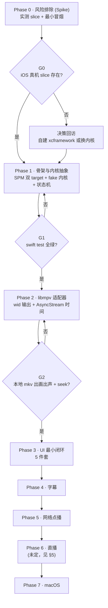

# 自建播放器 · 路线图

> **前置阅读**：[`01-KSPlayer-设计思想与整体评估.md`](01-KSPlayer-设计思想与整体评估.md)（认识）· [`02-自建播放器决策记录.md`](02-自建播放器决策记录.md)（约束）
> **路线图日期**：2026-10-13
> **规模标记**：`S` ≈ 一次专注投入 · `M` ≈ 数轮迭代 · `L` ≈ 需要拆成多张 ticket

---

## 一、总览

**两个"阻塞点"必须先说**：

1. **G0 是硬门**：若 `kingslay/FFmpegKit` 不提供 iOS 真机 slice，`02` 里的整条 iOS 路线要重估。所以 Phase 0 不做任何产品代码。
2. **G1 是纪律门**：Phase 1 结束时必须做到 `PlayerCore` 零 UI 框架 import + 测试全绿。这道门一旦放过，Phase 2 之后的可测性就永久丧失了（KSPlayer 的教训）。

---

## 二、阶段与判定门

| 阶段 | 目标 | 交付物 | 判定门 | 规模 |
| --- | --- | --- | --- | --- |
| **P0 风险排除** | 排掉唯一暗礁 | 一份实测报告 | **G0**：slice 存在？ | S |
| **P1 骨架与抽象** | 立起可测的地基 | 双 target + fake 内核 + 状态机 | **G1**：`swift test` 全绿 + 零 UI import | M |
| **P2 内核接入** | 让真画面出来 | MPVAdapter + wid 输出 + 时间流 | **G2**：本地 mkv 出画出声 + seek | M |
| **P3 UI 最小闭环** | 能用手操作 | SwiftUI 5 件套 | **G3**：模拟器上可点可拖 | M |
| **P4 字幕** | 能看字幕 | 外挂字幕 + 轨道切换 | **G4**：SRT/SRT 编码 + ASS 特效正常 | M |
| **P5 网络点播** | 能看在线 | HLS/mp4 播放 + 缓存 | **G5**：弱网不崩、可切清晰度 | M |
| **P6 直播** | 能看直播 | RTMP/RTSP + 低延迟策略 | **G6（未定）** | L |
| **P7 macOS** | 双平台 | macOS target 复用同一包 | **G7**：同一包在 macOS 编译零改动 | M |

---

## 三、逐阶段拆解

### Phase 0 · 风险排除（Spike，不写产品代码）

**目标**：用最小成本确认 libmpv 路线在 iOS 上成立。

| ticket | 内容 | 规模 |
| --- | --- | --- |
| `P0-T1` | 实测 `kingslay/FFmpegKit` 的产物构成：`libmpv` product 是否存在、是否含 **`ios-arm64`（真机）** slice、`MoltenVK` 是否一并提供。手段：把包拉下来解出 xcframework 结构 + `lipo -info` | S |
| `P0-T2` | 最小冒烟 App（一次性工程，不进主仓）：iOS 模拟器上 `wid` 嵌入 + `vo=gpu-next`/`vulkan`/`moltenvk`，播一个本地 mp4，确认能出画面 | S |
| `P0-T3` | 真机冒烟（依赖 T1 结论）：同一个 App 装到真机，确认 MoltenVK 可用 | S |

**交付物**：`docs/04-libmpv产物实测报告.md`（记录 slice 列表、`lipo` 输出、冒烟截图/日志）。

**判定门 G0**

| 结果 | 后续动作 |
| --- | --- |
| ✅ 有 `ios-arm64` 且冒烟通过 | 直接进 Phase 1 |
| ⚠️ 只有模拟器 slice | 触发**决策回访**：① 自建 FFmpeg/libmpv xcframework；② 只做模拟器（自用降级）；③ 换回 AVPlayer 内核 |
| ❌ libmpv product 不存在 | 触发**决策回访**，回到 `docs/02` 分支 B 重新走一遍 |

**风险**：这是全项目唯一"可能推翻设计"的阶段。所以它必须**第一个做**，且**不写任何要长期留存的代码**。

---

### Phase 1 · 骨架与内核抽象（零 UI 依赖）

**目标**：把 `docs/02` 的工程约束变成物理事实 —— 内核与 UI 编译期隔离。

| ticket | 内容 | 规模 |
| --- | --- | --- |
| `P1-T1` | `Package.swift`：`PlayerCore` / `PlayerUI` 两个 target；`Demo/project.yml` + xcodegen 生成 app 工程（iOS 17 / macOS 14） | S |
| `P1-T2` | `PlayerCore` 定义 `PlayerKernelProtocol`（对应参考实现的 `MediaPlayerProtocol`）+ **注册表**（`kernelTypes` / `firstKernelType` / `secondKernelType`）+ `FakeKernel` 测试替身 | M |
| `P1-T3` | `PlayerState` 状态机（`idle → preparing → readyToPlay → playing → paused → finished`）+ 非法迁移处理 | M |
| `P1-T4` | `PlayerTimeModel` + `AsyncStream` 时间流（**0.2–1 s 粒度**，禁止毫秒级推送） | S |
| `P1-T5` | 纯逻辑单测套件（资源解析 / 状态机迁移 / 时间钳制 / 轨道模型）+ 跑通 mutation testing | M |

**交付物**：可 `swift test` 的骨架包（此时**还没有真实播放能力**）。

**判定门 G1**（三条同时满足）

1. `swift test` 全绿；
2. mutation testing 有通过记录（对应既有纪律）；
3. **`PlayerCore` 内 `grep -r "import SwiftUI\|import UIKit\|import AppKit"` 为空**。

**风险**：最容易犯的错是"先在 Core 里 import UIKit 图省事"。这道门就是防线。

---

### Phase 2 · libmpv 适配器（让真画面出来）

**目标**：把 `wid` 方案接上，走通一条真实链路。

| ticket | 内容 | 规模 |
| --- | --- | --- |
| `P2-T1` | `MPVKernel` 实现 `PlayerKernelProtocol`：`mpv_create` / `mpv_initialize` / 事件循环（`mpv_set_wakeup_callback` + `mpv_wait_event`） | M |
| `P2-T2` | `VideoOutputProtocol` 抽象 + `WindowEmbedOutput`（`wid` 实现，`CAMetalLayer`） | S |
| `P2-T3` | mpv 属性 ↔ 模型映射（`time-pos` / `duration` / `pause` / `paused-for-cache` / `width` / `height` / `track-list`），参照 `vendor/ksplayer/Sources/MPVPlayer/MPVHandle.swift` 的 `observeProperties` 清单 | M |
| `P2-T4` | 播放控制：load / play / pause / seek / stop；`hwdec=videotoolbox` 配置 | M |
| `P2-T5` | 本地 mkv 端到端验证（含多音轨文件） | S |

**交付物**：能播本地 mkv 的内核层 + 对应的 mock 化单测。

**判定门 G2**：iOS 真机（或模拟器，视 G0 结论）上，本地 mkv **出画 + 出声 + 能 seek**。

**风险**：`wid` 嵌入时字幕由 mpv 画在最上层，会与我们自建 UI 打架 —— 这是已知的取舍（见 `docs/02` §4 风险 3），第一期接受。

---

### Phase 3 · UI 最小闭环（5 件套）

**目标**：能用手操作。范围**严格**限定 5 件。

| ticket | 内容 | 规模 |
| --- | --- | --- |
| `P3-T1` | SwiftUI 播放器壳（`UIViewRepresentable` 包 `WindowEmbedOutput` 的 View） | S |
| `P3-T2` | ① 播放/暂停 ② 时间显示 ③ 进度条 + 拖拽 seek | M |
| `P3-T3` | ④ 全屏与旋转 ⑤ 外挂字幕开关（占位，Phase 4 接实） | S |
| `P3-T4` | 本地文件选择（系统 picker / 文件 App 集成） | S |

**明确不做**（推后到 P3.5 之后的独立期次）：倍速、音轨切换、清晰度切换、设置面板、手势调亮度/音量、画中画。

**判定门 G3**：模拟器上能选文件、能播、能拖进度、能全屏。

**参考**：`vendor/ksplayer/Sources/KSPlayerUI/SwiftUI/` 的 `PlayerSlider.swift`、`SeekView.swift`、`VideoControllerView.swift` 布局骨架。**不要参考** `SettingsView.swift`（2147 行）、`IOSVideoPlayerView.swift`（2116 行）。

---

### Phase 4 · 字幕

| ticket | 内容 | 规模 |
| --- | --- | --- |
| `P4-T1` | 外挂字幕加载（SRT / ASS），编码探测（BOM / UTF-8 / GBK 回退） | M |
| `P4-T2` | 内挂字幕轨道枚举与切换（走 mpv `track-list`） | S |
| `P4-T3` | 字幕渲染策略收口：第一期用 mpv 自绘；若需自绘则切 `VideoOutputProtocol` 的 render API 实现 | M |
| `P4-T4` | 字幕解析纯逻辑单测（含 `docs/01` 提到的上游两个无限循环 bug 的回归用例） | M |

**判定门 G4**：SRT 中文不乱码；ASS 特效字幕正常；字幕延迟可调。

---

### Phase 5 · 网络点播

| ticket | 内容 | 规模 |
| --- | --- | --- |
| `P5-T1` | HTTP(S) 点播（mp4 / m3u8）| S |
| `P5-T2` | 缓存参数对齐（`cache-secs` / `cache-pause-wait` / `cache-pause-initial`，参照 `MPVHandle.swift`） | M |
| `P5-T3` | 弱网与缓冲状态呈现（接 `paused-for-cache` → UI 状态） | M |
| `P5-T4` | HTTP header / User-Agent / 请求头注入 | S |

**判定门 G5**：弱网下不崩、有缓冲提示、恢复后自动继续。

---

### Phase 6 · 直播（RTMP / RTSP / 低延迟）— **未定**

> 这一期**没有参考实现可抄** —— KSPlayer 文档只说了"支持 RTMP、RTSP"，没有任何实现细节或策略说明（见 `docs/01` §7.2）。

| ticket | 内容 | 规模 |
| --- | --- | --- |
| `P6-T0` | **先做技术调研**：libmpv 对 RTSP/RTMP 的支持现状、低延迟参数（`cache-secs=0` / `--untimed` / `demuxer-lavf-*`）、追帧策略 | M |
| `P6-T1` | 直播播放基本打通 | M |
| `P6-T2` | 延迟测量与调优（给出可量化的延迟指标） | L |

**进入条件**：Phase 5 的 G5 通过，且 `P6-T0` 调研给出明确结论。**在此之前不排期。**

---

### Phase 7 · macOS

| ticket | 内容 | 规模 |
| --- | --- | --- |
| `P7-T1` | Demo 增加 macOS target（`project.yml` 加 target，包本身零改动） | S |
| `P7-T2` | 平台差异收口（窗口/全屏/键盘快捷键） | M |
| `P7-T3` | 双平台回归 | S |

**判定门 G7**：同一个 SPM 包在 macOS 上**零源码改动**编译通过（若需改动 ⇒ 说明 Phase 1 的隔离没做到位，回补）。

---

## 四、横切事项（贯穿所有阶段）

| 事项 | 做法 | 从哪个阶段开始 |
| --- | --- | --- |
| **CI** | 多 destination `build` + `test`；badge 用**真状态**（不学参考实现的静态假 badge） | P1 |
| **测试纪律** | 纯逻辑走 fake 内核；mutation testing 必须有记录；**没有真文件集成测试不算缺口**，但内核稳定后要补 | P1 |
| **PITFALLS 日志** | 每踩一个坑即落一条（平台生命周期顺序、MoltenVK 兼容性、字幕编码…） | P2 |
| **文档** | 按"图 + 表 + 踩坑记"三段交付（`docs/01` 思想 8） | 全程 |
| **性能基线** | 记录首屏耗时 / 缓冲次数 / 缓冲时长 / 内存峰值 / 功耗；**给出门槛值**，不学参考实现"只讲不做" | P2 |
| **依赖纪律** | `Package.swift` 保持声明式；禁用 `unsafeFlags`；不引入 submodule 装大二进制 | P1 |

---

## 五、未定项与决策回访点

| 项 | 何时必须定 | 依赖 |
| --- | --- | --- |
| iOS 真机 slice 是否存在 | **P0-T1 立刻** | 无（阻塞一切） |
| 自建 xcframework 与否 | G0 未通过时 | P0-T1 |
| 渲染是否从 `wid` 切到 render API | 出现以下任一：MoltenVK 不稳 / 需自绘字幕 / 要做全景 | P2、P4-T3 |
| 第二内核（AVPlayer）是否要加 | 当明确需要 AirPlay / DRM / 原生 PiP / 系统 HDR 时 | 无（扩展点已留） |
| macOS 进入节奏 | G2 通过后评估（是"UI 换壳"还是"双平台并行"） | P2 |
| 直播是否做、做到什么延迟 | P5 完成后 | P6-T0 调研 |
| 项目/仓库最终命名 | 代码落地前 | 当前为 `playerlearning`（学习与评估阶段） |

---

## 六、里程碑：什么叫"成了"

| 里程碑 | 定义 | 对应门 |
| --- | --- | --- |
| **M0 路线成立** | 确认 libmpv 能在 iOS 上跑 | G0 |
| **M1 地基可测** | 有骨架、有 fake 内核、测试全绿、Core 零 UI 依赖 | G1 |
| **M2 能看片** | 本地 mkv 出画出声、能拖进度 | G2 |
| **M3 能顺手用** | 5 件套 UI 完整，日常看本地文件不再需要别的播放器 | G3 + G4 |
| **M4 全能** | 在线点播可用 | G5 |
| **M5 双平台** | macOS 达成，同一包零改动 | G7 |

> **最早"自己愿意用"的时刻是 M3。** 在此之前的所有工作都是为它铺路 —— 这是范围控制的锚点：**任何不推进 M3 的需求都往后排。**

---

## 七、参考实现的对应位置（速查）

想抄哪块，去 `vendor/ksplayer/` 里找：

| 要借鉴的东西 | 路径 |
| --- | --- |
| 协议抽象与注册表的用法 | `.swiftinterface` 中的 `KSOptions.playerTypes` / `firstPlayerType` / `secondPlayerType`（二进制，见 `docs/01` §思想 1） |
| libmpv 接入与选项配置 | `Sources/MPVPlayer/MPVHandle.swift` |
| mpv 属性观测清单 | `MPVHandle.swift` 末尾 `observeProperties` |
| 内核实现的样板 | `Sources/MPVPlayer/KSMPVPlayer.swift` |
| 手势交互 | `Sources/KSPlayerUI/SwiftUI/GestureView.swift` |
| 进度条拖拽细节 | `Sources/KSPlayerUI/SwiftUI/PlayerSlider.swift` |
| seek 预览 | `Sources/KSPlayerUI/View/SeekView.swift` |
| 控制层布局骨架 | `Sources/KSPlayerUI/SwiftUI/VideoControllerView.swift` |
| 架构与并发模型（**先读这份**） | `Documents/KSPlayer原理详解.md` |
| 平台踩坑 | `Documents/AVPlayer踩坑记.md` |
| 测试风格参考 | `Tests/KSPlayerUITests/KSPlayerResourceTest.swift` |

> `vendor/ksplayer/` 的完整说明（来源、版本、许可、剔除内容、不可构建声明）见 [`vendor/ksplayer/NOTICE.md`](../vendor/ksplayer/NOTICE.md)。
