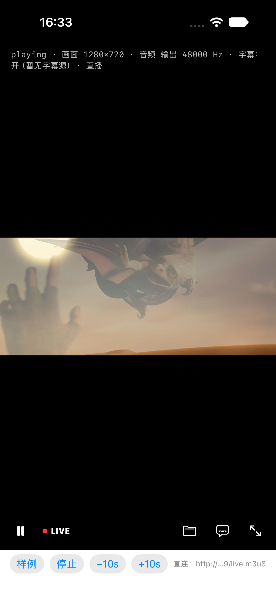
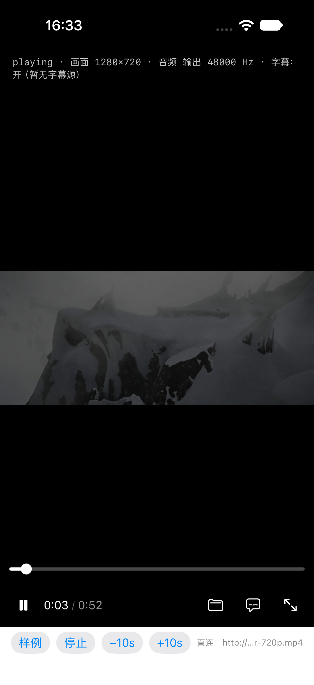

# `P6-T6` 直播的时间轴呈现 —— **进度条消失，换 `LIVE`**

> **起点**：[`docs/19`](19-P6-T5-HLS直播源.md) §4.2（`progress` 实测 0.53–0.96 抖动 ⇒ 百分比在直播下没有意义）
> **当时状态**：属**产品约束**，`docs/03` §五 明确写着"不擅自动"。
> **2026-10-17 董事长拍板**：走「**不显示百分比**」这条，不做"显示落后量"。

---

## 一、结论先说

| # | 结论 |
| - | --- |
| 1 | **进度条整条不画**（不是"画得保守"），时间位换成「🔴 `LIVE`」徽标 —— 红点是这一屏**唯一带颜色**的元素，直播与点播必须一眼分得开 |
| 2 | 判定是**纯逻辑**（`PlayerLiveModel`，`PlayerCore`），不碰 UI ⇒ 能在毫秒级单测里钉住，也不必开模拟器 |
| 3 | 端到端**三条都验了**：RTSP 直播第 **4.4 s** 转 `live=true`；HLS 直播（滚动播放列表，`ffprobe` 给 `duration=N/A`）第 **3.3 s** 转 `live=true`；同一条 mp4 走 HTTP 点播**全程 `live=false`**（0 次误判） |
| 4 | **像素级证据**有截图：直播态下进度条整条消失、时间位是红点 + `LIVE`（§4.2），不是"读代码推断应该会消失" |
| 5 | ⚠️ **顺带更正 `docs/19` 一处错误**：RTSP 直播的 `duration` **不是"未知/0"**，而是"已推流到的位置"（与 HLS 直播同一种语义）。这个错误有代价 —— 见 §二 |

---

## 二、判据是怎么定下来的（**被实测推翻两次**）

这一节比结论值钱：**两版判据都是"看着合理"的，都在真机/模拟器上当场破掉。**

### 第 1 版：`duration` 一涨就算直播 —— 漏判

按 `docs/19` 的字面读法（"RTSP 的 duration 是未知/0，HLS 是滑动窗口末端"），
设计成"增长 > 1 s 且累计 2 次"。

**实测直接打脸**：RTSP 直播的 `duration` **每秒涨约 1 秒**，单次增幅永远小于 1 s 容差：

```
[status]  1.663 state=playing t=0.00/1.07 progress=0.000
[status]  2.669 state=playing t=0.00/2.14 progress=0.000
[status]  5.784 state=playing t=4.46/5.21 progress=0.855
```

⇒ **判据一次都没触发**，日志里从头到尾没有 `live=true`。
根因不在实现，在**我信了"RTSP 恒 0"这句话**（那句已被本次实测更正，见 §四）。

### 第 2 版：`duration` 一涨且 `currentTime > 0` 就算 —— 误判 VOD

改成"未知时长 + 时间已推进"就判直播。**4 条既有测试当场变红**：

```
✘ testFirstTimeEventIsAlwaysPublished … update == PlayerTimeUpdate(currentTime: 0.01, duration: 0)
```

因为 VOD 起播的头 0.01 秒**正是**"duration 还没到、时间已经在走"。
⇒ 这条判据会把**每一个点播**都判成直播。这是比漏判严重得多的一类错。

### 第 3 版（定案）：**累计增长 + 同步推进**

```
live ⇔ duration − baseline.duration ≥ 2.0 s
      且 currentTime − baseline.currentTime ≥ 1.0 s
```

- `baseline` = **第一个非零 duration**（一旦确立不再改）；
- 两个条件**必须同时**满足：只看 duration 会把"VOD 分两次上报（0.5 → 52.2）"判成直播；
- 不看单次增幅 ⇒ 每秒涨 1 秒的 RTSP 也抓得住；看累计 ⇒ VOD 的 0.008 s 修正纹丝不动。

**兜底分支**（`duration` 真为 0 的源）：`currentTime` 在"无时长"状态下推进 ≥ 3 s ⇒ 直播。

| 场景 | 判据 | 实测 |
| --- | --- | --- |
| mp4 点播 | duration 52.21 恒定 | ✅ `live=false` 全程 |
| mp4 微调（52.2 → 52.208） | 累计 0.008 s | ✅ 不触发 |
| VOD 分两次上报（0.5 → 52.2，`currentTime` 不变） | 缺"同步推进" | ✅ 不触发 |
| RTSP 直播 | duration 与 t 同步涨 | ✅ 第 4.4 s 转 `live=true` |

---

## 三、实现

| 位置 | 内容 |
| --- | --- |
| `Sources/PlayerCore/PlayerLiveModel.swift` | 判定器本身（`Sendable` 值类型，无依赖） |
| `Sources/PlayerCore/PlayerTimeUpdate.swift` | 加 `isLive`（默认 `false` ⇒ 既有调用方零改动） |
| `Sources/PlayerCore/PlayerTimeModel.swift` | 每次时间/时长事件后喂一次判定；`publish()` 带上 `isLive`；新增 `resetLiveDetection()` |
| `Sources/PlayerCore/PlayerController.swift` | `load()` 里调 `resetLiveDetection()` —— **换文件必须清**，否则"先播直播再开本地文件"会让 VOD 顶着一个 LIVE |
| `Sources/PlayerUI/PlayerViewModel.swift` | 暴露 `isLive` |
| `Sources/PlayerUI/PlayerControlBar.swift` | `isLive` 为真时**不画 `PlayerSlider`**、时间位换 `liveBadge` |
| `Sources/PlayerUI/PlayerScreenView.swift` | 接线；状态行补「· 直播」（**为了可核对** —— 徽标只能靠看图确认，这一行在日志里读得到） |
| `Demo/Sources/MPVDemoView.swift` | `[status]` 行补 `live=`（端到端取证的唯一入口） |

**为什么判定不放在 UI**：`PlayerUI` 的同一套规则如果写在 `View` 里，就只能靠 UI 自动化证
—— 而 UI 自动化一次几十秒、还只能证"看得见"。放在 `PlayerCore` 后，19 条用例毫秒级跑完，
且**每一条边界都能单独钉住**（VOD 微调、分两次上报、换文件复位）。

---

## 四、证据

### 4.1 端到端（模拟器 iPhone 18 Pro / iOS 27）

**直播**（`mediamtx` + `ffmpeg -c copy -f rtsp` 推一个 720p mp4 循环）：

```bash
xcrun simctl launch --console-pty <UDID> com.playerstack.demo -- \
  -directURL rtsp://127.0.0.1:8554/live
```

```
[status]  3.356 state=playing t=0.00/3.13 progress=0.000  live=false
[status]  4.413 state=playing t=3.42/4.16 progress=0.822  live=true    ← 转 live
[status]  5.425 state=playing t=4.46/5.20 progress=0.857  live=true
…
[status] 13.979 state=playing t=11.96/13.43 progress=0.890 live=true
```

⚠️ 注意 `progress` 那一列：**0.822 → 0.890 一路贴着 1** —— 这正是"百分比没有意义"的现场证据。

**点播**（同一条 mp4，走 `Tools/serve-range.py`）：

```
[status]  1.249 state=playing t=0.50/52.21 progress=0.010 live=false
…
[status] 15.608 state=playing t=15.00/52.21 progress=0.287 live=false
```

`grep -c "live=true"` ⇒ **0**（16 行采样，无一次误判）。

**HLS 直播（第二种形态，补验）**：`ffmpeg -c copy -f hls -hls_time 2 -hls_list_size 5
-hls_flags delete_segments+omit_endlist` 写一个**滚动播放列表**，用
`python3 -m http.server` 提供（`ffprobe` 给出 `duration=N/A` ⇒ 确系直播形态）：

```
[status]  1.216 state=playing t=0.66/2.08   live=false
[status]  3.298 state=playing t=2.71/4.16   live=true    ← 第 3.3 秒转
[status]  9.401 state=playing t=8.83/10.25  live=true
```

⇒ **两种直播形态共用一条判据**：RTSP（`duration` 随推流涨）与 HLS（`duration` = 已加载末端）
都表现为"分母跟着分子涨"，累计增长 ≥ 2 s 这条路对两者都成立。

> ⚠️ **环境坑（写给下一个要复现的人）**：`mediamtx` 的 HLS 输出不是裸 HTTP ——
> `index.m3u8` 会 302 到 `?cookieCheck=1`，随后变体清单里的 `?session=` 要靠
> `hlsSession` **cookie** 才放行，否则段请求 401。用 `curl` 取一次 cookie 再注入 `-headers`
> 能跑通（本轮先按这条路验过一次），但**会话在实际请求间会漂移**，脚本里很容易取到空值
> （`[direct] headers=Cookie: …hlsSession=` 后面直接是空 ⇒ `state=failed`）。
> 要稳定复现，用上面的「ffmpeg 写目录 + 静态服务」：**没有鉴权、没有 cookie、没有会话**。

### 4.2 `LIVE` 徽标的像素级确认

同一个 HLS 直播源，抓控制条自动隐藏前的那一帧：



- 进度条**整条消失**（`if !isLive` 分支），时间位变成 **红点 + `LIVE`**
- 同一屏的顶部状态行给的是 `playing · 画面 1280×720 … · 直播`（`PlayerScreenView` 第 187 行的诊断串）
  ⇒ **状态与像素两种证据互相印证**，不是"看代码推断应该会消失"

点播对照（同一台机器、同一个播放器、同一条 mp4 走 `serve-range.py`）：



⇒ 直播与点播的差别**一眼可见**，且点播那条路径一行未改。

### 4.3 测试

| 包 | 结果 |
| --- | --- |
| `PlayerCoreTests` | **252 tests / 23 suites** 全绿（含新增 `PlayerLiveModelTests`） |
| `PlayerUITests` | **98 tests / 13 suites** 全绿（含新增 `PlayerViewModelLiveTests`） |
| Demo · iOS 模拟器 | `BUILD SUCCEEDED` |

> 两个目标各有一行汇总 —— **要报就两份都给**（`P-065`）。

---

## 五、仍未覆盖 / 边界

| 项 | 说明 |
| --- | --- |
| ~~**HLS 直播**~~ | ✅ 已补验（§4.1 末）：`ffmpeg` 写滚动播放列表 + 静态服务，第 3.3 秒转 `live=true`。**两种直播形态共用一条判据** |
| ~~**`LIVE` 徽标的像素级确认**~~ | ✅ 已补（§4.2）：截图里进度条整条消失、时间位是红点 + `LIVE`，同屏状态行给 `· 直播` |
| ~~**真机 UI 自动化**~~ | ✅ 2026-10-17 16:40 跑通 4 / 4（`docs/03` Phase 7 的 📌 补记）。这是**界面用例**，不是**播放端到端** |
| **真机上的直播端到端** | ⬜ 端到端两条（RTSP / HLS）都只在模拟器。真机受网络与解码器差异影响，**未跑** |
| 显示「落后量」 | **明确不做**（董事长选定"不显示百分比"）。要做的话得把 `P6-T2` 的延迟口径接进 UI，属另一票 |
| 低延迟流（`cache-secs=1`）下的判定时延 | 判定窗口约 3–4 s；网络抖动时 `duration` 的采样会稀疏，**未量化**对判定时延的影响 |
| HLS 切片粒度的影响 | 本轮 HLS 的分片被关键帧拉到 4–9 s（`-hls_time 2` 但切在关键帧上）⇒ **没验**"2 s 分片、频繁重载"下的判定时延 |

---

## 六、一句话

**判据不是想出来的，是被实测打回来两次才收敛的：第一版漏判（信了"RTSP 恒 0"）、
第二版误判所有点播（把"时长未到"当成直播）、第三版用"累计增长 + 同步推进"同时避开两者；
落地是纯逻辑判定器 + 一条 `if !isLive` 的视图分支，直播第 4.4 秒转 `LIVE`、点播 16 次采样零误判。**
