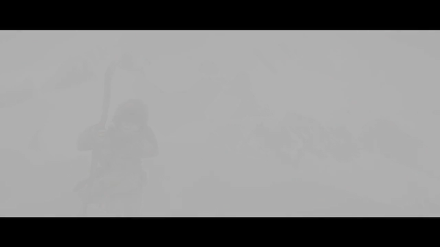

# render API 取帧 —— **把像素拿到手上**（`P4-T3` 触发条件的第一步）

> **为什么做这件事**：`wid` 嵌入那条路上，帧**只存在于播放器内部**（被直接画到我们的图层）。
> 于是"自绘字幕 / 滤镜 / 逐帧截图 / 全景 / 3D"全都做不了 —— 这不是性能问题，是**结构上拿不到**。
> `P4-T3` 当时把"切 render API"记成**条件触发**，触发条件之一是「需自绘字幕」。
>
> **本篇范围**：只回答一个问题 —— **在 iOS 上，我们到底能不能把帧取到手上？**
> 不换 UI、不动现有的 `wid` 那条路，先把"帧的出口"打通并留下证据。
>
> **日期**：2026-10-17 · **结论**：✅ **能**（软件后端，已在模拟器实测取到真实画面）

---

## 一、结论先说

| # | 结论 |
| - | --- |
| 1 | **能**：`MPV_RENDER_API_TYPE_SW` 在本项目自建的 libmpv 产物上**可用**，iOS 模拟器实测取到 640×360 RGBA 帧 |
| 2 | 判据不是"没报错"：**非黑占比 0.761**、落盘 PNG 里是真实画面（雾中人物 + 上下黑边，符合 2.39:1 素材） |
| 3 | **代价必须写在明处**：软件后端是 **CPU 拷贝** —— 1080p 每帧 ≈ 8 MB、4K ≈ 33 MB。够验证与低频取帧，**不适合当高帧率渲染管线** |
| 4 | **GPU 那条仍未实测**（GLES / Vulkan→MoltenVK）：它要先有可用的 GL 上下文与 FBO，而 iOS 上 GL 已废弃、GLES 纹理→Metal 又是一层桥。本轮**没有**碰它，`knowledge/K6` §3.2 的存疑项**依然存疑** |
| 5 | 实现是**产品代码**（`MPV/Sources/PlayerMPV/MPVRenderProbe.swift`），不是测试脚本 —— 它是"帧出口"的第一版，下一步会被 `VideoOutputProtocol` 的 render 实现接走 |

---

## 二、证据

### 2.1 取到的帧



日志（模拟器 · iPhone 18 Pro · iOS 27）：

```
[render] api=sw 640x360 第 54 次渲染命中 非黑占比=0.761
         png=…/Documents/render-probe.png
```

- `api=sw` 不是从字符串里猜的：`mpv_render_context_create` 接受的就是
  `MPV_RENDER_API_TYPE_SW`，被接受（返回 0）才算数
- 第 1 版"第一帧非黑就返回"拿到的是**片头淡入的近黑帧**（非黑 0.316）——
  拿它当证据等于自己降标准，所以改成"6 秒窗口内**取最亮的那一帧**"

### 2.2 怎么跑出来的（可复现）

```bash
# 1) 本地 HTTP 源（**必须放后台任务里跑**，见 §三 坑 2）
python3 Tools/serve-range.py --port 8768 --root /tmp/vidprobe2

# 2) 起 App，走 probe 分支
xcrun simctl launch --console-pty <模拟器 UDID> com.playerstack.app -- \
  -renderProbe http://127.0.0.1:8768/sintel_trailer-720p.mp4

# 3) 取帧产物（沙盒 Documents 里）
xcrun simctl get_app_container <UDID> com.playerstack.app data
```

### 2.3 失败时的第一现场（诊断串）

取不到帧时不要猜，`MPVRenderProbe.diagnostics()` 直接问 mpv：

```
[render] 失败：等了 8 秒没有取到非黑帧 · vo-configured=no video-format=nil
         width=nil height=nil duration=nil core-idle=yes pause=no path=nil
```

`path=nil` 是**关键那一项**：它说明文件根本没被打开 —— 问题在 `loadfile`，
不在渲染、不在解码、也不在 render API。**这一个属性省掉了三层假设。**

---

## 三、两个真踩到的坑

### 坑 1（代码级）：`withCString` 的指针不能带出作用域

```swift
// ❌ 错：指针在闭包返回时就失效了
var args: [UnsafePointer<CChar>?] = ["loadfile".withCString { $0 }, path, nil]

// ✅ 对：嵌套
"loadfile".withCString { command in
    url.absoluteString.withCString { path in
        var args: [UnsafePointer<CChar>?] = [command, path, nil]
        _ = mpv_command(handle, &args)
    }
}
```

**它为什么危险**：悬空指针**不保证崩**。这次的表现是 `loadfile` 静默失败、
`path` 属性恒为 nil —— 看起来像"render API 不支持"或"网络不通"，
而真相是一个 C 字符串的生命周期。已立 `P-089`。

### 坑 2（环境级）：`(cmd &)` 起的本地服务会被会话回收

用 `(python3 Tools/serve-range.py … &)` 起源，**下一条命令还在跑**，
但**下一次工具调用时它已经没了** ⇒ 播放器报
`tcp: Connection to tcp://127.0.0.1:8768 failed: Connection refused`。

这次是它第二次咬人（第一次是把 `mediamtx` 吃掉，害我以为 HLS 鉴权有问题）。
**规矩**：长时间服务一律用后台任务方式起，不要用 `( & )` 塞给会话。已立 `P-090`。

---

## 四、下一步（要接着做的事，按顺序）

| # | 事 | 为什么必须在前一步之后 |
| - | --- | --- |
| 1 | 把 `MPVRenderProbe` 收敛成 `VideoOutputProtocol` 的 **render 实现**：帧 → `CVPixelBuffer` → Metal 纹理 → 由我们的图层显示 | 现在只有"取帧"，没有"显示"；`wid` 那条路还在用，两条路要能**并存切换** |
| 2 | 用 `CVPixelBuffer` 的 `kCVPixelBufferMetalCompatibilityKey` 建纹理 | 产物里已有这个符号（`knowledge/K4` §4），但**没在运行时验证过** |
| 3 | 测**吞吐**：1080p / 4K 下 SW 后端每帧耗时 | 决定"软件后端能撑到什么分辨率/帧率"，也就是要不要上 GPU 桥 |
| 4 | 再决定 GPU 那条要不要做 | 只有 3 的结果说"不够用"时，才值得为它引入 GLES/FBO 一堆复杂度 |
| 5 | 有了帧之后，才谈得上自绘字幕 / 滤镜 / 全景 / 3D | 这些是**帧的下游**，现在谈是空谈 |

> ⚠️ **不要**在这条线上顺手改 `wid` 路径：它现在是**唯一能真出画面**的路
> （端到端、真机、直播全在它上面验过）。render API 那条要**并存**接入，验证到位再切。

---

## 五、一句话

**"能不能拿到帧"这件事，以前是"文档说能、代码里没做过"；
现在它是 `api=sw` 那一行日志 + 一张能看出内容的 PNG —— 软件后端成立，
代价是 CPU 拷贝，而 GPU 那条依然未实测。**
