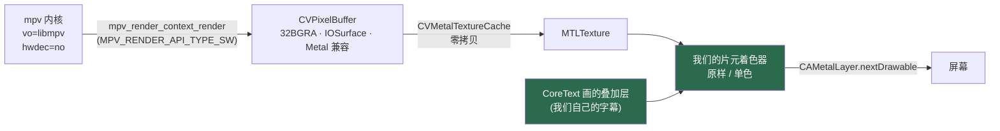
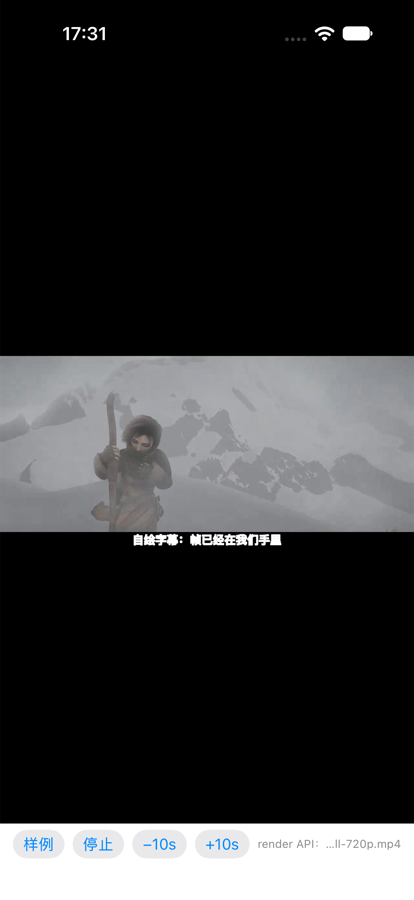
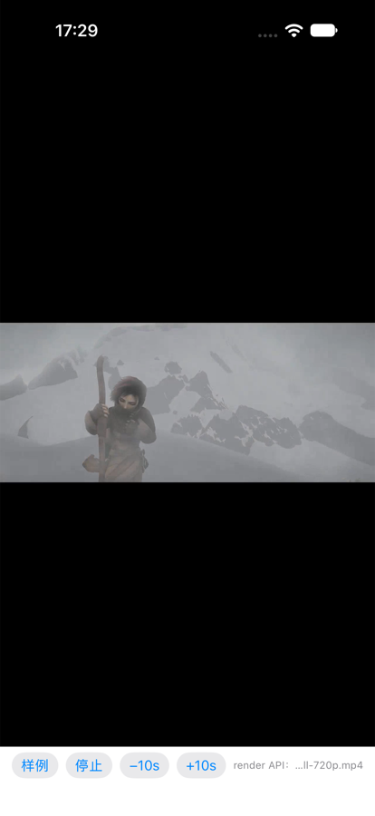

# render API 上屏 · 帧下游开闸（`P7-T3`）

> **上一篇**：[`24-RenderAPI取帧.md`](24-RenderAPI取帧.md) 回答的是"**能不能**把帧取到手上" —— 答案是能（软件后端，非黑占比 0.761，落盘 PNG 有真实画面）。
>
> **本篇回答三件事**（也就是 `docs/24` §四 的前三步）：
> ① 帧能不能**上屏**（不是落一张 PNG，而是当播放器用）；
> ② 软件后端**撑得住多少**（1080p / 4K 每帧多久，要不要上 GPU 桥）；
> ③ 有了帧之后，"**我们改像素**"这件事到底能不能落地（效果 + 自绘叠加层）。
>
> **日期**：2026-10-17 · **结论**：✅ 三件都成立，且**不需要 GPU 桥**（理由在 §三）

---

## 一、结论先说

| # | 结论 | 判据（可复核） |
| - | --- | --- |
| 1 | **帧能上屏，能当播放器用** | 1280×720 源连播 12 s，`frames=290`（≈24 fps × 12 s），截图见 §四 图 1；状态行 `finished · 画面 1280×720`，进度条走满到 0:12 |
| 2 | **两种视频输出并存**，默认仍是 `wid` | 只有给 `-renderDisplay` / `-renderBench` 才切 render 那条；不给我改的是默认路径 —— 它现在是唯一端到端（含真机、直播）验过的路 |
| 3 | **软件后端够用，不需要 GPU 桥** | 4K 源的**按上屏尺寸**渲染 p50 **17.9 ms**（p95 折算 **49.8 fps**），30 fps 播放有 1.6× 余量。按源码尺寸渲染才是 60.8 ms —— 而那**不是**必要的做法（§三） |
| 4 | **成本 ∝ 目标像素数，不 ∝ 源分辨率** | 1080p 与 720p 在同一块 1206×678 图层上分别是 9.47 / 8.11 ms；4K 同尺寸 17.91 ms 的差额是**软解 4K** 的代价，不是缩放的代价 |
| 5 | **帧下游真的开闸了**：片元效果 + 自绘叠加层都能改画面 | 单色效果把画面平均饱和度从 **0.6986 打到 0.0000**（饱和像素占比 70.3% → 0%）；自绘字幕截图见 §四 图 2 |

---

## 二、结构：谁在画



**绿色那两块是 `wid` 那条路上根本不存在的位置。** 那条路上帧直接进了播放器自己的图层，
我们能改的只有"要不要显示"，改不了"显示成什么样"。

### 代码落点（都在产品包里，不是测试脚本）

| 文件 | 职责 |
| --- | --- |
| `MPV/Sources/PlayerMPV/MPVSWSession.swift` | 渲染上下文：建 / 问尺寸 / 渲进一块内存。**取帧与上屏共用这一份** |
| `MPV/Sources/PlayerMPV/MPVRenderOutput.swift` | `CAMetalLayer`：CVPixelBuffer → 纹理 → 着色器 → 上屏；`CADisplayLink` 驱动 |
| `MPV/Sources/PlayerMPV/MPVRenderBridge.swift` | 内核 ↔ 显示端之间**只传一个句柄**的交接点（为什么要它见 §三 坑 3） |
| `Sources/PlayerCore/VideoFitRect.swift` | 摆放几何 + **按目标尺寸缩放**（纯函数，已单测） |
| `Sources/PlayerCore/FrameTimingStats.swift` | 逐帧耗时分布（p50/p95/max + p95 折算帧率） |
| `Sources/PlayerCore/VideoEffect.swift` | 片元分支号（`none=0` / `mono=1`），与 MSL 里的常量由测试钉住 |
| `Sources/PlayerUI/VideoSurface.swift` | "能挂上视图、知道自己该占哪一块"的图层契约（两种输出都实现它） |

---

## 三、吞吐：要不要上 GPU（**数据先说话**）

### 3.1 方法（以及两个必须写明的选择）

- **环境**：iPhone 18 Pro 模拟器 · iOS 27 · Debug 构建 · 120 帧强制压帧（`-renderBench`）
- **必须先暂停**：`mpv_render_context_render` 在播着的时候会**阻塞到该显示的时刻**
  （`render.h` 的注释自己写着："lets this function block until the supposed display time"）。
  那是**等**不是**算** —— 把它算进耗时，量出来的只是帧率上限，与后端快慢无关。
  ⇒ 压帧前先 `pause()`，再连压 120 帧。**实测证据**：同一段 720p 源码、同一台模拟器、同一个 `native` 策略，
  播着时整帧 p50 = **33.8 ms**，暂停后 **7.2 ms** —— 差 **4.7 倍**，差的就是那段等待。
- **用 p95 而不是平均值**：平均 11 ms 但每 20 帧有一个 40 ms 尖刺的后端，
  平均看是"89 fps 够用"，实际每 20 帧掉一次（`FrameTimingStats` 的注释与 `FrameTimingStatsTests` 钉住这件事）。

### 3.2 数据（同一构建、同一素材尺幅、暂停压帧 120 帧）

| 源 | 目标策略 | 实际目标尺寸 | 整帧 p50 | p95 | max | 仅 mpv 软件渲染 p50 | p95 折算帧率 |
| --- | --- | --- | --- | --- | --- | --- | --- |
| 1280×720 | `drawable` | 1206×678 | **8.11 ms** | 8.81 | 20.05 | 7.83 | 113.5 fps |
| 1920×1080 | `drawable` | 1206×678 | **9.47 ms** | 9.66 | 10.23 | 9.14 | 103.5 fps |
| 3840×2160 | `drawable` | 1205×678 | **17.91 ms** | 20.08 | 29.47 | 17.49 | 49.8 fps |
| 3840×2160 | `native` | 3840×2160 | **60.78 ms** | 65.97 | 79.53 | 60.45 | 15.2 fps |

另一次（第一批，`native` 策略，作对照）：720p **7.24 ms** · 1080p **16.10 ms** · 4K **62.57 ms**。

### 3.3 怎么读这张表

1. **同一块目标尺寸下，源分辨率几乎不影响渲染**：720p 与 1080p 都是画 1206×678 个像素
   （8.11 vs 9.47 ms，差的是"缩放"这一步：720p 源要缩一点点，1080p 缩得多一点）。
2. **4K 的 17.9 ms 里，大头不是渲染而是软解**：目标尺寸与 1080p 完全相同，却贵了 8.4 ms ——
   `hwdec=no` 下 4K H.264 是纯 CPU 解码。
3. **结论：不需要 GPU 桥**。
   - 4K 源按上屏尺寸渲染，p95 折算 ≈ **50 fps**，30 fps 播放有 1.6× 余量；
   - 只有"**必须按源码分辨率逐像素处理**"的场景才会掉到 15 fps —— 而目前没有这样的场景。
4. **什么时候才该谈 GPU 桥**：当"渲染尺寸"本身必须很大时 —— 全景（等距柱状投影要按
   双眼视口重采样）、3D（每眼各一张）、以及"逐像素取帧做 CV"。那是**新的一类需求**，
   不是"把现在的播放器做得更流畅"。

> ⚠️ **这些数字的上限在哪**：模拟器跑的是 Mac 的 CPU，真机（A 系列）单核更弱、但能效核更多。
> 所以这组数字**不能当作真机性能**，只能当作"量级判断"。而"要不要上 GPU"这个判断对
> **倍数级**敏感（17.9 ms vs 60.8 ms 是 3.4×），不受"真机慢 30%"影响。

---

## 四、帧下游：把"能改像素"变成证据

### 4.1 片元效果（判据是数字，不是"看着不一样"）

`-renderEffect mono` 走同一个着色器的不同分支：`effect == 1u` 时按 BT.709 亮度取单色。

| 输入 | 效果 | 画面平均饱和度 | 饱和像素占比（>0.15） |
| --- | --- | --- | --- |
| SMPTE 彩条 | `none` | **0.6986** | 70.31% |
| SMPTE 彩条 | `mono` | **0.0000** | 0.00% |

量的是**上屏后的截图**（`simctl io screenshot`），不是内部缓冲 —— 所以它同时证明了
"着色器真的在帧和屏幕之间"。量法：`ffmpeg -vf crop=… -f rawvideo -pix_fmt rgb24` 后逐像素算
`(max−min)/max`。

### 4.2 自绘叠加层（**这就是"自己画字幕"的位置**）



由 CoreText 画好一张与视频同尺寸的透明位图 → 纹理 → 第二个 quad 用预乘 alpha 混合上去。
**它与 mpv 一点关系都没有** —— 帧在 Metal 纹理里，我们想往上叠什么就叠什么。

> 字幕的三个可用性细节都在这一版里：**白色 + 黑色描边**（不描边时白字压在亮画面上会消失）、
> **按视频高度取字号比例**（写死像素值时 720p 合适、4K 细如发丝）、**底部居中**。

### 4.3 图 1：真实素材上屏（1280×720，`wid` 之外的另一条路）



---

## 五、这一路上真踩到的三个坑

### 坑 1（时序）：**渲染上下文必须早于 `loadfile`**

第一版是"显示端在自己的下一拍里取句柄再建上下文"。结果 mpv 直接报：

```
[mpv/vo/libmpv] No render context set.
[mpv/cplayer] Error opening/initializing the selected video_out (--vo) device.
[mpv/cplayer] finished playback, no audio or video data played (reason 4)
```

⇒ `state=failed`、**一帧都没有**。原因是 mpv 在**打开 `vo=libmpv` 的那一刻**就要求上下文已经在。

**处置**：句柄交接之后，由内核 `await` 显示端**在 `loadfile` 之前**把上下文建起来
（`MPVRenderBridge.attachDisplay()`）。顺序变成：
`mpv_initialize` → 建渲染上下文 → `loadfile`。

**教训**：`docs/24` 只验证了"先建上下文、再 load"这条顺序能出帧，**没验证反过来会怎样**。
换一条路复用时，"顺序"本身就是需要重新取证的东西（`P-083` 同族：别把"我们这么写"当成"它要求这么写"）。

### 坑 2（CoreText）：`CTLineDraw` 会**推进** `textPosition`

字幕被并排画了两遍（描边一遍、填充一遍），看起来像"字幕重复了一次"。

`CTLineDraw` 画完会把上下文的 `textPosition` 推到行末，第二遍就从行末开始画。
**处置**：两遍之间重设 `textPosition`。已立 `P-091`。

### 坑 3（Swift 6）：主线程隔离的对象**不能塞进 actor**

最直觉的写法是 `MPVKernel(renderOutput: output)`（内核握着显示端）。Swift 6 直接拒绝：

```
sending main actor-isolated 'output' to actor-isolated initializer 'init(renderOutput:)'
risks causing data races between actor-isolated and main actor-isolated uses
```

这句话是对的：那个图层之后会同时被主线程（画）和 actor（读状态）使用。

**处置**：改成只交接**一个句柄**（`MPVRenderBridge`，`Sendable` 的小盒子） ——
内核不认识图层、图层也不认识内核，方向仍然是单向的。已立 `P-092`。

---

## 六、边界（这一版**没有**做什么）

| 没做 | 为什么 | 前置条件 |
| --- | --- | --- |
| 字幕还没接 `SubtitleTimeline` | `overlayText` 现在是启动参数给的一串文字 —— **机制通了，数据源还没接** | 把 `PlayerViewModel` 当前的 `SubtitleTimeline.text(at:)` 每帧喂给叠加层（纯装配，逻辑已有且已测） |
| 全景（等距柱状） | 需要按**双眼视口**重采样，渲染尺寸要 ≥ 每眼分辨率 | 与 §三 的结论相反：**那才是真正需要 GPU 的地方** |
| 3D（左右/上下 → 每眼） | 同上，而且没有眼镜端设备可验 | 同上 |
| 真机复验 | 本轮全部证据来自模拟器 | 真机跑一次 `-renderDisplay`（本文没做，别当成已验） |
| 硬件解码 | SW 后端要 CPU 帧；硬解帧回 CPU 走 `MPV_RENDER_PARAM_HW_FRAMES` 是另一条路，**未验证** | 4K 软解那 8.4 ms 就是它的代价（§3.3） |

---

## 七、下一步（按依赖顺序）

| # | 事 | 依赖 |
| - | --- | --- |
| 1 | 把 `SubtitleTimeline.text(at:)` 接到 `overlayText` —— **自绘字幕真正可用** | 本篇 §4.2 的机制 |
| 2 | 真机跑一次 `-renderDisplay` + `-renderBench`，把 §三 的表补上真机一列 | 无 |
| 3 | 逐帧截图（`-renderProbe` 已有）与"自绘字幕"共用同一条纹理路径，收成一处 | 1 |
| 4 | 全景 / 3D 各自立票，**先定"渲染尺寸要多大"**，再决定 GPU 桥 | §三 的结论 |

> ⚠️ **不要**把默认路径改成 render API。它现在缺一样东西：**真机端到端**没验过。
> 在补齐之前，`wid` 是唯一"直播 / 网络点播 / 真机"全验过的路（`docs/12` / `docs/16` / `docs/19`）。
