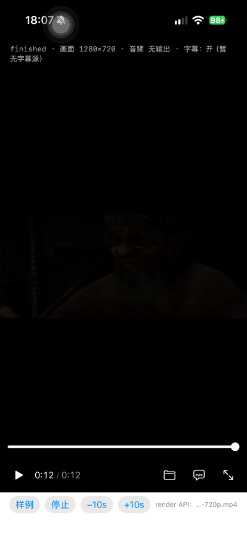

# 26 · 真机复验：render API 上屏（iPhone 16 Pro）

> **日期**：2026-10-17 · **设备**：iPhone 16 Pro（iPhone17,1）· iOS 27
> **结论**：✅ **真机上可用**。`docs/25` §七 里那句"不要把默认路径改成 render API ——
> 它缺真机端到端"的**技术理由已经消掉**（还剩一类场景没验，见 §五）。
>
> 附带交付：`MPVRenderOutput.verifiesOnScreen` —— 一套**三层读数**的上屏取证能力，
> 用来在"屏幕是黑的"时分清是哪一段断的。它在这一轮里先骗了我六轮（§四）。

---

## 一、结论先说

| 问题 | 答案 | 判据（不是"看着像"） |
| --- | --- | --- |
| 渲染上下文能在真机上建起来吗 | ✅ | `[render] attach 完成 · 后端=sw · 驱动=CADisplayLink` |
| mpv 的软件后端在真机上出得了真实画面吗 | ✅ | `-renderProbe` 落盘 PNG：**非黑占比 0.761**（640×360），与模拟器同值 |
| 帧能画到屏幕上吗 | ✅ | 三层读数 **cpu 0.673 / source 0.673 / drawable 0.674**（与模拟器逐位一致）+ 截图有画面 |
| 软件后端的吞吐够不够 | ✅ **比模拟器还快** | 4K 按上屏尺寸 **p50 11.51 ms（86 fps）** |



> 图：iPhone 16 Pro 实拍截图。状态行 `finished · 画面 1280×720`、进度 `0:12 / 0:12`、
> 底部是 render 那条路的入口标记。画面暗是素材本身（片尾暗场），不是渲染问题 ——
> 这正是 §四 那个坑的起因。

---

## 二、三层读数：把"屏幕是黑的"拆成三段

`presentedFrames` 只证明"`present` 被调用过"，**不证明屏幕上真有画面**。
截图能当证据，但它只回答"最终屏幕上是什么" —— 一旦是黑的，你分不清是哪一段断的。
所以 `-renderVerify` 打开后，每 30 帧读回三层：

| 层 | 读什么 | 读到黑说明什么 |
| --- | --- | --- |
| `cpu` | `CVPixelBuffer` 的 base 指针，**在 `unlock` 之前**直接数 | mpv 压根没写进这块内存（或写到了别处） |
| `source` | `CVMetalTextureCache` 从同一块 buffer 取出的 Metal 纹理 | IOSurface → 纹理这一步断了 |
| `drawable` | 着色器画完之后、**`present` 之前**的 drawable | 着色器/几何没画上去 |

实现要点（都在 `MPVRenderOutput` 里）：

- **`framebufferOnly` 必须先关**：CAMetalLayer 的 drawable 纹理在 `framebufferOnly = true`
  时**不允许被读**，blit 拿不到内容。`verifiesOnScreen` 的 `didSet` 会把它设成 `false`。
- **读回用 blit 到 `.shared` 纹理再 `getBytes`**：真机上 `.shared` 是唯一能直接 `getBytes`
  的存储模式（`.managed` 只有 macOS 有）。
- **读回塞进同一个 command buffer、`present` 之前**：`present` 一调，drawable 就交还给系统了。
  ⚠️ 但要说清楚：**本机没有测到"present 之后读就一定黑"**。实际是两种时机都读到 0.000，
  真因是 §四。把顺序写成"这是必须的"就是假归因（`P-083`）—— 保留它是因为它语义上安全。

---

## 三、真机吞吐（补上 `docs/25` §三那张表的真机一列）

同一构建、同一素材尺幅、**暂停后压帧 120 帧**、同一采样口径（p50/p95 用最近秩法）。

| 源 | 目标策略 | 目标尺寸 | 模拟器 p50 | **真机 p50** | **真机 p95** | 真机 p95 折算 |
| --- | --- | --- | --- | --- | --- | --- |
| 1280×720 | 按上屏 | 1206×678 | 8.11 ms | **6.55 ms** | 8.55 ms | **117.0 fps** |
| 1920×1080 | 按上屏 | 1206×678 | 9.47 ms | **6.83 ms** | 8.48 ms | **118.0 fps** |
| 3840×2160 | 按上屏 | 1205×678 | 17.91 ms | **11.51 ms** | 11.61 ms | **86.1 fps** |
| 3840×2160 | 按源码 | 3840×2160 | 60.78 ms | **44.34 ms** | 45.84 ms | 21.8 fps |

**怎么读**：

1. **真机比模拟器快 1.2–1.6 倍**，且 4K 那一档的差距最大（17.91 → 11.51）。
   模拟器不是"慢的机器"，它是**另一条软件路径**；拿它的数字当上界是保守的，可以，但不能当结论。
2. **1080p 与 720p 几乎同价（6.83 vs 6.55）** —— 再次印证 `docs/25` §3.3 的结论：
   成本 ∝ **目标像素数**，不 ∝ 源分辨率。两条都是 1206×678。
3. **"仅 mpv 软件渲染"与"整帧"差 0.01–0.02 ms**：Metal 那一段（纹理 → 着色器 → present）
   在真机上**几乎免费**，GPU 吃掉了。瓶颈始终在 mpv 的 CPU 拷贝。
4. **4K 按源码尺寸 44 ms（21.8 fps）** —— 这就是"按上屏尺寸渲染"这条策略值钱的地方：
   同一个 4K 源，改一个策略从 21.8 fps 变 86 fps。用户看不到的像素不该让 CPU 去画。

⇒ **`docs/25` 的"不上 GPU 桥"结论在真机上更成立**。GPU 桥只留给全景 / 3D ——
那两件事的渲染尺寸本身就大，不是"多拷一次"的问题。

---

## 四、这一轮踩的坑：判据落进了素材的黑边里（`P-094`）

**现象**：真机第一次复验，`frames` 稳定增长、`status=0`、`drawable=1206×678` 正常，
但三层读数**全是 0.000**，屏幕截图全黑。看起来就是"真机渲染不出来"。

**追查过程（六轮，每轮都改了错的假设）**：

| 轮次 | 假设 | 怎么被否掉 |
| --- | --- | --- |
| 1 | 真机截图抓不到 CAMetalLayer | 加读回取证，读数也是 0 —— 但**那时读数本身还不可信** |
| 2 | `makeTexture` 在 `unlock` 之前，GPU 读到未刷新内容 | 调换顺序，仍 0.000 |
| 3 | `framebufferOnly = true` 让 blit 静默失败 | 关掉，仍 0.000（但这条本身是**真问题**，只是不是这次的） |
| 4 | 渲染尺寸 1205×678 是奇数、缩放有问题 | 强制 640×360（probe 成功过的尺寸）⇒ **c 层变成 0.185**，其余照旧 |
| 5 | mpv 没写进 CVPixelBuffer | 往采样框写 0x80 再读 ⇒ **回读 1.000**，说明 CPU 读写自洽、mpv 确实在写 |
| 6 | **采样框位置错了** | 在模拟器上跑同一套读数：**也是 0.000**，而模拟器截图明明有画面 ⇒ **判据坏了，不是渲染坏了** |

**根因**：采样框取的是**左上角 96×54**。本机素材（Sintel 预告片）是 2.39:1，
在 16:9 里上下自带黑边，左上角正好落在黑条内。**画面正常，读数恒为 0。**

**处置**：采样框挪到**画面中心**。改完：

```
模拟器: [render] 上屏取证 cpu非黑=0.673 source非黑=0.673 drawable非黑=0.674
真机:   [render] 上屏取证 cpu非黑=0.673 source非黑=0.673 drawable非黑=0.674
```

**逐位一致** —— 真机一直是好的。

**防再犯**：见 `P-094`。核心一条：**当一个判据说"什么都没发生"、而直觉说"应该在发生"时，
先用同一判据去测一个**已知正常**的样本。** 判据在正常样本上给 0，
那被测对象是不是 0 就毫无意义 —— 这一步花十秒，省掉六轮。

---

## 五、边界（这一轮**没有**证明的）

| 没做 | 为什么重要 |
| --- | --- |
| 只在 **iPhone 16 Pro（A18 Pro）** 上测 | 老机型（A12/A13）的 CPU 拷贝慢一档，4K 按上屏尺寸可能掉到 30 fps 附近。**没测就是没测** |
| 只测了**局域网 mp4** | `wid` 那条验过直播 / HLS / 弱网（`docs/12` / `docs/16` / `docs/19`）；render 这条**一个都没验** |
| 没有**长时间**跑 | bench 是暂停压 120 帧；连续播放 30 分钟的热降频 / 内存增长未测 |
| `HW_FRAMES`（硬解帧回 CPU）未试 | 4K 软解那 44 ms 就是它的代价；这条路能不能砍掉，没验 |

**所以默认路径仍然是 `wid`**，理由从"真机没验"换成了"**只验了局域网 mp4，直播与网络异常路径没验**"。
要切默认，先把 §五 第 2 条补齐。

---

## 六、这一轮新增的开关（都在 Demo，产品代码零影响）

| 开关 | 用途 |
| --- | --- |
| `-renderVerify` | 打开三层读数（每 30 帧一次），日志形如 `上屏取证 cpu非黑=… source非黑=… drawable非黑=…` |
| `-renderTarget native\|drawable` | 按源码尺寸 / 按上屏尺寸渲染（`docs/25` §三 的策略对照） |
| `-renderSize 640x360` | **强制**渲染尺寸。用来把"尺寸的锅"与"内存的锅"分开 —— 这一轮就是靠它把范围缩到 640×360 的 |

`verifiesOnScreen` 默认关：读回要 `waitUntilCompleted`，是**同步等 GPU**，不该出现在播放路径上。

---

## 七、下一步

| # | 事 | 依赖 |
| - | --- | --- |
| 1 | 把 `SubtitleTimeline` 接到 `overlayText` | 无（纯装配，逻辑已测） |
| 2 | render 那条补**直播 / HLS** 端到端 | 无（`wid` 的用例可直接复用） |
| 3 | 老机型（A12/A13）复测 4K 按上屏尺寸 | 需要设备 |
| 4 | 全景 / 3D 各自立票，**先定"渲染尺寸要多大"**，再决定 GPU 桥 | `docs/25` §三 |
