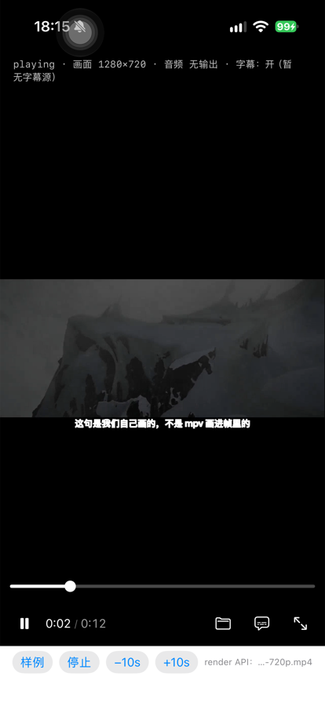
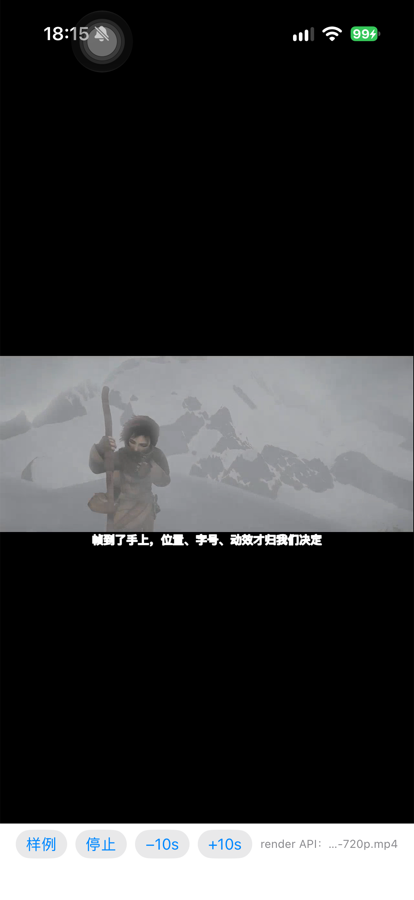
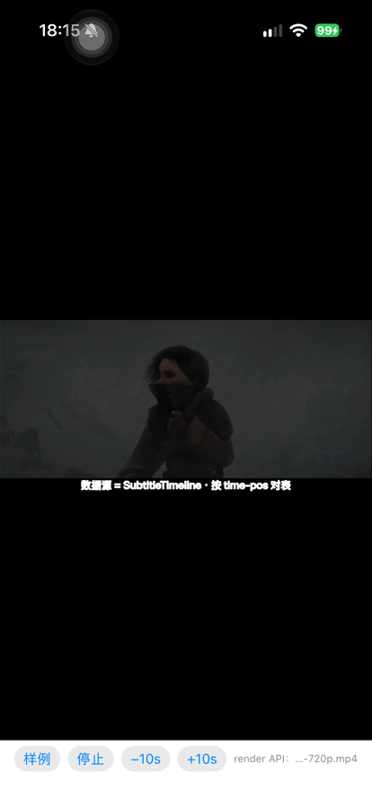

# 27 · 自绘字幕：把 `SubtitleTimeline` 接到帧上

> **日期**：2026-10-17 · **结论**：✅ **通了**。字幕由我们画（不是 mpv 烧进帧里），
> 数据源是 `SubtitleTimeline`，按 **mpv 的 `time-pos`** 对表逐条切换。
>
> 这是 `docs/25` §六 里"`overlayText` 是启动参数给的一串文字 —— 机制通了、数据源没接"
> 那一条的收口，也是 `docs/24` §四第 5 步"帧下游"的第一个真实功能。

---

## 一、为什么要有这条路

`wid` 那条路里，mpv 把字幕**烧进帧**：字幕存在，但**文本到不了我们手上**。
于是这些都做不了 —— 位置、字号、描边、动效、按台词做镜头语言、字幕检索/导出。

`render API` 把帧交出来之后，字幕才有第二种做法：**我们自己画**。
这条路上，文本先到我们手里，再合成到帧上（`MPVRenderOutput.overlayText`）。

> ⚠️ **两条路不能同时开**，否则同一句会出现两遍。`-subtitle` 装载时会顺手把
> mpv 那条关掉（`sub-visibility=no`），日志里会写 `mpv 那条已关闭=true`。

---

## 二、证据：三张不同时刻的截图

同一段 12 秒素材、同一条 3 句的 `.srt`，连拍：

| 图 | 播放位置 | 屏幕上的字幕 | 对应 SRT |
| --- | --- | --- | --- |
|  | `0:02 / 0:12` | 这句是我们自己画的，不是 mpv 画进帧里的 | 第 1 条（0.5–4.0 s） |
|  | ≈ `0:05` | 帧到了手上，位置、字号、动效才归我们决定 | 第 2 条（4.5–8.0 s） |
|  | ≈ `0:09` | 数据源 = SubtitleTimeline · 按 time-pos 对表 | 第 3 条（8.5–11.5 s） |

**判据不是"屏幕上有字"**（一串写死的字也能有字），而是：

1. 三张图的文本**互不相同** ⇒ 不是常量；
2. 每一张的文本都与**当时的播放位置**对应 ⇒ 不是按顺序轮播，是按时间查表；
3. 日志 `[subtitle] 自绘字幕已装载：3 条 · srt · mpv 那条已关闭=true`
   ⇒ 文本来自 `.srt` 文件而非启动参数，且 mpv 没有参与绘制。

第 1 张图还顺带证明了位置：字幕压在**视频区域内**的底部（不是屏幕底部），
黑边在它下面 —— 这是 `overlayTexture` 按视频高度取字号与底距的结果。

---

## 三、结构：三段，各管一件事

```
SubtitleTimeline          （PlayerCore，早就存在，已测）
   ↓ 文件 → 解析
SubtitleOverlaySource     （PlayerCore，本轮新增）
   ↓ 每帧 time-pos
MPVRenderOutput.overlayText → CoreText 画字 → 纹理 → 合成到帧
```

| 件 | 在哪 | 干什么 | 可测性 |
| --- | --- | --- | --- |
| `SubtitleOverlaySource` | `PlayerCore` | 给时刻、回文本；管开关与延迟；**不认识 mpv，也不认识图层** | ✅ 8 条单测 |
| `MPVSWSession.timePosition()` | `PlayerMPV` | 问 mpv 要 `time-pos` | 需真内核 |
| `MPVRenderOutput.subtitleSource` | `PlayerMPV` | 每帧查一次，**只在文本变化时**重建叠加层纹理 | 需真内核 |

### 3.1 为什么单独抽一个 `SubtitleOverlaySource`

`SubtitleTimeline.text(at:)` 已经能回答"这一刻显示什么"，所以这个类型只多三件事，
但每一件都值得**离开 mpv 去单测**：

| 它多做的 | 为什么不能塞进 timeline |
| --- | --- |
| `isEnabled` | 关字幕不该丢掉已解析内容（外挂 ASS 常见几百 KB，重解析肉眼可见）⇒ **关的是显示，不是数据** |
| 单行化 | 叠加层是**一行一画**；字符串里带 `\n` 时 CoreText 不会当成换行（**未单独验证**，预防性处理） |
| 重叠拼接 | ASS 允许两条同时在场，只取一条是**丢内容**，不是"少显示一点" |

### 3.2 为什么按 `time-pos` 对表，而不是帧计数或墙钟

- **帧计数**在丢帧/跳帧时与真实播放位置脱钩；
- **墙钟**在缓冲、seek、变速时越漂越远；
- `time-pos` 是 mpv 自己的**显示时刻**，也是它烧字幕时用的那个时间轴 —— 两边对齐。

---

## 四、边界（这一版**没有**做的）

| 没做 | 说明 |
| --- | --- |
| ASS 的样式与定位（`\pos` `\fs` `\an` `\c`） | 只用了纯文本。`ASSParser` 解析出了 `[Script Info]` 与样式表，但叠加层只读文本 |
| 长句换行 | 现在单行；超出画面宽度会被**画到画外**（不是折行）。第一版接受 |
| 字幕延迟的 UI | `SubtitleOverlaySource.setDelay` 已实现且测过，但没接到控制条 |
| 多行 SRT 的排版 | 已经被单行化成一行（用空格连接），丢掉了原作者的换行意图 |
| 真机以外的机型 | 与 `docs/26` 同一台 iPhone 16 Pro |

---

## 五、怎么自己跑一遍

```bash
# 1) 起本地服务（要 Range + 0.0.0.0，真机才够得着）
python3 Tools/serve-range.py --port 8769 --root /tmp/renderbench --host 0.0.0.0

# 2) 真机：视频 + 外挂字幕
xcrun devicectl device process launch --device <真机 UDID> --terminate-existing --console \
  com.playerstack.app -- \
  -renderDisplay http://192.168.x.x:8769/clip-720p.mp4 \
  -subtitle     http://192.168.x.x:8769/sample.srt

# 3) 期望日志
#   [subtitle] 自绘字幕已装载：3 条 · srt · mpv 那条已关闭=true
```

`sample.srt` 是 3 条、覆盖 0.5–11.5 s，与 12 秒素材对齐（这一轮自己造的，没进仓库）。
