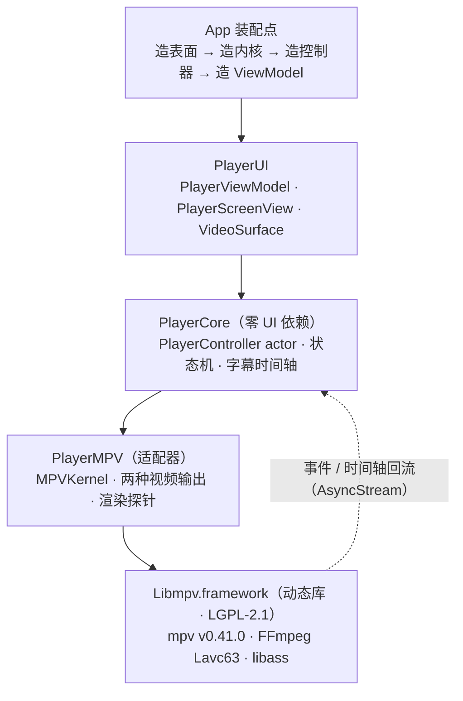
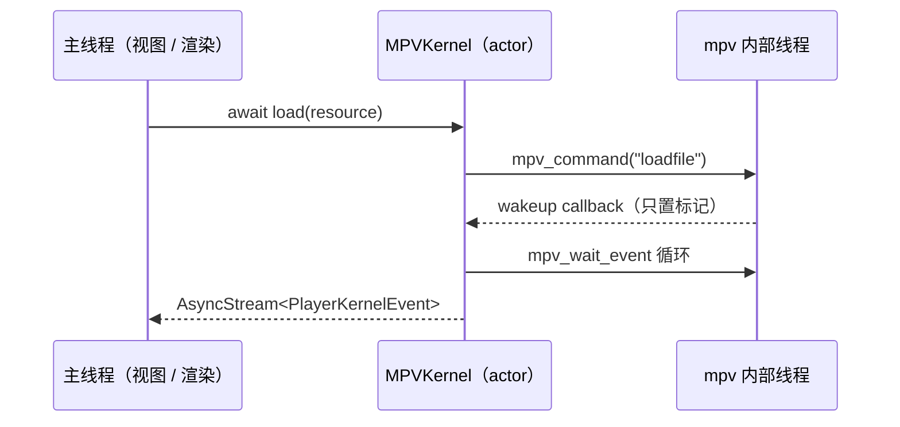

# 28 · 播放能力总览（怎么用 + 技术原理）

> 用途：给**要把它用到别处的人**看的一页说明书。
> 结论先说：这不是一个 App，是**三层库 + 一个内核适配器**；
> 能不能用好，取决于你有没有选对"帧从哪出来"那一步（`§3.2`）。
>
> 证据来源：`docs/24`（取帧）· `docs/25`（上屏与吞吐）· `docs/26`（真机复验）· `docs/27`（自绘字幕）。
> 本文只做归纳，**新数字一律以那四篇为准**。

---

## 一、它是什么（一张图）



| 包 | 有没有 libmpv | 能不能被 UI 依赖 | 它的职责 |
| --- | --- | --- | --- |
| `PlayerCore` | 否 | **不能**（门禁 `G1` 查这条） | 状态机、时间模型、字幕解析与时间轴、内核契约 |
| `PlayerUI` | 否 | 是 | SwiftUI 壳、图层宿主、拖拽/全屏/控制层显隐的纯逻辑模型 |
| `PlayerMPV` | 是（`binaryTarget`） | 是（要 `VideoSurface`） | mpv 句柄生命周期、两种视频输出、请求头、探针 |

**分层的实际意义**：`PlayerUI` 不认识 libmpv，所以"换内核"不用动界面；
`PlayerCore` 不认识 UIKit，所以它的 288 条测试可以在任何机器上跑（不需要模拟器）。

---

## 二、怎么用（三步装配，顺序不可换）

以 `Demo/Sources/MPVDemoView.swift` 为准（那是唯一的参考装配点）。

### 2.1 三步

```swift
// ① 先有"表面"——它决定帧从哪出来（这一步决定后面一切）
let output = try MPVRenderOutput(bridge: MPVRenderBridge())   // render API 路径
// 或者 let output = WindowEmbedOutput()                      // wid 路径

// ② 再造内核——因为渲染上下文必须早于第一次 loadfile
let kernel = MPVKernel(renderBridge: bridge)                   // 对应 ①
// 或者 let kernel = MPVKernel(windowEmbedHandle: handle)

// ③ 最后造控制器与界面壳
let vm = PlayerViewModel(controller: PlayerController(kernel: kernel))
```

**顺序不能换的理由**（不是风格问题，是失败会很难查）：

| 约束 | 违反后的现象 |
| --- | --- |
| `wid` 必须在 `mpv_initialize` 之前给 | 句柄给晚了，mpv 已经挑了别的 `vo`，画面不出来且不报错 |
| render 上下文必须在 `loadfile` **之前**建 | mpv 直接报 `No render context set.`，整个文件加载失败（`P-092`） |
| render 上下文必须在**主线程**建、且此后每帧同线程 | `mpv_render_context_*` 是**单线程**API，跨线程调等于未定义行为 |

### 2.2 挂到界面上

```swift
PlayerScreenView(viewModel: vm, surface: output)   // surface 是 CALayer（VideoSurface）
```

`PlayerScreenView` 只做一件事：把 `surface` 摆到自己的 bounds 上（`layout(in:scale:)`）。
它**不知道**这个图层是"播放器自己画的"还是"我们画的"——这是 `VideoSurface` 协议存在的全部理由。

### 2.3 播放

```swift
await vm.start()                                   // 建立更新流
await vm.load(PlayerResource(url: url, headers: ["Referer": "https://example.com/"]))
await vm.play()
await vm.seek(to: 12.5)
await vm.pause()
```

`PlayerResource.headers` 是**在线播放的关键**：`http-header-fields` 会被写进 mpv 选项，
用于过防盗链（`P5-T4`，`RequestHeaders`）。

---

## 三、技术原理（六个机制）

### 3.1 线程模型：mpv 有自己的线程，我们只有一个入口



要点：

- 内核是 **actor**，所有 mpv 调用都排在它的串行域里。
- mpv 的 `wakeup callback` **从 mpv 自己的线程打进来**，所以回调里只允许置标记，
  真正的 `mpv_wait_event` 由 actor 侧去拉（否则就是跨线程直接碰句柄）。
- `PlayerController` 也是 actor，它消费这条事件流，翻译成 `PlayerControllerUpdate`
  （状态 / 时间 / 尺寸 / 音轨 / 字幕轨），再由 `PlayerViewModel` 在主线程贴到 `@Observable` 属性上。

**这条链上唯一的"帧"不在里面** —— 帧走的是另一条路（`§3.2`），与事件流互不阻塞。
这是"UI 卡了但画面还在动"能成立的原因。

### 3.2 两种视频输出（**本项目的核心分水岭**）

| | `windowEmbed`（wid） | `renderAPI` |
| --- | --- | --- |
| 怎么配 | `wid = 图层句柄` + `vo=gpu-next` + `gpu-api=vulkan` + `gpu-context=moltenvk` | `vo=libmpv` + `mpv_render_context_create("sw")` |
| 谁在画 | **mpv 自己**画进你的 `CAMetalLayer` | **我们**每帧调 `mpv_render_context_render` |
| 帧在哪 | 在 mpv 内部，**拿不到** | 先落进我们给的 `CVPixelBuffer` |
| 能做什么 | 只能播 | 字幕自绘 / 滤镜 / 截图 / **深度合成** |
| 代价 | 无额外拷贝 | 多一次拷贝（真机 4K 按上屏 11.51 ms · 86 fps 上限） |
| 默认 | **是**（唯一端到端验过真画面的路径） | 需要显式打开 |

**"拿不到像素"这句话的准确含义**：`wid` 那条路上，帧从解码到上屏全在 mpv 的 GPU 管线里，
我们的进程里**没有任何一刻**持有它的像素。所以想在帧上做任何事（包括 Jove 要做的 2D→3D），
只能走 `renderAPI`。

`renderAPI` 那条路每一步的可核对事实（`docs/25` §二）：


- 池子按**目标尺寸**分配；mpv 软件后端会缩放到你给的尺寸。
  ⇒ 4K 源在 1206×678 的图层上只花 1080p 的钱（这是吞吐数字好看的真实原因）。
- 颜色格式必须是 `"bgra"`，与 `CVPixelBuffer` 的 32BGRA 对齐；
  对不上不会报错，只会**颜色全错**。

### 3.3 时间轴：mpv 是唯一权威

`time-pos` 是 mpv 的**显示时刻**（不是解码时刻、不是墙钟）。界面进度、字幕对表、
直播判定全从它来：

| 用途 | 用什么 | 为什么不用别的 |
| --- | --- | --- |
| 界面进度 | `time-pos / duration` | 帧计数会随丢帧漂、墙钟会随缓冲漂 |
| 字幕对表 | `time-pos` 查 `SubtitleTimeline` | 同上（`P-094` 那个坑就是这么来的） |
| 直播判定 | `PlayerLiveModel`（RTSP duration 恒 0；HLS 时长在增长） | HLS 直播的 `progress` 恒在 0.9 以上抖动，分母是滑动窗口末端 |

### 3.4 字幕有两条路，**不能同开**

| 路 | 谁排版 | 优点 | 缺点 |
| --- | --- | --- | --- |
| mpv 内建（libass） | mpv | 支持 ASS 富文本、字体嵌入、`\pos` 动效 | 样式改不动、不能做检索/翻译/交互 |
| 自绘（`SubtitleTimeline` + 纹理） | 我们 | 完全可控（字体/位置/动效随便做）、能拿到文本做检索 | 现在是**单行化**的，ASS 富文本被压平 |

自绘那条的接线方式（`docs/27`）：`MPVRenderOutput.subtitleSource` 每帧用 `time-pos` 查表，
**文本变了才重建纹理**（不是每帧重画），再作为一个叠加层纹理画在最上面。
装载自绘字幕时要把 mpv 那条关掉（`sub-visibility=false`），否则两套字叠在一起。

### 3.5 音频：**mpv 自己出声**

`MPVKernel` 没有设 `ao`，即 mpv 默认 `ao=auto` → iOS 上走 AudioUnit 直接出声。
本项目**没有**"另起一路 AVPlayer 播音频"的设计。

> 这与 JoveView 是相反的：它有一条独立的 `PlaybackAudio`（`AVPlayer` + 只含音轨的 composition），
> 因为它的画面是自己逐帧合成的、`AVAssetReader` 永远不出声。
> **两条路都出声 = 双声 + 抢 AudioSession**，移植时必须先定归属（见 `docs/29` 决策 D1）。

### 3.6 度量与取证

| 手段 | 用来回答什么 |
| --- | --- |
| `FrameTimingRecorder`（p50 / p95） | 慢不慢。**必须用 p95**，均值会被偶发的快帧拉低 |
| `StartupTimeline`（`load()` 起的分段打点） | 起播慢在哪一段 |
| `cpuNonBlackRatio` / `sourceNonBlackRatio` / `drawableNonBlackRatio` | **画面黑是谁弄丢的**（mpv 没写 / IOSurface 没通 / 着色器没画） |
| `verifyOnScreen` | 每 30 帧自读一次 drawable 像素，把"上屏"变成可核对的数 |

⚠️ 读数有一条硬纪律：**采样框必须在画面中心**。素材自带黑边（如 2.39:1 的上下黑边）时，
取左上角会把"正常画面"读成 0.000 —— 这个坑连查了六轮（`P-094`）。

---

## 四、能力清单（能做什么，实测到哪）

| 能力 | 状态 | 证据 |
| --- | --- | --- |
| mp4 / mov / mkv / ts 等常见封装 | ✅ | 走 libavformat，不是 Apple 的格式清单 |
| HLS（多码率、直播、低延迟） | ✅ | `docs/19`（HLS 直播源端到端）、`docs/16`（低延迟参数） |
| RTSP / RTMP | ✅ | `docs/13`（调研）、`docs/15`（延迟指标） |
| 请求头（Referer / UA / Cookie） | ✅ | `P5-T4`、`RequestHeaders` |
| 外挂字幕（srt / ass，自动编码） | ✅ | `SubtitleTextDecoder`、`docs/10` |
| 视频轨切换（清晰度） | ✅ | `selectVideoTrack(id:)`，HLS 多码率 |
| 自绘字幕（可排版） | ✅ 文本层 | `docs/27`（样式层还没做） |
| 全景 / 3D | ❌ | 需要按双眼视口重采样，**那才是真需要 GPU 的地方** |
| YouTube 一类**网页链接** | ❌ | 产物 `-Dlua=disabled` ⇒ 没有 `ytdl_hook`，mpv 只吃直链 |
| DRM（Widevine / FairPlay 内容） | ❌ | 不具备，也不应具备 |

真机吞吐（iPhone 16 Pro，暂停后压 120 帧，p50）：

| 源 | 按上屏尺寸渲 | 按源码尺寸渲 |
| --- | --- | --- |
| 720p | 6.55 ms | — |
| 1080p | 6.83 ms | — |
| 4K | **11.51 ms（86 fps）** | 44.34 ms（21.8 fps） |

---

## 五、边界（这一版**没有**做什么）

| 没做 | 为什么 | 谁需要它 |
| --- | --- | --- |
| 全景 / 3D | 需要双眼视口重采样，SW 后端不划算 | JoveView（已自己实现） |
| 硬解回 CPU 取帧 | `MPV_RENDER_PARAM_HW_FRAMES` 是另一条路，未验 | 想同时要"省电"和"拿像素"的人 |
| 网页链接解析 | 精简构建无 lua | 在线浏览 |
| 字幕样式层 | 只有默认样式 | 自绘字幕的产品化 |
| 默认走 render | 直播 / HLS / 弱网没验过 | 想切默认的人 |

---

## 六、为什么它是这个形状（决策史）

| 决策 | 当时的理由 | 出处 |
| --- | --- | --- |
| 自建 `xcframework` 而不用现成产物 | 现成产物没有"动态 + LGPL"这个组合 | `docs/02`、`docs/05` |
| 默认 `wid` 而不是 render | render 只验过局域网 mp4；`wid` 验过直播/HLS/弱网 | `docs/25` §七 |
| render 用**软件**后端 | 硬件帧回 CPU 要 `HW_FRAMES`，那条没验；SW 的拷贝在真机上只值 0.01–0.02 ms（Metal 那段几乎免费） | `docs/26` §五 |
| 不上 GPU 桥 | 4K 按上屏 11.51 ms 已经够 60 fps | `docs/25`、`docs/26` |
