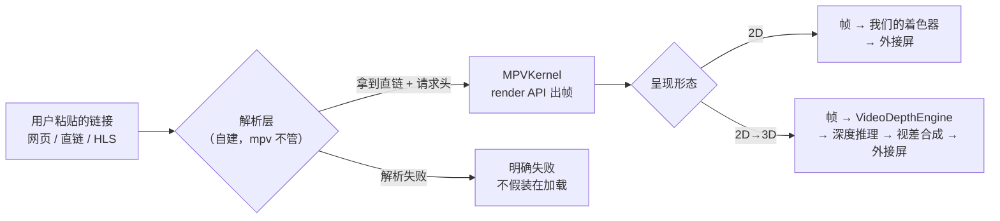
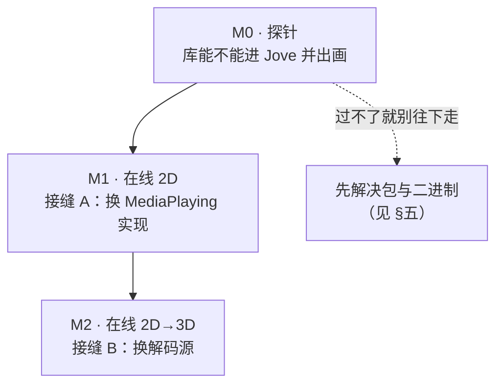

# 29 · 把播放能力移植到 JoveView（方案表）

> 目标：JoveView 的**在线浏览**能输入一个视频网站链接，在眼镜里播放，并（可选）做 2D→3D。
> 本文只解决"怎么搬、搬哪些、先做什么"；**不代替 Jove 自己的票**（那些按它的
> `.scratch/<feature-slug>/issues/` 规矩拆）。
>
> 结论先说（三句）：
> 1. **接缝已经现成** —— Jove 的 `MediaPlaying` 端口和"管线只认 `CVPixelBuffer`"这两件事，
>    让 mpv 可以插进去，不用改它的架构。
> 2. **真正的工作量不在搬代码，在两件配套事**：把包变成"能被远程消费的包"，和把"两套时基"合成一套。
> 3. **在线浏览的价值 80% 在链接解析，不在播放器** —— 而这恰好是 mpv 帮不上忙的那一半（无 lua/ytdl）。

---

## 一、目标链路

三个必须承认的现实：

| 现实 | 依据（可核对） |
| --- | --- |
| mpv **不能**解析网页 | 产物是精简构建：`spike/p0-t5b-lgpl-dynamic-build/build-evidence.md:34` → `-Dlua=disabled` ⇒ 没有 `ytdl_hook` |
| DRM 内容**不可能**播 | 无 Widevine / FairPlay，且不应试图绕过 |
| 深度合成把帧率压到远低于 60 | 推理成本固定（672×384 网格），与输出分辨率无关（`CONTEXT.md`「分辨率与性能」） |

---

## 二、JoveView 现状对齐（它已经有什么）

| Jove 已有 | 在哪个文件 | 与 PlayerStack 的关系 |
| --- | --- | --- |
| 播放控制端口 `MediaPlaying`（play/pause/resume/stop） | `Domain/GlassesPlayback.swift` | **与 `PlayerKernelProtocol` 同构**，但更窄（没有 load/seek 的语义） |
| 呈现二选一（`.media` / `.depth`，互斥） | `Domain/Presentation.swift` | 天然决定"mpv 放哪条路" |
| 2D 播放（AVPlayer + AVPlayerLayer） | `ExternalDisplay/GlassesMediaPlayer.swift` | **要被替换的就是它**（接缝 A） |
| 逐帧管线（AVAssetReader → Metal → CoreML → 合成） | `VideoDepthEngine.swift` | **要换的就是它的取帧口**（接缝 B） |
| 音频所有权（`AudioOwner`） | `Domain/Presentation.swift` | 只有 `mediaPlayer` / `depthPreview` 两项，**没有 mpv 的位置** → 决策 D1 |
| 深度合成吃 `CVPixelBuffer` | `Metal/MetalDepthCompositor.swift:316 makeSourceTexture` | **与 mpv SW 后端的输出格式天然对齐** |
| 热熔断 / 片长阶梯 / 丢帧保实时 | `VideoDepthEngine.swift` | mpv 不替代它们，只提供帧 |
| 在线浏览入口 | `ExternalDisplay/GlassesChrome.swift:212`（`destination: nil`） | **今天完全空白**：无页面、无网络代码、无解析 |

**一句话**：Jove 不是"没有播放能力"，它缺的是**解码域**（只吃 AVFoundation 认识的格式）
和**帧的来源**（只能读本地相册）。PlayerStack 补的正是这两样。

---

## 三、三个必须分开的阶段

| 阶段 | 做什么 | 判据（可核对） | 不改什么 |
| --- | --- | --- | --- |
| **M0** | 一个启动参数 `-joveMpvProbe <URL>`：建 mpv → 播到外接屏（render API 直上屏） | 外接屏出现画面；日志里 `time-pos` 在前进；**失败要能说出失败在哪一步** | 不碰 `MediaPlaying`、不碰 `Presentation` |
| **M1** | 写 `MPVMediaPlayer: MediaPlaying`；在线条目走它，相册条目仍走 AVPlayer | 播放/暂停/seek/播完 的行为与相册视频一致；长按切 3D 能交棒 | 不碰 `VideoDepthEngine` |
| **M2** | mpv 出帧 → `VideoDepthEngine.processFrame`；`VideoDepthEngine` 增加"外部帧源"分支 | 深度 3D 画面出现；丢帧数与推理耗时在预算内；音画不漂 | 不改合成器与推理 |

**为什么不能一步到位**：M1 验的是"库能用"，M2 验的是"两套时钟能合成一套"。
把两件事混在一张票里，一旦画面不对，你分不清是库没接好还是时钟打架。

---

## 四、移植单元表（逐文件：搬 / 改 / 不搬）

| 源文件 | 作用 | 落到 Jove 的哪里 | 处理 |
| --- | --- | --- | --- |
| `PlayerMPV/MPVKernel.swift` | mpv 句柄生命周期、选项、事件流 | 新增 `Infrastructure/MPVKernel.swift` | **搬**，日志出口改成 `LogSink`（见 §五-8） |
| `PlayerMPV/MPVSWSession.swift` | 软件后端渲染上下文 | 同目录 | **搬**，不改 |
| `PlayerMPV/MPVRenderOutput.swift` | 帧池 + 纹理 + 上屏 + 探针 | 拆两半：帧池搬到"帧源"，上屏搬到呈现面 | **改**（M1 只要上屏那半，M2 只要帧池那半） |
| `PlayerMPV/MPVRenderBridge.swift` | 内核 ↔ 显示端的单向上交 | 同目录 | **搬**，不改（线程约束都在里面的注释里） |
| `PlayerMPV/RequestHeaders.swift` | `http-header-fields` 拼装 | 同目录 | **搬**（在线播放必用） |
| `PlayerMPV/StreamProbePlan.swift` | 流可播性预判 | 同目录 | **搬**（可选） |
| `PlayerCore/SubtitleDocument.swift` / `SubtitleTimeline` / `SRTParser` / `ASSParser` / `SubtitleTextDecoder` / `SubtitleCue` / `SubtitleTrack` | 字幕解析与时间轴（纯逻辑） | `Domain/Subtitle/` | **搬**（无任何平台依赖，最好搬的一块） |
| `PlayerCore/SubtitleOverlaySource.swift` | 自绘字幕文本（单行化、重叠拼接） | 同目录 | **搬** |
| `PlayerMPV/MPVRenderOutput` 里的叠加层部分 | 字幕纹理绘制 | 合并进呈现面 | **改**（Jove 的呈现面是 `MetalPreviewView`，不是 `CAMetalLayer` 直挂） |
| `PlayerCore/PlayerStateMachine.swift` + `PlayerStateTransition` | 状态机 | — | **不搬**：Jove 的 Redux state 是唯一权威，多一套状态机 = 两个真相 |
| `PlayerCore/VideoFitRect` / `VideoSizeTracker` | 几何适配 | — | **不搬**：`MetalDepthCompositor.frameTransform` 已经在做同一件事 |
| `PlayerUI/PlayerViewModel` / 控件 / 键盘快捷键 | 界面 | — | **不搬**：Jove 有自己的控制面（`PhoneMediaControls`、`ControlBar`） |
| `PlayerCore/FrameTimingStats` | p50/p95 | — | **不搬**：Jove 有 `JoveMeter` / `PerfSignal`，别再引第二套性能面 |
| `Demo/Sources/MPVDemoView.swift` | 装配范例 | 组合根 `Container+App.swift` | **参照**，不搬 |

**一句话**：搬"解码 + 帧 + 字幕解析"，不搬"状态机 + 界面 + 度量" —— 后三样 Jove 已经有一套更贴合它自己的。

---

## 五、作为依赖被别的 App 消费之前，必须改的 9 项

> 这一节是新增的：现在这个仓库是"能自己跑的项目"，**不是"能被别人引用的库"**。
> 每一条都给了可核对的判据（命令在仓库根执行）。

| # | 问题 | 现状（可核对） | 必须做什么 |
| - | --- | --- | --- |
| 1 | **适配器在子包里，`url:` 依赖够不着** | 根 `Package.swift` 的 products 只有 `PlayerCore` / `PlayerUI`；`PlayerMPV` 在 `MPV/` 子目录，靠 `path: ".."` 反指 | 把 `PlayerMPV` 与 `binaryTarget` **挪进根 `Package.swift`**，作为第三个 product。SPM 的 `url:` 依赖只解析仓库根的清单，**不能**引子目录包 |
| 2 | **二进制不在仓库里** | `.gitignore:19` → `MPV/Library/*.xcframework/`；`git ls-files MPV/Library` → 空。产物共 **104 MB**（真机 slice 34 MB + 模拟器 slice 71 MB，`du -sh` 量的未压缩值） | 改成 `binaryTarget(url:checksum:)`，把 `Libmpv.xcframework.zip` 挂到 GitHub Release。**好消息：有模拟器 slice**（`ios-arm64_x86_64-simulator`），Jove 的 `-mockExternalDisplay` 那套开发流程不会断 |
| 3 | **没有任何 tag** | `git tag` → 空 | 打 `0.1.0`。Jove 的纪律是"0.x 用 `minVersion`+`maxVersion` 区间，不用 `from:`"（`CONTEXT.md:89`） |
| 4 | **公开面太宽** | `MPVKernel` 有 3 个 `public init`，外部要看得出"该用哪个" | 加一个门面（`PlayerStack.make(config:) -> (PlayerViewModel, VideoSurface)`），把"先表面后内核"的顺序收进库里 —— 这个顺序**错一次就是黑屏** |
| 5 | **隐私清单只挂在 Demo 上** | `find . -name "PrivacyInfo*"` → 只有 `Demo/Sources/PrivacyInfo.xcprivacy`。它的内容不是猜的：`nm -u` 量出产物命中 4 个符号 —— `_stat`·`_fstat`（FileTimestamp）与 `_mach_absolute_time`·`_mach_continuous_time`（SystemBootTime）；`_statvfs` / `_NSUserDefaults` 实测**不存在** | 我们自己的源码不碰这类 API（`grep -rn "UserDefaults\|statfs\|attributesOfItem" Sources/ MPV/Sources/` → 0），但**二进制里带着它们** ⇒ Jove 的 app target 必须同样申报这两类。把这份 plist 当**可复用文件**交过去，别让它跟着 Demo 留在原地 |
| 6 | **许可材料没跟包走** | `compliance/` 在仓库里，但 SPM 包没有 license 元数据 | Jove 上架时需要 App 内可打开的许可页；`compliance/licenses/LGPL-2.1.txt` 与 `SOURCE.md` 必须能被 App 读到 |
| 7 | **动态库要嵌进 App** | 产物是 `@rpath/Libmpv.framework/Libmpv`（`otool -L` 只有 1 条非系统依赖） | Jove 的 target 要 `embed & sign`，否则启动即崩（`Library not loaded`）。`project.yml` 里加 `embed: true` |
| 8 | **日志出口对不上** | 内核只暴露 `enableLogging(handler:)`，内部用 `log` 闭包 | 一行适配到 `LogSink` / TGLogger；**不要**让 mpv 的 `print` 直接进 Console（会破 Jove 的 `AppLog` 分类契约） |
| 9 | **平台与语言模式声明会误导** | `MPV` 包声明 `.macOS(.v14)`，但 `MPVKernel` / 渲染全在 `#if os(iOS)` 里 ⇒ macOS 下是空模块；根包 `swiftLanguageModes: [.v6]`，Jove 是 `SWIFT_VERSION: 5.0` | 要么去掉 macOS 声明（诚实），要么在 README 写明"macOS 只是编译占位"；语言模式混用**可以**（模块各按自己的），但 Jove 侧要记住 UI 调用都在 `@MainActor` |

> 前三条是**阻塞级**：不解决，Jove 连"引进来"都做不到。
> 第 1、2 条合起来的意思是：**今天这个仓库换个机器 clone 下来，是编译不过的**（产物被 ignore）。
> 这句原来是从清单推断的，**已在 [`docs/30`](30-导出物现状与欠缺.md) §二 实测确认**：
> 干净 clone 上 `swift build` 直接报 `local binary target 'Libmpv' … does not contain a binary artifact`。
> 同处还测出两件本节没提的事：`package:` 参数认的是**目录名**（不是清单 `name`），
> 以及 macOS 上 `PlayerMPV` 是**空模块**（能 import、里面什么都没有）。
> 另外提醒一句实施细节：合并子包时 `MPV/Package.swift` 的 `testTarget(path: "Tests/PlayerMPVTests")`
> 要跟 `Tests/PlayerCoreTests` 挤在同一个 `Tests/` 下，路径会重名 —— 改名比改结构省事。

---

## 五·补 · JoveView 侧要动的地方（10 处）

> 库改好了只是"能用"，这一节是"接上"。

| # | 改哪 | 改什么 | 为什么 |
| - | --- | --- | --- |
| 1 | `project.yml` | 加 SPM 依赖（`url:` + 版本区间）；Libmpv 要 `embed & sign` | 不嵌动态库＝启动即崩 |
| 2 | `joveview/Info.plist` | 视解析结果决定是否要 `NSAppTransportSecurity` 例外 | 默认 ATS 只放 https；**http 直链会被系统直接拒**，而报错不会指向 ATS |
| 3 | `Domain/Presentation.swift` | `AudioOwner` 加 `.mpv`（D1）；`audioOwner` 的分支跟着加 | 现在只有 `mediaPlayer` / `depthPreview`，mpv 没位置 |
| 4 | `Domain/GlassesPlayback.swift` | 新增 `MPVMediaPlayer: MediaPlaying` 适配器 | 接缝 A 就是这里 |
| 5 | `Domain/` 新增 `OnlineVideo.swift` | 链接模型 + 解析状态（`idle / resolving / ready(stream) / failed(reason)`） | 状态要进 Store，不能藏在视图里 |
| 6 | `Infrastructure/` 新增解析端口 | `OnlineResolving`（URL → 直链 + headers） | mpv 不管这一半，必须自建 |
| 7 | `ExternalDisplay/GlassesChrome.swift:212` | `browser` 卡片 `destination: nil` → 真的页面 | 今天点了没有反应 |
| 8 | `VideoDepthEngine.swift` | 增加"外部帧源"分支（mpv 送帧），保留 `AVAssetReader` 那条给相册 | M2；两条帧源并存，按来源选 |
| 9 | `Domain/MediaLimits.swift` | 片长上限按来源区分（D6） | 45 分钟会挡掉在线长片 |
| 10 | `.scratch/online-video/` | feature spec + 分批票（M0/M1/M2 各一张） | Jove 的流程纪律：一票一文件，不写成一个合集 |

---

## 六、关键决策（需要拍板，附推荐与代价）

| # | 决策 | 选项 | 推荐 | 代价 / 依据 |
| - | --- | --- | --- | --- |
| **D1** | **音频归谁** | ① mpv 出声（`ao=auto`）② mpv 静音（`ao=null`）+ Jove 的 `PlaybackAudio` 再拉一路音轨 | **①** | 一路解码，音画天然同步；②要二次连接（同一 URL 拉两遍），防盗链下大概率失败。代价：`AudioOwner` 要加第三项 `.mpv`，且在 2D↔3D 切换时要交棒 |
| **D2** | **时基归谁** | ① mpv（`time-pos` 唯一权威，管线当消费者）② 保留 Jove 的"锚点 + 墙钟" | **①** | ②会让"mpv 等我们"和"我们等 mpv"互相顶，表现为随机卡顿。代价：`keepsWallClockSync` 那条丢帧策略要改成"接不住就丢送来的帧" |
| **D3** | **mpv 渲多大** | ① 外接屏尺寸（1920×1080 / 3840×1080）② compositor 输出画布（960×540 / 1280×720 / 1920×1080，双倍宽 ×2） | **②** | SW 后端按目标尺寸花钱；喂给合成器的帧再大也没用（反正是 672×384 推理）。**这一条直接回答"渲染尺寸要多大"** |
| **D4** | **链接解析做到哪** | ① M1 只支持"直链 / HLS 粘贴"② 做通用网页解析 | **①先，②单独立票** | ②是独立的工程（各站点规则、签名、时效、法律）；且 mpv 帮不上（无 lua）。先让"能播"这件事成立 |
| **D5** | **包怎么引** | ① `url:` + tag（守 Jove 纪律）② `path:` 本地包（联调快） | **①**，联调期用 `-joveLocalPlayerStack` 开关临时切 `path:` | ⚠️ **与既有规则冲突**：`CONTEXT.md:89` 原话「SPM 依赖一律用 `url:` + 锁版本（**不用** `path:` 本地包）」，理由是"改了库必须先 push + tag 才被 app 看到"。要豁免就得改这条，**请董事长裁定** |
| **D6** | **片长上限** | ① 沿用 `MediaLimits` 45 分钟 ② 在线来源放开 | **②，按来源区分** | 45 分钟是给相册视频定的（热保护），在线看剧会直接撞墙；但放开就要靠 D3 的降分辨率 + 热熔断兜底 |

---

## 七、风险与**现在还答不了**的问题

| 项 | 状态 | 说明 |
| --- | --- | --- |
| mpv 出帧 + 深度合成的实际帧率 | **未验证** | 现在只有"mpv 单独跑 4K 86 fps"与"深度管线自己的 fps"两个数，**没有叠加后的数** |
| 在线流 seek 的稳定性 | **未验证** | 局域网 mp4 验过；HLS/直播的 seek 没验 |
| 2D↔3D 切换时音频会话行为 | **未验证** | Jove 已有过一次"切 3D 后无声"的坑（`devnotes/2026-09-15-preview-audio-silent-after-3d-mode-switch`） |
| 防盗链 / 签名 URL 过期 | 高风险 | 需要在解析层处理时效，并给用户明确的"链接已失效" |
| DRM 内容 | **不可行** | 不做，也不应做 |
| App Store 审核 | 注意 | "在线浏览"接第三方站点要按 `5.2.x` 自查，别把 App 变成浏览器 |
| 4K 软解的代价 | 已知 | 按源码尺寸 44.34 ms/帧 ⇒ 在线 4K 必须让 D3 生效，否则 21.8 fps 封顶 |

---

## 八、验收判据（每阶段只认这几条）

| 阶段 | 判据 |
| --- | --- |
| M0 | 外接屏出现画面（**截图**）+ `time-pos` 在前进（**日志**）+ 失败时能指出卡在哪一步（**不是"黑屏"三个字**） |
| M1 | 播放/暂停/seek/播完与相册视频行为一致；切 3D 能交棒；拔掉眼镜管线暂停（沿用 Jove 的 Gate） |
| M2 | 深度 3D 画面出现；丢帧数与推理耗时在 `JoveMeter` 预算内；音画不漂（连续 10 分钟对比 `time-pos` 与音频位置） |

---

## 附：ELI5（这段是给"为什么不能直接插一根线"的）

把播放想成**两条传送带**：

- **Jove 现在**是一条自己伸手取货的线：它按自己的拍子走，取货慢了就把后面那箱**扔掉**（丢帧保实时），
  进度条也是自己数的。
- **mpv** 是另一条**自带秒表**的线：它按自己的秒表匀速送货，声音是它的主时钟；你接得慢，它就**等你**（不丢，会卡），
  进度也它说了算。

把 mpv 塞进 Jove 的管线，等于**两个人都拿着秒表管同一条线**：一会儿你等它、一会儿它等你，
表现就是**随机的一卡一顿**，而且你很难从现象上判断是谁在等谁。

所以移植的真正动作不是"把解码器换掉"，而是：**把秒表交给 mpv，Jove 改成接货的一方**。
跟不上仍然是丢帧 —— 但丢的是"送来的那帧"，声音和画面才在同一个节拍上。
