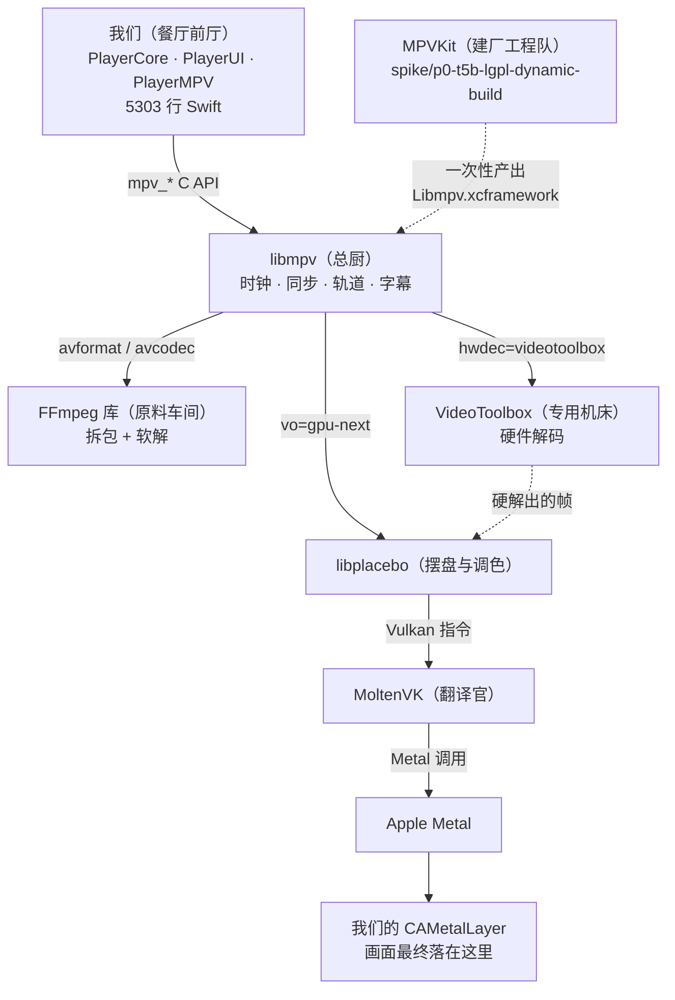

# K1 · 概念底：这些东西分别是什么

> **结论先说**
>
> 这套系统里，真正在"播放"的是 **libmpv** —— 只有它同时握着 **时钟、解码、渲染、字幕、轨道** 这五件事。
>
> | 名字 | 一句话身份 | 它**不**做什么 |
> | --- | --- | --- |
> | **FFmpeg** | 原料车间：把文件拆成包、把包解成帧 | 不做同步、不做渲染、没有窗口和界面 |
> | **libmpv** | 总厨：决定第几帧在第几毫秒上屏 | 不自己实现解码算法（外包给 FFmpeg / VideoToolbox） |
> | **MPVKit** | 建厂工程队：把 20 个 C/C++ 库按顺序编译、打包 | 不参与运行时，只在"造产物"那一刻存在 |
> | **MoltenVK** | 翻译官：Vulkan 语言 → Metal 语言 | 不是图形驱动，是**指令翻译层** |
> | **VideoToolbox** | 苹果的专用机床：硬件解码 | 不认识容器格式，只认识"码流" |
> | **我们写的 5303 行 Swift** | 餐厅前厅：点菜、装修、上菜 | **一帧像素都不碰** |
>
> 一句话：**我们写的是"怎么用"，不是"怎么放"。**

---

## 1 先破三个最常见的误会

| 误会 | 实际 |
| --- | --- |
| "FFmpeg 就是个播放器" | FFmpeg 是一**套库**（外加一个演示用的命令行程序 `ffplay`）。**我们只用它的库**：`libavformat`（拆包）· `libavcodec`（解码）· `libavutil`（工具）· `libswscale`（缩放）· `libswresample`（重采样）。它**不知道**"播放"是什么 —— 没有时钟、没有窗口、没有用户界面 |
| "mpv 里装着 FFmpeg" | 不是"装着"，是**链接**。编译 mpv 时把 FFmpeg 的静态库链进去。我们的产物更彻底：**20 个库全部静态链进一个动态库**（`Libmpv.framework`） |
| "MPVKit 是用 libmpv 编出来的" | **反了。** MPVKit 是**构建工程**（一套 Swift 写的脚本 + 依赖清单），`libmpv` 是它**最后的产物**。两个名字都带 mpv，但一个是**工厂**、一个是**产品** |

> 第三个误会正是"一头雾水"的主要来源：`build.sh` 里从头到尾**没有一行**"调用 libmpv"，
> 因为它就是在**造** libmpv。名字像 ≠ 有调用关系。

---

## 2 六个角色：谁是谁

| 角色 | 通俗类比 | 真实身份 | 谁调用它 | 在本仓库哪里能看见 |
| --- | --- | --- | --- | --- |
| **FFmpeg** | 原料车间 | 一组 C 库（`libav*`） | libmpv | 只在**配方**里：`spike/…/ffmpeg/0001-*.patch`（源码本体只在 `/tmp` 一次性工作区） |
| **libmpv** | 总厨 | mpv 播放器内核**做成库**的形态 | **我们** | `MPV/Sources/PlayerMPV/MPVKernel.swift` |
| **libplacebo** + `vo=gpu-next` | 摆盘与调色师 | 高级 GPU 渲染器（HDR 映射 / 缩放 / 抖动） | libmpv | 一行配置：`setOption(handle, "vo", "gpu-next")` |
| **MoltenVK** | 翻译官 | Vulkan → Metal 的**转换层** | libplacebo（通过 Vulkan） | 构建进产物内部 |
| **VideoToolbox** | 苹果的专用机床 | 系统框架（硬件解码） | libmpv（`hwdec=videotoolbox`） | 系统提供，**不在**产物里 |
| **MPVKit** | 建厂工程队 | 构建脚本工程（锁定在某个 revision） | **人**（跑 `build.sh`） | `spike/p0-t5b-lgpl-dynamic-build/` |
| **我们** | 餐厅前厅 | 5303 行 Swift | — | `Sources/` · `MPV/Sources/` · `Demo/Sources/` |

**一个关键分界**：前六个里有五个是"别人写好的东西"，我们只是**配置**它们。
我们真正**写**的，只有"什么时候下什么命令、拿到回调后更新哪块状态"。

---

## 3 谁依赖谁



读法：

- **实线 = 运行时的调用链**（每次播放都在跑）。
- **虚线 = 只在"造产物"那一刻发生一次**（之后就固定成一份 106 MB 的二进制）。
- 我们**只跟 B 打交道**。C / D / E / F / G 全是它的内务，我们连它们的头文件都不需要 include。

---

## 4 一次播放的完整因果链

（这是**简版**；每一站的细节与数据流总图在 `K3`（待写）。）

| # | 发生什么 | 谁在做 | 对应代码 / 证据 |
| --- | --- | --- | --- |
| 1 | 建一个 mpv 实例 | 我们 | `mpv_create()`（相当于"请一位总厨进厨房"） |
| 2 | 告诉它用什么锅、什么刀、网络怎么走 | 我们 | `setOption(...)` 共 **20 处调用**（含一对互斥分支；iOS 上实际生效 **18 条**：画面 4 · 播放语义 3 · 网络 5 · 缓存 6） |
| 3 | 初始化内核 | 我们 → libmpv | `mpv_initialize()` |
| 4 | 把要播的东西递进去 | 我们 → libmpv | `loadfile <url>` |
| 5 | **拆包**（demux）：mkv/mp4 → 视频包 / 音频包 / 字幕包 | FFmpeg `libavformat` | 网络源先过 stream 层（HTTP / HLS / RTSP…） |
| 6 | **解码**：压缩的包 → 原始帧（YUV 像素 / PCM 采样） | FFmpeg `libavcodec`，或 **VideoToolbox**（开了硬解时） | 硬解出来的是 GPU 上的 `CVPixelBuffer` |
| 7 | **决定什么时候上屏** | libmpv 的**时钟** | 这是 mpv 存在的**全部理由** —— 音画同步、丢帧/补帧都在这里 |
| 8 | 渲染：缩放 / 色调映射 / 抖动 | `vo=gpu-next` + libplacebo | 产出 Vulkan 指令 |
| 9 | 把 Vulkan 指令翻成 Metal 调用，画进我们的窗口 | MoltenVK → Metal | 我们的 `CAMetalLayer`（`WindowEmbedOutput`） |
| 10 | 反过来：状态变化传回我们 | libmpv → 我们 | `mpv_observe_property` 共 **15 条**（时间 / 时长 / 暂停 / 尺寸 / 轨道 / 缓冲…）→ 我们的状态机 → SwiftUI |

**第 7 步是理解整个系统的那把钥匙**：FFmpeg 能解码，但**它不会"等"**。
让画面按正确的时间出、让声音和画面不脱节、让 seek 之后从对的地方继续 ——
这些全是 libmpv 干的活。所以我们选了 mpv 而不是自己拼 FFmpeg。

---

## 5 「它能播什么」—— 用产物本身回答

### 5.1 它是库，不是程序

构建配置里有 `--disable-programs`。核对：

```bash
nm -gU MPV/Library/Libmpv.xcframework/ios-arm64/Libmpv.framework/Libmpv | grep -c "_mpv_"
# 导出的是 mpv_* 库 API；没有命令行主程序
```

⇒ **没有 `mpv` 命令行工具可调**。所有能力都必须从 `mpv_*` C API 进去。

### 5.2 它是被"白名单裁剪"过的 FFmpeg，不是全量

配方里 `--disable-muxers / --disable-encoders / --disable-decoders / --disable-filters` **全关**，
再逐项 `--enable-*` 打开（见 [`docs/05`](../docs/05-libmpv产物实测报告.md)）。

实测白名单规模：

```bash
# 从静态库取实际编译进去的解复用器 / 解码器（下面数字来自本机实测）
nm -gU <构建树>/libavformat.a | grep -oE "_ff_[a-z0-9_]+_demuxer" | sort -u | wc -l   # → 54
nm -gU <构建树>/libavcodec.a  | grep -oE "_ff_[a-z0-9_]+_decoder" | sort -u | wc -l   # → 203
```

⇒ "FFmpeg 支持 xxx" **不能直接当成"我们的产物支持 xxx"**。判据是上面这两个清单。

### 5.3 容器（demuxer）—— 54 个

| 类别 | 清单 | 常见的 |
| --- | --- | --- |
| **视频文件** | matroska · mov · avi · flv · live_flv · rm · ogg · asf · caf · dv · ivr · kux · mpegps · mpegts · mpegtsraw · mpegvideo · vc1 | **mkv / webm / mp4 / m4v / mov / avi / flv** 都能开 |
| **音频文件** | mp3 · aac · ac3 · eac3 · flac · wav · aiff · amr · ape · loas · ogg | |
| **网络流** | hls · dash · rtsp · rtp · srt · concat · webm_dash_manifest · sdp | HLS / DASH / RTSP 都在 |
| **字幕** | ass · webvtt | SRT 走的是 `sub` 路径（见 `K5`） |
| **裸流** | h264 · hevc · av1 · m4v · rawvideo · data | |

### 5.4 编码（decoder）—— 203 个

| 类别 | 关键项 | 备注 |
| --- | --- | --- |
| **视频** | h264 · hevc · vp8 · vp9 · av1（原生 + `libdav1d`）· mpeg1/2/4 · prores · vc1 · libuavs3d · mjpeg · huffyuv · ffv1 · vp6 | AV1 有**两个**实现（性能兜底） |
| **音频** | aac · mp3 · ac3 · eac3 · flac · vorbis · opus · alac · PCM 全系（56 个） | 覆盖面很宽 |
| ❌ 不在列表 | `png` · `gif` · `tiff` · `webp` · `theora` · `dvvideo` | **图片与动图序列播不了**（`mjpeg` 有，但 `image2` 解复用器没有） |

> **这一格很重要**：如果哪天要"播一张图"，会发现播不了 —— 不是坏了，是**产物里没有这个解码器**。
> 要加就得改配方重建（`K2` 讲怎么做）。

### 5.5 本地文件：✅ 早就验证过了

**能播，而且已经端到端验证过**，不是"理论支持"：

- `P2-T11` 的判定门 `G2` 就是**拿本地 mkv** 判的：**出画 ✅ · `seek` 精确 ✅ · 门禁 0 ✅**
  （见 [`docs/03`](../docs/03-路线图.md) 的 `P2-T11` 行）。
  ⚠️ 唯一没覆盖的是那一次**没有音轨**（样例片段无音轨，如实记在 [`docs/10`](../docs/10-P2验证报告.md) §四）；
  "出声"后来在 720p 源上实测为 **48 kHz 立体声**正常。
- **真机上还有一条活证据**：Demo 的样例视频是**先下载到 App 容器、再把本地 URL 交给 mpv** 播的
  （`SampleClipProvider`）⇒ 真机每一轮跑的**都是本地文件路径**，不是网络播放。
- UI 层也有文件选择入口：`PlayerScreenView` 的 `.fileImporter` + `PlayerSecurityScopedAccess`（`P3-T4` ✓）。
  ⚠️ 但**当前 Demo 用的是 `MPVDemoView`（Phase 2 的样板），没接这个页面** ⇒
  今天在 Demo 界面上"用文件选择器挑文件"这条路径**点不到**，要验请走下面的命令行路径。
- **原理上本地比网络更简单**：内核拿到的都是同一个 `PlayerResource(url:)`，
  mpv 对 `file://` 与 `http://` 是**同一条 `loadfile` 路径**，区别只在 stream 层要不要联网。
  ⇒ 内核里没有"本地/网络"的分叉代码。

### 5.6 自己验一遍

```bash
cd Demo && xcodegen generate

# 路径 A（**已实测**，全程走本地文件）：自动加载样例 ——
#   它会先下载到 App 容器，再把**本地 URL** 交给 mpv。真机上每一轮跑的都是这条。
xcrun simctl launch --console-pty <UDID> com.playerstack.demo -- -autoLoadSample

# 路径 B（**未实测**）：直接把本地文件当 URL 递进去
#   （mpv 对 file:// 与 http:// 是同一条 loadfile 路径）
#   ⚠️ file:// 指的是**设备/模拟器上**的路径，不是宿主机路径
xcrun simctl launch --console-pty <UDID> com.playerstack.demo -- \
  -directURL "file:///path/on/device.mkv"
```

---

## 6 量级对比：5303 行 与 106 MB

| 面 | 量 |
| --- | --- |
| 我们自己写的 Swift | **5303 行**（`PlayerCore` 1832 · `PlayerUI` 1616 · `PlayerMPV` 1009 · `Demo` 846） |
| 产物二进制 | **106 MB**（真机切片 34 MB + 模拟器切片 72 MB） |
| 构建管线里的单元 | **20 个**（19 个依赖库 + mpv 自身；含 FFmpeg 的 5 个 `libav*`、libplacebo、MoltenVK、dav1d、ass…） |
| 编译它们要多久 | 全量 ≈ **80 分钟**；只重建 ffmpeg + mpv ≈ **7 分钟** |

⇒ 这个比例说明一件事：**我们的工作全在"怎么用"，不在"怎么解"。**
那 106 MB 怎么来 ⇒ `K2`（待写）；它怎么运转 ⇒ `K3`（待写）。

---

## 7 术语表

| 术语 | 中文 | 一句话解释 |
| --- | --- | --- |
| **demux / demuxer** | 解复用 / 解复用器 | 把容器文件拆成"视频包 / 音频包 / 字幕包"的流。**它不懂画面内容** |
| **codec / decode** | 编解码 / 解码 | 把压缩的包还原成原始帧（像素 / 采样）。**它不认识文件结构** |
| **container** | 容器 | mkv / mp4 / avi 这类"盒子"，里面装着多条流 |
| **vo** | video output | mpv 的"画面输出端"。`vo=gpu-next` = 用新一代 GPU 渲染管线 |
| **hwdec** | hardware decode | 硬件解码。`hwdec=videotoolbox` = 交给苹果的解码单元 |
| **CVPixelBuffer** | 像素缓冲 | 苹果的图像容器（CoreVideo）。硬解产出的就是它 |
| **Vulkan / Metal** | — | 两套"指挥 GPU"的接口。Metal 是苹果独有，Vulkan 跨平台 |
| **MoltenVK** | — | 让 Vulkan 程序能在 Metal 上跑的翻译层 |
| **libplacebo** | — | 高质量 GPU 渲染库（HDR 映射、缩放、去色带），mpv 的 `gpu-next` 后端 |
| **xcframework** | — | 把多个平台/架构的二进制打成一个包的格式，Xcode 直接可用 |
| **LGPL / GPL** | — | 两种开源许可证。GPL 会"传染"整个 App，LGPL 允许动态链接后闭源 ⇒ 这是我们产物做成**动态库**的原因（`K2` 详解） |
