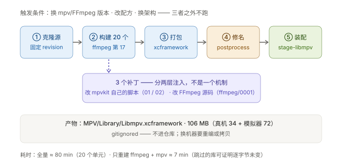

# K2 · 构建面：那 106 MB 是怎么造出来的

> **结论先说**
>
> 那 106 MB **不是"编译我们的代码"来的**，而是**一次性生产出来的资产**：
> 把 **20 个 C/C++ 单元**（含 FFmpeg 与 mpv 自身）按依赖顺序编成机器码、打成一份 `xcframework`，
> 再由 `stage-libmpv.sh` 拷进仓库。
>
> **日常开发完全不碰这条管线** —— 只有三种情况才跑：
> ① 换 mpv / FFmpeg 版本 ② 改配方（补丁）③ 换架构或平台。产物本身 **gitignored**（不进仓库）。
>
> ⚠️ **两个必须记住的坑**（都真实踩过，都"看起来成功了"）：补丁**分两层**，而且**会静默失败**。



---

## 1 为什么必须自己造，不能拿现成的

| 选项 | 结果 |
| --- | --- |
| 用官方/第三方预编译的 mpv / FFmpeg | 它们通常是 **GPL 构建** ⇒ **传染整个 App** ⇒ 无法闭源上架 |
| 用系统 AVPlayer（唯一"干净"的路） | 是**黑盒**：拿不到帧、无法注入处理、格式支持窄（详见 `ksplayer-playbook/C-三种内核`，待写） |
| **自建 LGPL + 动态链接**（我们的选择） | ✅ 可闭源上架；✅ 全能；代价 = **这条管线要自己维护** |

**关键机制**：LGPL 允许"动态链接后闭源"，但要求**用户可替换库** ⇒
所以产物必须是**动态库（dylib）**，不能是静态库。
配方里的 `-Ddefault_library=shared` 就是干这件事（见 §4 的外层补丁 01）。
背景：[`docs/02`](../docs/02-自建播放器决策记录.md) 的 `B2` · [`docs/07`](../docs/07-P0-T5b验证报告.md)。

---

## 2 五个阶段

| # | 阶段 | 谁在做 | 产物 |
| --- | --- | --- | --- |
| ① | 克隆 MPVKit（**固定 revision**） | `build.sh` | `/tmp/p0t5b-build/mpvkit`（一次性工作区） |
| ② | 构建 20 个单元 | MPVKit 的 Swift 脚本（`swift run … build platform=ios`） | `dist/FFmpeg/` · `dist/libmpv-*/` … |
| ③ | 打包 | MPVKit | `dist/release/xcframework/Libmpv.xcframework` |
| ④ | **修 `install_name`** | `postprocess-framework.sh` | 把库内的自引用路径改成 `@rpath/…` |
| ⑤ | 装配 | `Tools/stage-libmpv.sh` | `MPV/Library/Libmpv.xcframework`（106 MB） |

⚠️ **④ 和 ⑤ 是两步，容易漏**：漏了 ④ 的症状极其阴险 —— **真机启动即崩、模拟器一切正常**（`P-081`）。
原因见 §7。

---

## 3 二十个单元与它们的顺序

`main.swift` 里按这个顺序 `buildALL()`：

```
1 OpenSSL  2 Gmp   3 Nettle  4 Gnutls   5 Unibreak  6 Freetype  7 Fribidi
8 Harfbuzz 9 ASS  10 Smbclient 11 Bluray 12 Dovi   13 Vulkan  14 Shaderc
15 LittleCms 16 Placebo  17 FFMPEG  18 Uchardet  19 LuaJIT  20 MPV
```

**"第几个"是什么**：`main.swift` 里有一串顺序调用，**一行一个单元**，那个行序就是编号。
它**不是重要性排序**，而是**拓扑序** —— 后面的要用前面已经编好的东西。
自己看：`grep -n "try Build" Sources/BuildScripts/XCFrameworkBuild/main.swift`

⚠️ **序号 ≠ 依赖数量**：第 17 的 FFmpeg 并不依赖前面全部 16 个（`Smbclient` / `Bluray` / `Dovi` / `OpenSSL` 与它无关）。
顺序只是**保守的充分条件**（保证"不会用到还没编好的东西"），**不等于精确依赖图**。
要精确依赖就看两处：`BuildFFMPEG.dependencies`（声明式，已被配方 01 改成 `[]`）与 configure 的 `--enable-*`（实际链接）。

**顺序即依赖拓扑**：

| 单元 | 为什么在这个位置 |
| --- | --- |
| **FFMPEG（第 17）** | 它要用到前面的 libplacebo（16）· vulkan（13）· freetype（6）· harfbuzz（8）· ass（9）· lcms（15） |
| **MPV（第 20，最后）** | 它要用前面**几乎每一个**；mpv 自己也要通过 meson 构建 |
| OpenSSL / Gmp / Nettle / Gnutls（1–4） | **仍然会被构建**，但我们的配方已经把 `gnutls/nettle/gmp` 从 FFmpeg 的依赖里摘掉了（因为 TLS 改走 SecureTransport）⇒ 它们编出来但**不参与链接** |

> 记住这一点：**"在构建列表里" ≠ "在最终产物里被用到"**。
> 判定"产物有什么"的唯一依据永远是**产物符号表**（同 [`K8`](K8-多格式播放的原理.md) §5）。

---

## 4 ⭐ 补丁分两层 —— 这是一个容易搞混的结构


| 层 | 补丁 | 改的是**谁** | 内容 | 谁负责应用 |
| --- | --- | --- | --- | --- |
| **外层** | `01-build-changes.patch` | **MPVKit 自己的构建脚本** | ① `-Ddefault_library=shared`（动态化）② 把 gnutls/nettle/gmp 从 FFmpeg 依赖里摘掉（压回 LGPL） | `build.sh` 用 `git apply`（幂等：已应用的会 `--check` 挡下） |
| **外层** | `02-build-env-passthrough.patch` | MPVKit 自己的构建脚本 | 让子进程继承 `WGETRC`（MITM 代理下 `wget` 要跳证书校验） | 同上 |
| **内层** | `ffmpeg/0001-videotoolbox-metal-compatibility.patch` | **FFmpeg 的源码** | 像素缓冲的兼容性标记从 OpenGLES 换成 **MetalCompatibility** | **MPVKit**（它会 `git apply` 自己 `patch/<依赖名>/*.patch` 目录里的东西） |

**怎么一眼分辨**：`patch` 文件里的路径——
- 改 `Sources/BuildScripts/...` ⇒ **外层**（改工厂）
- 改 `libavcodec/...` / `libavformat/...` ⇒ **内层**（改原料）

---

## 5 ⭐⭐ 补丁会**静默失败**（两个真实教训）

### 5.1 `P-078`：产物里有、配方里没有

FFmpeg 源码树里躺着一处**未提交改动**（`libavcodec/videotoolbox.c` 的 Metal 兼容性），
而**配方里没有它**。危险在于 MPVKit 的清理动作：

```swift
// 只有补丁目录存在时，才会先 git checkout . 把源码树还原
if <补丁目录存在> { git checkout . }
```

⇒ **"给 FFmpeg 加补丁目录"这个动作本身，就会把这处本地改动悄悄清掉。**
所以必须**先把它固化成补丁文件**（就是现在的 `ffmpeg/0001-…`）。

判据（符号级，不能只看"我传了补丁"）：

```bash
nm -u <产物>/Libmpv | grep -c kCVPixelBufferMetalCompatibilityKey   # 必须 ≥ 1
nm -u <产物>/Libmpv | grep -c kCVPixelBufferOpenGLESCompatibilityKey # 必须是 0
```

### 5.2 `P-079`：嵌套补丁

第一版把 FFmpeg 补丁**套在外层 git patch 里**送进 MPVKit。结果：

- 外层 0001 应用成功 ✅
- 内层 0002 **悄悄没上** ❌ —— 因为外层 patch 会把内层里"只有空格的上下文行"弄坏，
  而 MPVKit 那边是 `try!` 调用 ⇒ **失败不抛异常、不报错**

**修法**：`build.sh` 直接 `cp` 补丁文件进 MPVKit 的补丁目录，并在日志里打 `copied N`。
**判据**：构建日志里必须出现 `copied 1 ffmpeg patch(es)`。

---

## 6 产物形态

```
MPV/Library/Libmpv.xcframework/
├── Info.plist
├── ios-arm64/                    ← 真机切片 34 MB
│   └── Libmpv.framework/Libmpv   （动态库）
└── ios-arm64_x86_64-simulator/   ← 模拟器切片 72 MB
    └── Libmpv.framework/Libmpv
```

| 问题 | 答案 |
| --- | --- |
| 为什么两个切片？ | 真机是 arm64，模拟器在 Apple Silicon 上要 arm64 + x86_64 两个架构 ⇒ 打包成一个 `xcframework` 让 Xcode 自动挑 |
| 为什么模拟器切片更大？ | 它含**两个架构**（arm64 + x86_64），真机只有一个 |
| 为什么是 dylib 不是静态库？ | LGPL 的"用户可替换"要求（§1） |
| 它有多大？ | **106 MB**（对比：我们自写的 Swift 共 5303 行） |
| 进仓库吗？ | ❌ **不进**（`.gitignore` 里 `MPV/Library/*.xcframework/`） |

---

## 7 ④ 修名 与 ⑤ 装配

### 7.1 `postprocess-framework.sh`：把 `install_name` 改成 `@rpath`

动态库内部会记录"我是谁"（`install_name`）。构建时它指向构建树（`/private/tmp/.../libmpv.2.dylib`）。

**漏跑这一步的症状**（`P-081`）：

| 环境 | 表现 | 原因 |
| --- | --- | --- |
| **模拟器** | ✅ 一切正常 | 那个 `/private/tmp/...` 路径**在宿主机上真的存在**（同一台机器）⇒ 它真能加载到 |
| **真机** | ❌ **启动即崩** | 手机上根本没有那个路径 |

⇒ 一条**理由错误的绿灯**。判据：

```bash
otool -D MPV/Library/Libmpv.xcframework/ios-arm64/Libmpv.framework/Libmpv
# 必须是 @rpath/Libmpv.framework/Libmpv
```

### 7.2 `Tools/stage-libmpv.sh`

把 `dist/release/xcframework/Libmpv.xcframework` 拷进 `MPV/Library/`。
它**不做任何改造**，就是搬运 —— 但它是"构建树 → 仓库"的唯一边界：
**产物永远从构建树来，仓库里的那份是拷贝。**

---

## 8 什么时候必须重建

| 场景 | 要改什么 | 跑什么 | 耗时 |
| --- | --- | --- | --- |
| 换 mpv / FFmpeg 版本 | MPVKit 的 revision 或 FFmpeg 版本号 | 全流程 | **≈ 80 min**（全量 20 个单元） |
| 改配方（补丁） | `spike/…/*.patch` 或 `ffmpeg/*.patch` | ①+②+④+⑤ | 只重建 ffmpeg + mpv ≈ **7 min**（见 §9） |
| 换架构 / 平台（如加 macOS 切片） | 配方里的 `platform=` | 全流程 | 新增平台的构建时间 |
| **日常改 Swift 代码** | — | **`swift build`** | **≈ 10 s**（只链接现成产物，不碰 C） |

---

## 9 省时间：只跑需要的单元（**有前提**）

MPVKit 的入口是按顺序调 20 个 `buildALL()`。临时把其余注释掉，只留 `BuildFFMPEG` + `BuildMPV` ⇒ 80 min → 7 min。

**但必须证明"跳过的库没有变"**，否则省下来的时间会以"产物不一致"的形式还回来：

```bash
# 构建前存指纹
find dist -path "*ios*" -type f \( -name "*.a" -o -name "lib*" \) | sort | xargs shasum > /tmp/before.txt
# 构建后再存一次，逐字节比对
diff -q /tmp/before.txt /tmp/after.txt && echo "105 个文件逐字节相同 ⇒ 等价"
```

⚠️ 用完**记得还原** `main.swift`（否则下次重建会"看起来成功但少了依赖重建"）。

---

## 10 自己验一遍

```bash
cd /Users/tango/Developments/playerlearning

# 完整重建（需要代理/网络 + wget，见 docs/05）
WORK=/tmp/p0t5b-build spike/p0-t5b-lgpl-dynamic-build/build.sh   # ② 构建
WORK=/tmp/p0t5b-build spike/p0-t5b-lgpl-dynamic-build/postprocess-framework.sh   # ④ 修名
./Tools/stage-libmpv.sh                                          # ⑤ 装配

# 三项产物级必核
nm -u  MPV/Library/Libmpv.xcframework/ios-arm64/Libmpv.framework/Libmpv | grep -c kCVPixelBufferMetalCompatibilityKey
otool -D MPV/Library/Libmpv.xcframework/ios-arm64/Libmpv.framework/Libmpv
du -sh MPV/Library/Libmpv.xcframework
```

---

## 11 术语表

| 术语 | 一句话 |
| --- | --- |
| **MPVKit** | 一套 Swift 写的构建工程，把 20 个 C/C++ 库按依赖顺序编成一份 `xcframework` |
| **revision** | MPVKit 被锁定在某个 git 提交上（可复现的关键） |
| **单元 / builder** | 构建管线里的一个库；`main.swift` 里有 20 个 |
| **补丁（patch）** | 对上游源码的改动。本项目**分两层**：改工厂 vs 改原料 |
| **`install_name`** | 动态库内记录的"我自己的路径"；必须指向 `@rpath` 才能在设备上加载 |
| **xcframework** | 把多平台/多架构的二进制打成一个包的格式 |
| **stage（装配）** | 把构建产物拷进仓库的动作（产物本身不入 git） |
| **GPL / LGPL** | 许可证。GPL 传染 App ⇒ 不能闭源；LGPL 允许动态链接后闭源 |
