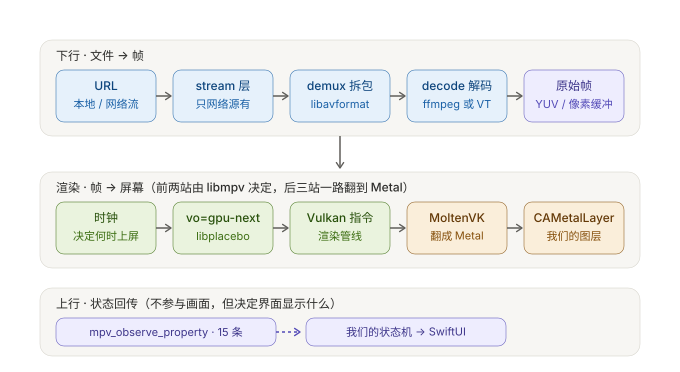
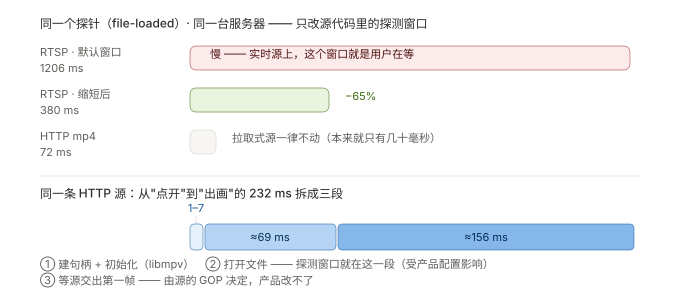

# K3 · 运行面：一帧像素的旅程

> **结论先说**
>
> 数据从 URL 到屏幕要过 **8 站**，分成三段：
> **下行（拆 + 解）→ 渲染（时钟 + 画）→ 上行（状态回传）**。
>
> 其中**只有第 1 站（URL）和第 8 站（我们的图层）是我们能直接看见的**，中间 6 站全在 libmpv 内部。
>
> 理解这条链的真正价值在于**排障**：每一站出问题，症状完全不同 ——
> 拆不了 = "打不开"；解不了 = 黑屏但有声；时钟乱 = 音画不同步；渲染错 = 花屏；
> 状态不回 = 界面不动。**症状定位站，站定位代码。**



---

## 1 八站逐站

| 站 | 干什么 | 谁负责 | 出问题的症状 | 我们能干预吗 |
| --- | --- | --- | --- | --- |
| **① URL** | 一个地址：本地文件 / HTTP / HLS / RTSP | 我们传给 mpv | 打不开（地址/权限/网络） | ✅ 完全 |
| **② stream 层** | 把"地址"变成"字节流" | libmpv（**只网络源有**） | 连不上、超时、证书被拒 | ✅ 通过选项（超时/TLS/请求头） |
| **③ demux 拆包** | 字节流 → 视频包 / 音频包 / 字幕包 | FFmpeg `libavformat` | "不支持的格式" | ⚠️ 只能靠**产物白名单**（改配方） |
| **④ decode 解码** | 压缩包 → 原始帧（YUV / PCM） | FFmpeg `libavcodec` 或 **VideoToolbox** | 黑屏但有声 / 有声无画 | ⚠️ 同上 + 硬解开关 |
| **⑤ 原始帧** | 解码结果，等待上屏 | libmpv 内部队列 | 画面滞后 / 丢帧 | ❌（内部） |
| **⑥ 时钟** | **决定第几帧在第几毫秒上屏** | libmpv 核心 | 音画不同步、seek 后位置乱 | ⚠️ 少数选项 |
| **⑦ vo + 渲染** | 缩放 / 色调映射 / 抖动 → 图形指令 | `vo=gpu-next` + libplacebo | 花屏、颜色不对、比例不对 | ⚠️ 通过 `vo` / `gpu-*` |
| **⑧ 上屏** | 图形指令 → 翻译 → 真 GPU → 我们的图层 | MoltenVK → Metal → `CAMetalLayer` | 全黑 / 崩溃 | ✅ 图层是我们建的 |

**一句话总结这条链的意义**：`FFmpeg` 能解码，但**它不会"等"** —— 让画面按正确时间出、让声画不脱节、
让 seek 之后从对的地方继续，全靠**第 ⑥ 站的时钟**。这是 mpv 存在的全部理由，也是我们**不自己拼 FFmpeg** 的原因。

---

## 2 我们设的 18 个选项 —— 按四个抽屉分（iOS 上实际生效的）

代码在 `MPV/Sources/PlayerMPV/MPVKernel.swift`（另有 2 处是互斥分支的另一侧，共 20 处调用）。

### 抽屉 A · 画面输出（4 条）

| 选项 | 值 | 不这么设会怎样 |
| --- | --- | --- |
| `vo` | `gpu-next` | 用旧渲染器：HDR 映射差、缩放质量低 |
| `gpu-api` | `vulkan` | 无法配合 libplacebo |
| `gpu-context` | `moltenvk` | iOS 上没有原生 Vulkan 驱动 |
| `hwdec` | `videotoolbox` | 退回 CPU 软解：耗电、发热、4K 可能跑不动 |

### 抽屉 B · 播放语义（3 条）

| 选项 | 值 | 作用 |
| --- | --- | --- |
| `keep-open` | `yes` | 播完**停在最后一帧**，而不是空白/关闭 |
| `idle` | `yes` | 没有文件时也保持实例活着（否则句柄会退） |
| `terminal` | `no` | 不接管终端输入（库形态必须） |

### 抽屉 C · 网络（5 条）

| 选项 | 值 | 作用 |
| --- | --- | --- |
| `http-header-fields` | 动态 | 注入自定义请求头（`P5-T4` 验过真的到了服务器） |
| `user-agent` | 动态 | 有些服务端按 UA 返回不同内容 |
| `network-timeout` | `30` | 太短会在弱网误判断流；太长则"打不开"迟迟不报错 |
| `tls-verify` | `yes` | ⭐ **一行决定 HTTPS 到底校不校验证书**（见 [`K5`](K5-网络面-直播与HTTPS.md)） |
| `demuxer-lavf-analyzeduration` | `0.2`（**只实时源**） | 不加这条：RTSP 起播要等 1.1 s（见 §6） |

### 抽屉 D · 缓存与缓冲（6 条）

| 选项 | 值 | 作用 |
| --- | --- | --- |
| `cache` | `yes` | 开流缓存 |
| `cache-secs` | `1` | ⭐ **直播落后量的主因**（不设 = mpv 默认 10 s） |
| `cache-pause-initial` | `no` | 不在起播时先攒满 |
| `cache-pause-wait` | `3` | "卡住多久算缓不过来"的阈值 |
| `demuxer-max-bytes` | `64MiB` | 前向缓冲上限 |
| `demuxer-max-back-bytes` | `16MiB` | 回退缓冲上限（seek 回看要用） |

⚠️ 这四组不是"参数清单"，而是**四个不同的问题域**。调参前先问"我要修的是哪个抽屉的问题"。

---

## 3 上行：15 条观测项 → 我们的状态机

libmpv 用 `mpv_observe_property` 注册"这些属性变了就告诉我"。15 条分四类：

| 类 | 属性 | 变成什么 |
| --- | --- | --- |
| 时间 | `time-pos` · `duration` · `eof-reached` | 进度条 / 时间显示 / `.finished` |
| 播放 | `pause` · `paused-for-cache` | 播放态 / 缓冲提示 |
| 画面 | `width` · `height` · `vo-configured` | 视频尺寸 / **"出画了"** |
| 轨道 | `track-list/count` · `vid` · `sid` · `sub-visibility` · `sub-delay` · `audio-params/samplerate` · `audio-out-params/samplerate` | 字幕菜单 / 清晰度菜单 / 音轨信息 |

**为什么要有"上行"这一路**：mpv 是**状态的唯一真相**。界面不许自己"乐观改"状态 ——
比如点了清晰度按钮，**不能立刻把菜单勾选改掉**，要等 `vid` 真正变化回传上来
（`P5-T5` 的测试里专门有一条"不本地乐观改状态"）。

⚠️ 有个坑值得记：`pause` 是**全局属性**，mpv 会在与播放无关的时机把它重置为 `no`
⇒ 直接读会得到假状态（`.failed` 被盖成 `.playing`，就是 `P-045` / `P-071` 那个问题）。
现在的做法是**两道判据都过才上报**：① 播放列表非空 ② 当前状态本来就可解读。

---

## 4 我们的图层是怎么被 mpv 画上的（`wid` 嵌入）

```
我们的 SwiftUI 视图
   └── WindowEmbedOutput（一个 CAMetalLayer 的宿主）
         └── 把这个 layer 的指针（wid）交给 mpv
               └── mpv 自己建 GPU 上下文、自己往这个 layer 上画
```

| 点 | 说明 |
| --- | --- |
| **优点** | 极简：我们不需要管渲染循环、色彩管理、GPU 上下文 |
| **代价** | ⭐ **我们看不到帧** —— 画面是 mpv 直接画上去的，不经过我们 |
| **后果** | 任何"要对画面做处理"的需求（如 2D→3D），都必须换到 **render API**（见 [`K6`](K6-浏览器在线视频-怎么变成可处理的帧.md)） |

这条是架构级的分界线，值得单独记住。

---

## 5 网络源多出来的那一站（②）

本地文件从 ① 直接到 ③；网络源要经过 **stream 层**：

| 源类型 | stream 层做什么 | 关键点 |
| --- | --- | --- |
| HTTP(S) | 请求 + Range | 需要服务器支持 Range（`P-052`：`python -m http.server` 不支持） |
| HLS | 反复重载 playlist + 取分片 | 判"是否直播"要看 playlist 有没有 `#EXT-X-ENDLIST`（见 [`K5`](K5-网络面-直播与HTTPS.md)） |
| RTSP / RTMP | 长连接、实时投递 | `analyzeduration` 窗口 = 用户等待（§6） |

---

## 6 一个具体例子：为什么实时源要缩短"探测窗口"

- lavf 在返回流信息前要"读够一段媒体"。**拉取式源**（HTTP 文件）这段几乎不花时间（57–81 ms）。
- **实时投递源**（RTSP）这段就是**墙钟**：源每秒只给 1 秒数据 ⇒ 读"固定时长的媒体"变成"固定等待"。
  实测默认窗口让 `file-loaded` 花 **1131–1206 ms**；缩到 0.2 s 后变成 **336–380 ms**。
- ⇒ 这就是 `demuxer-lavf-analyzeduration` 只对实时源设的原因（见 [`docs/17`](../docs/17-P6-T4-起播延迟.md)）。

---

## 7 起播时间线（我们埋的 8 个点）



| 节点 | 含义 |
| --- | --- |
| `load-entered` | `load()` 被调用 |
| `handle-created` | `mpv_create()` 完成 |
| `options-applied` | 20 个选项设完 |
| `initialized` | `mpv_initialize()` 返回 |
| `loadfile-sent` | `loadfile` 命令发出 |
| `file-loaded` | **文件已打开、流信息已读出** |
| `vo-configured` | **出画**（这才是用户感知的"画面来了"） |
| `playing` | mpv 上报 `.playing` |

**两个反直觉的事实**（都实测过）：

1. **"内核说在播"比"文件打开"还早** —— 修复前 `playing` 落在 2 ms，而 `file-loaded` 在 57–1200 ms。
   ⇒ 所以**指标要用 `vo-configured` 而不是 `playing`**（[`docs/17`](../docs/17-P6-T4-起播延迟.md)）。
2. **建句柄 + 初始化只要 1–7 ms** —— 曾经以为"起播慢是因为 mpv 初始化/管线编译"，实测被推翻。

---

## 8 自己验一遍

```bash
# ① 看状态流（每秒一行，最常用）
xcrun simctl launch --console-pty <UDID> com.playerstack.demo -- -directURL <url>
#   ⇒ [status] 3.00 state=playing t=1.02/52.21 progress=0.020 buffering=false 音频 48000/48000 Hz 清晰度=…

# ② 看起播分解（每次 load 打一行）
#   ⇒ [startup] file-loaded 380.2 ms  vo-configured 536.4 ms  playing 536.5 ms …

# ③ 看内核内部日志
#   ⚠️ -traceUpdates 会打开 mpv verbose ⇒ 会把 devicectl --console 在第 2 秒打爆（P-058）
#      要长期观察请只用 ① ②
```

---

## 9 术语表

| 术语 | 一句话 |
| --- | --- |
| **stream 层** | 把"地址"变成"字节流"的那一层（HTTP / HLS / RTSP 都在这里） |
| **vo / video output** | mpv 的"画面输出端" |
| **gpu-next** | mpv 的新一代 GPU 渲染管线（基于 libplacebo） |
| **libplacebo** | 高质量 GPU 渲染库：HDR 映射、缩放、去色带 |
| **moltenvk** | 让 Vulkan 程序跑在 Metal 上的翻译层 |
| **hwdec** | 硬件解码开关；`videotoolbox` = 用苹果的解码单元 |
| **CVPixelBuffer** | 苹果的图像容器；硬解产出的就是它 |
| **wid** | window id：把我们的图层指针交给 mpv，让它自己往上画 |
| **render API** | 另一条路：由我们驱动渲染、自己拿帧（**当前未使用**） |
| **analyzeduration** | 解复用器"读多久才算看清流信息"的窗口 |
| **GOP** | 一组帧（两个关键帧之间的距离）；直播出画要等下一个关键帧 |
