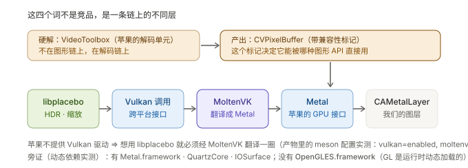
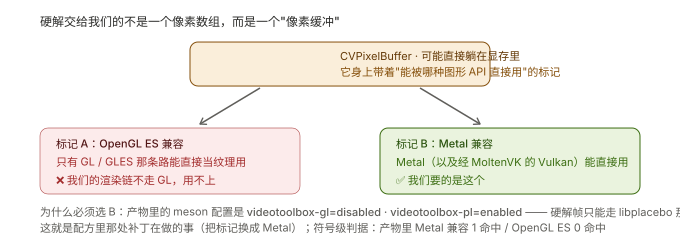

# K4 · 图形栈：Metal / Vulkan / OpenGL ES / 硬解

> **结论先说**
>
> 这四个词**不是竞品，是一条链上的不同层**：
>
> | 名字 | 它是什么 |
> | --- | --- |
> | **Metal** | 苹果的 GPU 接口（系统唯一的现代底层） |
> | **Vulkan** | 新一代跨平台 GPU 接口 —— **苹果不提供驱动**，所以只能"翻译" |
> | **MoltenVK** | 那个翻译层：Vulkan 调用 → Metal 调用 |
> | **VideoToolbox** | **硬件解码器** —— 它**不在图形链上，在解码链上**；但它的产出要汇入图形链 |
> | **OpenGL / OpenGL ES** | 上一代接口（苹果已废弃，但本项目里还有两处保留） |
>
> 我们的链路：**`libplacebo → Vulkan 调用 → MoltenVK → Metal → 我们的 CAMetalLayer`**
>
> 一句话记住它们的关系：**libplacebo 只会说 Vulkan，苹果只听得懂 Metal，中间必须有翻译。**



---

## 1 Apple 图形 API 谱系

| API | 谁家的 | 状态 | 在 iOS 上 |
| --- | --- | --- | --- |
| **OpenGL / OpenGL ES** | Khronos（跨平台） | **已废弃**（Apple 自 iOS 12 起标记 deprecated） | ⚠️ 可用但不推荐 |
| **Metal** | 苹果自家 | **现代、唯一推荐** | ✅ 系统底层 |
| **Vulkan** | Khronos（跨平台） | 现代、性能好 | ❌ **苹果不提供驱动** |
| **MoltenVK** | 第三方（Khronos 赞助） | 活跃 | ✅ 翻译层，把 Vulkan 变成 Metal |

⇒ 结论：**在 iOS 上想用 Vulkan，唯一的路是 MoltenVK。**

---

## 2 为什么我们**必须**绕这一圈

因为渲染算法那一层是 **libplacebo**（mpv 的 `gpu-next` 管线），而 **libplacebo 需要 Vulkan**。

所以链路被迫变成：`libplacebo（只会 Vulkan）→ MoltenVK（翻译）→ Metal（苹果只认这个）`。

**有没有不绕路的选项？** 有 —— mpv 支持 `gpu-api=opengl`（直接走 GLES）。
但我们**没有**选它：`gpu-next` + libplacebo 是 mpv 里画质最好的那条路（HDR 色调映射、高质量缩放），
而它恰好要 Vulkan。这是一个**画质 vs 绕路**的取舍，我们选了画质。

---

## 3 产物里的实证（别只看配置，看二进制）

### 3.1 产物自带它的构建配置（一条命令读出来）

```bash
strings Libmpv | grep -m1 "^Configuration: -Dlibmpv=true"
```

读出来的关键项：

| 配置项 | 值 | 含义 |
| --- | --- | --- |
| `-Dvulkan=enabled` | ✅ | 编译进 Vulkan 支持 |
| `-Dmoltenvk=enabled` | ✅ | 编译进 MoltenVK 翻译层 |
| `-Dgl=enabled` · `-Dplain-gl=enabled` · `-Dios-gl=enabled` | ✅ | GL/GLES 也编进去了（**可能被动态加载**） |
| **`-Dvideotoolbox-gl=disabled`** | ❌ | **硬解帧不走 GL 那条路** |
| **`-Dvideotoolbox-pl=enabled`** | ✅ | **硬解帧走 libplacebo 那条路** ← §4 的关键 |
| `-Dgpl=false` · `-Dcplayer=false` | — | 无 GPL · 无命令行播放器（印证"是库"） |

> ⭐ 最后两行是理解 §4 那把钥匙：**硬解出来的帧，被要求走 libplacebo（Vulkan/Metal）而不是 GL。**

### 3.2 动态依赖（`otool -L`）—— 22 条

| 类别 | 框架 |
| --- | --- |
| **图形** | **Metal** · **QuartzCore**（`CAMetalLayer` 在这里）· **IOSurface**（GPU 共享缓冲） |
| **媒体** | VideoToolbox · CoreMedia · **CoreVideo**（`CVPixelBuffer` 在这里）· AVFoundation · AVFAudio · AudioToolbox |
| **系统** | Foundation · CoreFoundation · CoreGraphics · CoreText · UIKit · Security · libc++ · libobjc · libz · libiconv · libxml2 |

⚠️ **注意：表里没有 OpenGLES.framework** —— 但 mpv 明明把 GL 编进去了。两者不矛盾：
产物里同时有 `libdl`（动态加载能力）⇒ **GL 是运行时按需加载的**。
这条提醒我们：**"链接依赖里没有" ≠ "用不到"**。

### 3.3 符号面的三个计数

```bash
nm -gU Libmpv | grep -cE "_vk[A-Z]"                    # → 428（Vulkan 实现）
strings Libmpv | grep -icE "moltenvk|mvk"              # → 128（MoltenVK 痕迹）
nm -u  Libmpv | grep -c kCVPixelBufferMetalCompatibilityKey  # → 1（见 §4）
```

---

## 4 ⭐ 硬解那一站：`CVPixelBuffer` 与"兼容性标记"



### 4.1 硬解交给我们的不是像素数组

VideoToolbox 解码出来的东西叫 **`CVPixelBuffer`**（苹果的图像容器）。它可以：
- 直接躺在**显存**里（通过 IOSurface）⇒ 不需要 CPU 拷贝；
- 并且身上带着**兼容性标记**，说明"能被哪种图形 API 直接当纹理用"：

| 标记 | 谁能直接用 |
| --- | --- |
| `kCVPixelBufferOpenGLESCompatibilityKey` | GL / GLES |
| **`kCVPixelBufferMetalCompatibilityKey`** | **Metal**（以及经 MoltenVK 的 Vulkan） |

### 4.2 所以那处补丁是在堵什么洞

§3.1 已经说清：我们的配置是 **`videotoolbox-pl=enabled`** —— 硬解帧要走 libplacebo，
而 libplacebo 最终落到 **Metal** 上。
⇒ 那么这帧**必须**带 **Metal 兼容标记**，否则接不上。

**配方里那处 FFmpeg 补丁**（`ffmpeg/0001-videotoolbox-metal-compatibility.patch`）干的就是这件事：
把像素缓冲的标记从 OpenGL ES 换成 **Metal**。

**符号级判据**（不能只看"我打了补丁"，见 [`K2`](K2-构建面-产物是怎么造出来的.md) §5）：

```bash
nm -u Libmpv | grep -c kCVPixelBufferMetalCompatibilityKey        # → 1  ✅
nm -u Libmpv | grep -c kCVPixelBufferOpenGLESCompatibilityKey    # → 0  ✅
```

### 4.3 ⚠️ 为什么这处补丁特别危险

它一开始**不在配方里**（是构建树上的一处本地改动），而 mpvkit 的清理逻辑"关在补丁目录存在"这个条件里
⇒ **创建补丁目录这个动作会把它清掉**（`P-078`）。
这正是"配方与产物必须对账"这条纪律的由来。

---

## 5 VideoToolbox 的两副面孔（一个"列表里有 ≠ 被用到"的例子）

`strings` 读出的 FFmpeg encoder 白名单里，赫然有：

```
--enable-encoder=h264_videotoolbox --enable-encoder=hevc_videotoolbox
--enable-encoder=prores_videotoolbox
```

⇒ 产物**具备硬件编码能力**。但**我们的产品从不编码** —— 这些永远不会被调用。
它们只是构建配方里"顺带开着"的东西。

同理，filters 白名单里有一批 `*_vulkan` 滤镜（`avgblur_vulkan` / `gblur_vulkan` / `nlmeans_vulkan`…），
我们也一个都没用。

> **这和 [`K8`](K8-多格式播放的原理.md) §5 是同一个道理**：能做什么（配置/符号）与在做什么（产品代码）是两件事。

---

## 6 如果换成 render API，图形栈会怎么变（延展 [`K6`](K6-浏览器在线视频-怎么变成可处理的帧.md) §3）

| | 现在的 `wid` 嵌入 | 换成 render API 之后 |
| --- | --- | --- |
| 渲染由谁驱动 | **mpv**（我们只给图层） | **我们**（要自己 `update` / `render`） |
| 图形栈 | `libplacebo → Vulkan → MoltenVK → Metal` | **同一个管线**，只是我们插在末端拿帧 |
| **可用后端** | 不受限（mpv 自己选） | ⚠️ 只有 **`opengl`** / **`software`**（`vulkan` / `d3d11` 未必可用于 render API） |
| 帧的形态 | 我们看不到 | GLES 纹理（opengl）或 CPU 像素（software） |

⚠️ **这里有个真问题**：render API 没有 `metal` 后端 ⇒ 拿到的是 **GLES 纹理**，
而我们的图层是 **Metal** ⇒ **GLES 纹理 → Metal 的桥接需要实测**（IOSurface 是候选路径）。
这条已登记为 [`K6`](K6-浏览器在线视频-怎么变成可处理的帧.md) §7 的待验项。

---

## 7 自己验一遍

```bash
B=MPV/Library/Libmpv.xcframework/ios-arm64/Libmpv.framework/Libmpv

# ① 产物自带的构建配置（最有信息量的一条）
strings "$B" | grep -m1 "^Configuration: -Dlibmpv=true" | tr ' ' '\n' | grep -E "^-D"

# ② 动态依赖：有哪些系统框架
otool -L "$B"

# ③ 图形相关符号
nm -gU "$B" | grep -cE "_vk[A-Z]"                              # Vulkan
strings "$B" | grep -icE "moltenvk|mvk"                        # MoltenVK
nm -u  "$B" | grep -c kCVPixelBufferMetalCompatibilityKey      # 兼容性标记
```

---

## 8 术语表

| 术语 | 一句话 |
| --- | --- |
| **Metal** | 苹果的现代 GPU 接口（系统底层，唯一推荐） |
| **OpenGL ES** | 上一代跨平台 GPU 接口；苹果已废弃 |
| **Vulkan** | 新一代跨平台 GPU 接口；**苹果不提供驱动** |
| **MoltenVK** | 把 Vulkan 调用翻译成 Metal 的层 |
| **libplacebo** | 高质量 GPU 渲染库（`gpu-next` 的核心）；**只会说 Vulkan** |
| **VideoToolbox** | 苹果的硬件编解码框架 |
| **`CVPixelBuffer`** | 苹果的图像容器；硬解产出它就是它 |
| **IOSurface** | 跨框架共享显存缓冲（CPU/GPU、GL/Metal 之间常走它） |
| **兼容性标记** | 附着在像素缓冲上，声明"能被哪种图形 API 直接当纹理用" |
| **`wid` 嵌入** | 把图层指针交给 mpv、由它自己画（**当前方式**） |
| **render API** | 由我们驱动渲染、mpv 把帧交给我们（**要拿帧就得换到它**） |
