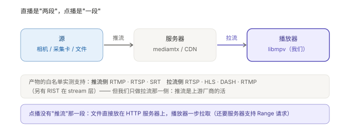
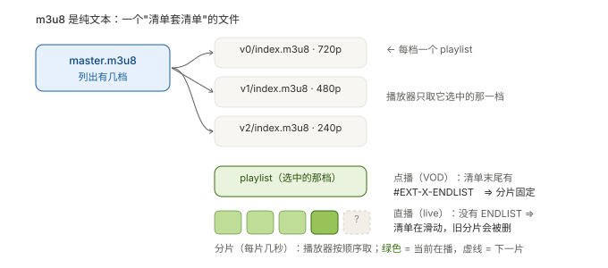
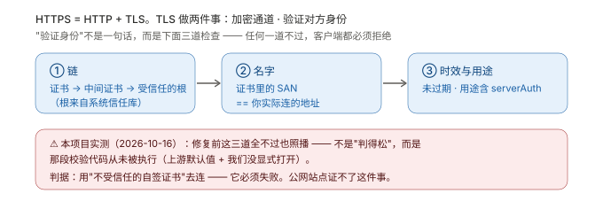

# K5 · 网络面：直播与 HTTPS

> **结论先说**
>
> 网络这条线只在 [`K3`](K3-运行面-一帧像素的旅程.md) 的**第 ② 站（stream 层）**起作用 ——
> 但它是"一切网络问题的现场"。它由两件**互不相关**的事组成：
>
> | | 内容 |
> | --- | --- |
> | **投递方式** | 推流 / 拉流 + 协议：RTSP · RTMP · HLS · DASH · SRT |
> | **传输安全** | HTTPS = HTTP + TLS；而 TLS 的"验证身份"是**三道检查**，不是一句话 |
>
> 而这两件共享**同一条教训**：**"参数设了" ≠ "它在生效"**、**"能播" ≠ "对"**。
> 本项目在这两点上各栽过一次，也都留下了判据（§5、§6）。



---

## 1 推流与拉流：先分清方向

| 词 | 方向 | 谁在做 | 我们的关系 |
| --- | --- | --- | --- |
| **推流（publish / push）** | 源 → 服务器 | **上游**（相机、采集卡、ffmpeg） | ❌ **我们不做**。造源时用 `ffmpeg -re` 推，那只是**验证环境** |
| **拉流（play / pull）** | 服务器 → 播放器 | **我们**（libmpv） | ✅ 这是产品的能力边界 |

**点播没有"推流"那一段**：文件直接放在 HTTP 服务器上，播放器一步拉取。
⚠️ 但要求服务器**支持 Range 请求** —— 不支持的症状很怪：mp4 会"14 毫秒就播完"，
看起来像产品坏了（`P-052`：`python -m http.server` 就不支持）。

---

## 2 协议谱系：延迟与兼容性的取舍

没有"最好的协议"，只有"这一场景下可接受的取舍"。

| 协议 | 跑在什么上 | 延迟量级 | 典型用途 | 产物支持 |
| --- | --- | --- | --- | --- |
| **RTSP** | TCP/UDP 长连接 | **低**（亚秒级） | 监控、局域网直播 | ✅ `rtsp` demuxer + stream 层 |
| **RTMP** | TCP 长连接 | 低（1–3 s） | **推流**主流；播放已过时 | ✅ 走 `flv` / `live_flv` demuxer |
| **HLS** | **HTTP + 分片** | 高（3–30 s） | **兼容性最好**，CDN 友好 | ✅ `hls` demuxer |
| **DASH** | HTTP + 分片 | 高 | HLS 的"标准版" | ✅ `dash` demuxer |
| **LL-HLS / LL-DASH** | 同上，但**把分片再切碎**（partial segment）+ playlist 请求**阻塞等新分片** | **低（1–3 s）** | 网页直播 / 需要低延迟又要兼容性 | ⚠️ 走**同一个 demuxer**（协议没变，变的是服务端怎么发）；**能否真降下来取决于服务端**（未实测） |
| **SRT** | UDP + 重传 | 中低 | 跨国/弱网传输 | ✅ `srt` demuxer |
| **RIST** | UDP | 中低 | 广电 | ✅ stream 层有（未实测） |

判断口径：**HLS/DASH 是"用延迟换兼容性"** —— 因为它跑在普通 HTTP 上，
任何 CDN、任何防火墙都不会拦它；代价是必须攒够分片。

⚠️ 表里 HLS/DASH 那两行是**常规形态**的量级。低延迟变体（`LL-HLS` / `LL-DASH`）不做协议替换，
只是**把分片切得更碎、并允许"新分片还没切完就先发一半"**（partial segment）——
量级能压到 1–3 s，换来的是**请求数变多、对抖动更敏感**。
⇒ 选协议时先问"这个场景能接受几秒"，再问"要不要为此付低延迟的复杂度"。

---

## 3 m3u8：HLS 的清单文件



三个要点：

| 要点 | 说明 |
| --- | --- |
| **它是纯文本** | 里面就是路径列表，没有任何二进制（可以直接 `cat` 出来看） |
| **清单套清单** | `master.m3u8` 列出有几档 → 每档一个 `index.m3u8` → 每个 playlist 列出分片 |
| **多码率 = N 条 video track** | 这就是 [`P5-T5`](../docs/14-P5-T5-HLS多码率调研.md) 的结论：切清晰度在 mpv 眼里**不是换 URL**，而是设 `vid` |

**VOD 与 live 的唯一分界**：playlist 末尾有没有 `#EXT-X-ENDLIST`。

---

## 4 怎么判断"它真的是直播"

⭐ **判据在服务端，不在客户端** —— 因为客户端两种都是 `state=playing`，光看状态行分不出来。

| 判据 | 怎么看 |
| --- | --- |
| playlist 被**反复**请求 | 服务器日志里 `index.m3u8` 出现很多次（实测 ~20 次 / 42 s） |
| playlist 里**没有** `#EXT-X-ENDLIST` | `cat` 出来看 |
| 分片序号**递增** | 服务器日志里的 `seg059 → seg080` |

**实测（[`docs/19`](../docs/19-P6-T5-HLS直播源.md)）**：

| 现象 | 原因 |
| --- | --- |
| `duration` 随 `t` 一起涨 | live 下 `duration` = **滑动窗口的末端**，不是总时长 |
| **进度百分比没有意义**（实测恒在 0.9 以上、来回抖） | 因为分母在动 ⇒ 要不要为直播换一套时间轴呈现是**产品决策**（已登记，未动） |
| 落后于窗口**不会崩** | 限速到 200 KB/s（720p 档需要 ~362 KB/s）后，服务端 **0 次 404**，抓到的分片是 `105→106→107→109→113→115→…`（**中间跳过**）⇒ 播放器**只向前要数据，跟不上就丢内容追直播边缘** |

---

## 5 ⭐ 低延迟与抗抖动：一对不可兼得的东西

### 5.1 先把"落后量"切成三段（否则归因不到产品）

```
推流端已推的媒体时间 ────────────────────────────►
                    │← 服务端段 ─┤← 产品段 ─┤
                                              ▲ 播放器 t
```

| 段 | 怎么量 | 归谁 |
| --- | --- | --- |
| **服务端段** | `推流 out_time − 原生 ffmpeg 客户端的 out_time` | 造源环境（**完全不含我们的产品**） |
| **产品段** | `原生客户端 out_time − 我们播放器的 t` | **我们的产品** |

⚠️ 两个被测对象**必须同一时刻启动**，否则量到的是"启动时刻差"而不是落后量（`P-068`，真踩过）。

### 5.2 实测（真机 · 同条件）

| 配置 | 服务端段 | **产品段** | 总计 |
| --- | --- | --- | --- |
| 默认（`cache-secs` 未设 ⇒ mpv 对流默认 **10 s**） | 4350 ms | **4463 ms** | 8813 ms |
| `cache-secs=1` | 4342 ms | **2579 ms** | 6922 ms |
| ＋`cache-pause-initial=no` | 4415 ms | **1559 ms** | 5974 ms |

**服务端段三组几乎不动 ⇒ 改善可归因到产品。** 而**那 4.4 s 不在产品里** ——
原生 `ffmpeg` 当客户端也落后 4.3–4.5 s，推流改 UDP 也不变 ⇒ 排除"RTSP over TCP 推流缓冲"。
⚠️ **不去追它**（真实相机不会有这一层）—— 这正是 `P-052` 的纪律：**不把验证环境的固有缓冲当产品缺陷去调参**。

### 5.3 代价必须一起说

| 指标 | 默认 | 收紧后 |
| --- | --- | --- |
| 弱网下 `buffering` 翻转 | 0.148 次/s | **0.30 次/s**（约 2 倍） |

⇒ **低延迟是用"更容易被网络抖动打断"换来的。** 一组默认值能同时说清"换到了什么"和"付了什么"，
才算真的定下来（[`docs/16`](../docs/16-P6-T3-低延迟参数.md)）。

---

## 6 ⭐ HTTPS：为什么"设了参数"不等于"在生效"



### 6.1 我们踩的坑（一句话版）

这份产物**默认不校验证书**，而且**看起来像在校验**：

| 层 | 事实 |
| --- | --- |
| 上游默认值 | `mpv` 的 `--tls-verify` 在代码里**默认 `false`**（手册里**根本没写默认值**），且它**无条件**把这个值传给底层 ⇒ 底层直接放行 |
| 我们的处境 | 于是**不受信任的自签证书、甚至名字不匹配的证书，都能照播**（真机 + 模拟器实测） |
| 最危险的地方 | 症状是**"一切正常"** —— 没有任何报错、没有任何异常，**只是不安全** |

**修法就一行**：`setOption(handle, "tls-verify", "yes")`（[`docs/20`](../docs/20-P0-T5d-HTTPS校验修复.md)）。

### 6.2 怎么验这种"看不见的缺陷"

**判据必须能"要求它失败"**。四条正交探针：

| # | 场景 | 期望 |
| --- | --- | --- |
| ① | 明文 http 对照 | 能播（排除"连不上/路径错"） |
| ② | **根不受信任**的 HTTPS | **必须失败** |
| ③ | **名字不匹配**的证书 | **必须失败** |
| ④ | 把根装进信任库后的**同一个 URL** | **必须通过** |

④ 与 ② 只差"信任库里有没有那个根" ⇒ **证明系统信任库真的被查询了**。

⚠️ **不能用公网站点验这件事**：它的证书本来就受信任，只能证明"能播"，证明不了"不受信任时会拒"。
必须自造证书（自签 CA），而且要满足 iOS 的四项硬要求（SAN、用途含 `serverAuth`、RSA≥2048、有效期 ≤825 天）——
少一条会得到**另一种失败**，把结论带偏。

⚠️ 还有两条环境坑：**撤销信任用 `keychain reset` 并不生效**（`P-080`）；
**重装 App 会换数据容器路径**，放进去的测试文件会失效（`P-075`）。

---

## 7 网络问题的排障顺序（实用）

| 你看到的症状 | 先怀疑哪一站 | 怎么查 |
| --- | --- | --- |
| **立刻失败**（毫秒级） | 地址 / 权限 / 协议写错 | 对比同 URL 用 `curl` 能不能通（`P-056`：立刻失败 vs 超时失败是两种病） |
| 等很久才失败 | 网络 / 超时 / 证书 | 看 `network-timeout`；服务器侧有没有握手记录 |
| 能连上但打不开 | 容器 / 协议不匹配 | 换 `curl` 拉头部看；确认 demuxer 在白名单里（[`K8`](K8-多格式播放的原理.md) §5） |
| 能播但"14 ms 就播完" | 服务器**不支持 Range** | `curl -r 0-100` 看有没有 `206` |
| 播得动但一直落后 | 缓存深度（`cache-secs`） | §5 的三段切分 |
| 落后且越来越远 | 真的追不上（带宽不足） | 是不是"丢内容追边缘"（§4）—— 那是设计行为 |
| 时间轴/进度条很怪 | `duration` 语义（live vs VOD） | §4 |

---

## 8 自验命令

```bash
# 看服务器到底被请求了什么（判"是否直播"的判据在这里）
python3 Tools/serve-range.py --port 8770 --root <dir> --host 0.0.0.0     # 日志打在 stderr

# 造一条自己的 HTTPS 服务器（自签，用于"必须失败"那几条探针）
openssl req -x509 -newkey rsa:2048 -nodes -keyout ca.key -out ca.crt -days 2 \
  -subj "/CN=Test CA" -addext "basicConstraints=critical,CA:TRUE"
python3 Tools/serve-range.py --port 8443 --root <dir> --tls-cert server.crt --tls-key server.key

# 对照：会校验的客户端（同一个 TLS 后端）—— 它拒了才说明"该拒"
curl -s -o /dev/null -w "%{http_code}\n" https://127.0.0.1:8443/x.mp4 -r 0-100   # → 000
```

---

## 9 术语表

| 术语 | 一句话 |
| --- | --- |
| **推流 / 拉流** | 内容往服务器去 / 从服务器来 |
| **RTSP** | 长连接的低延迟直播协议（监控最常见） |
| **RTMP** | 推流主流协议；播放侧已过时 |
| **HLS / DASH** | 基于普通 HTTP 的分片直播；用延迟换兼容性 |
| **SRT / RIST** | 基于 UDP 的可靠传输（抗丢包） |
| **m3u8** | HLS 的**纯文本**清单：清单套清单（master → playlist → 分片） |
| **分片（segment）** | 媒体被切开的小文件（`.ts` / `.m4s`），每片几秒 |
| **`#EXT-X-ENDLIST`** | playlist 末尾的"到此结束"标记：**有 = 点播，没有 = 直播** |
| **滑动窗口** | live playlist 只保留最近若干分片，旧的会被删 |
| **GOP** | 两个关键帧之间的距离；直播出画要等下一个关键帧 |
| **TLS / 握手** | 建立加密通道并交换/验证证书的过程 |
| **SAN** | 证书里"这个名字对哪些地址有效"的字段 |
| **信任锚 / 根证书** | 校验链条的起点，来自系统信任库 |
