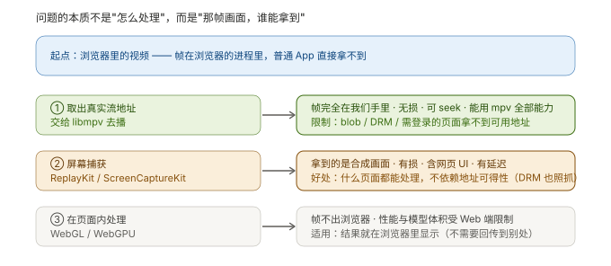
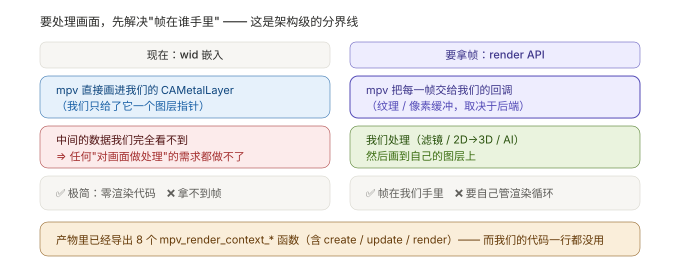

# K6 · 浏览器里的在线视频，怎么变成"可处理的帧"

> **结论先说**
>
> 这个场景里真正的问题**不是"怎么处理"**，而是 —— **"那帧画面，谁能拿到"**。
>
> 三条通路（取地址交给播放器 / 屏幕捕获 / 页面内处理）解决的正是这件事，代价完全不同。
> 而**更要紧**的是：只要你想对画面做任何处理（2D→3D、滤镜、AI），
> 就**必须换掉现在的接入方式** —— 从 `wid` 嵌入换成 **render API**。
>
> 产物里那 8 个 `mpv_render_context_*` 函数**已经在了**，而我们的代码**一行都没用**（§3）。



---

## 1 先把"浏览器里的视频"拆成几种形态

不是所有"网页上的视频"都是同一种东西 —— 形态决定第 ① 条通路能不能走通。

| 形态 | 典型长相 | 帧在哪 | 能拿到可用地址吗 |
| --- | --- | --- | --- |
| **直链文件** | `<video src="https://…/movie.mp4">` | 浏览器解码 | ✅ 直接可读 |
| **HLS / DASH** | `<video src="…/master.m3u8">`（Safari 原生支持 HLS） | 浏览器解码 | ✅ 拿到 `m3u8`/`mpd` 就行 |
| **MSE + `blob:`** | 流媒体站点常见（YouTube / B 站等） | 浏览器把分片喂给自己 | ❌ 地址是浏览器**内部拼的**，外部拿不到"一个 URL" |
| **WebRTC** | 实时通话 / 低延迟直播 | 浏览器 | ⚠️ 另一套（不是 HTTP 拉流） |
| **DRM 加密** | Widevine / FairPlay | 浏览器（带解密） | ⚠️ 地址可能拿得到，但**拿到了也解不开** |
| **Canvas / WebGL 渲染** | 某些自定义播放器 | 页面自己画的 | ❌ 连 `<video>` 元素都没有 |

> **一句话**：第 ③ 列决定了你能不能走第 ① 条通路。

---

## 2 三条通路

### A · 取出真实流地址 → 交给 libmpv（**推荐**）

**为什么最好**：帧**完全在我们手里** —— 无损、无网页 UI 混入、可 seek、能用 libmpv 的全部能力
（也就是 [`K3`](K3-运行面-一帧像素的旅程.md) 那条完整的链）。

**我们已经具备的能力**（不是"将来要有"）：

| 需要什么 | 现状 |
| --- | --- |
| 能拉 HLS / DASH / RTSP | ✅ 在产物白名单里（[`K5`](K5-网络面-直播与HTTPS.md) §2 实测） |
| 能带自定义请求头（部分站点要 Referer / Cookie） | ✅ `http-header-fields`，`P5-T4` 验过**真的到了服务器** |
| 能改 User-Agent | ✅ `user-agent` |
| HTTPS 证书校验 | ✅ 已修（[`docs/20`](../docs/20-P0-T5d-HTTPS校验修复.md)） |

**怎么拿到地址**（三种路子，由易到难）：

1. 页面里直接能看到（`<video src>`、右键"复制视频地址"）
2. **开发者工具 → Network** 面板，筛 `m3u8` / `mpd` / `mp4` —— 最常见的正经做法
3. 浏览器扩展或系统级代理（拦请求），用于地址由脚本拼出来的页面

**拿不到的三种情况**：`blob:`（MSE）· DRM · 地址带一次性 token 且很快过期。

### B · 系统级屏幕捕获

| 平台 | 框架 | 能力 |
| --- | --- | --- |
| macOS | **ScreenCaptureKit** | 可以只抓**某一个窗口**（不用整屏） |
| iOS | **ReplayKit** | App 内录制 / 系统级广播 |

**拿到的是什么**：**最终合成画面** —— 有损（受屏幕/窗口分辨率限制）、**含网页 UI**（播放器控件、弹幕、进度条全在里面）、有延迟。
**但它万能**：不依赖地址可得性 —— `blob:`、DRM、Canvas 全都照抓。

⚠️ **权限是硬门槛**：macOS 要"屏幕录制"权限（本项目在别的用途上实测被 TCC 拦过，
`PITFALLS` 里有记录）；iOS 的 ReplayKit 有明确的授权流程。

### C · 在页面内处理

WebGL / WebGPU + 模型（如 ONNX Runtime Web）。

- **优点**：不离开浏览器，不用改 App。
- **缺点**：性能与模型体积受 Web 端限制；**结果怎么送到别处**（如眼镜端）要另想办法。
- **适用**：结果就在浏览器里显示。

---

## 3 ⭐ 决定架构的那一步：从 `wid` 嵌入换成 render API



### 3.1 现在的做法为什么拿不到帧

[`K3`](K3-运行面-一帧像素的旅程.md) §4 讲过：我们把一个 `CAMetalLayer` 的指针（`wid`）交给 mpv，
**它自己建 GPU 上下文、自己往上画**。我们从头到尾没碰过画面数据。

**代码层面的证据**（这条最硬）：

```bash
grep -rn "CVPixelBuffer\|CGImage\|texture\|Texture" Sources/PlayerCore/ Sources/PlayerUI/
# → 空。我们的代码里至今没有任何"帧"的概念。
```

### 3.2 render API 是什么

mpv 提供的另一条接入方式：**由我们驱动渲染，mpv 把帧交给我们**。
产物里导出的 8 个函数（实测）：

```
mpv_render_context_create / free / get_info
mpv_render_context_render / report_swap
mpv_render_context_set_parameter / set_update_callback / update
```

**后端（`api_type`）**：mpv 文档明确支持的只有**两个** —— `opengl`（GPU 那条路）与
`sw`（软件那条路）。产物字符串里 `opengl` / `software` / `vulkan` / `d3d11` **四个词都能搜到**，
但**"字符串里出现过" ≠ "它是这个选项的取值"**：后面两个词来自别的子系统（hwdec / vo 列表之类）。

| 后端 | 是不是 render API 的后端 | 说明 |
| --- | --- | --- |
| `opengl` | ✅ 文档明确支持 | **iOS 上预期首选** —— 走 OpenGL ES（未实测） |
| `sw`（`software`） | ✅ 文档明确支持 | 纯 CPU 拷贝像素（简单但慢，大分辨率不划算） |
| `vulkan` | ⚠️ **存疑**（字符串有，未必是 api_type 取值） | 若可用，iOS 上仍要靠 MoltenVK |
| `d3d11` | ⚠️ 同上 | Windows 用，与我们无关 |

⚠️ **注意没有 `metal`** —— 这是个真问题：GPU 那条路会走 GLES，
而我们的图层是 Metal。**GLES 纹理怎么交给 Metal**（IOSurface 桥接之类）**需要实测**。

**配对要求**：用 render API 时，`vo` 要从现在的 `gpu-next` 换成 **`libmpv`**（产物里确认了这个值存在）。

### 3.3 换过去的代价（要说清）

| 得到 | 失去 |
| --- | --- |
| 每一帧的纹理/像素在我们手里 ⇒ 可以做任何处理 | 要**自己管渲染循环**（什么时候 `update`、什么时候 `render`） |
| 可以做 2D→3D / 滤镜 / AI 推理 | 要**自己管 GPU 上下文**与尺寸变化 |
| | 失去"零渲染代码"这个当前最大的便利 |

---

## 4 三条通路 × 代价（决策表）

| | 画面质量 | 通用性 | 需要动的代码 | 能否 seek / 换清晰度 | 延迟 |
| --- | --- | --- | --- | --- | --- |
| **A 取地址 + 播放器** | **无损** | 中（blob/DRM 不行） | 只需"取地址"这一步 + render API（若要处理） | ✅ 全部能力 | 低 |
| **B 屏幕捕获** | 有损（含 UI） | **万能** | 新增一条采集链 | ❌ 只能对着合成画面 | 中高 |
| **C 页面内** | 无损 | 中 | 全在 Web 端 | ⚠️ 取决于页面自己的实现 | 低 |

---

## 5 建议的判断顺序

```
能不能拿到可用地址？
├── 能 ──────────────► A（最优）
└── 不能（blob / DRM）
    └── 画面是否可以在页面上"可见地"播？
        ├── 能 ───────► B（万能，有损）
        └── 不能 ─────► C（只能留在浏览器里）
```

---

## 6 与我们现有代码的关系

| 能力 | 现状 | 对三条通路的影响 |
| --- | --- | --- |
| HLS / DASH / RTSP 拉流 | ✅ 已具备 | **A 通路已具备 90%** —— 只差"取地址"这一步 |
| 请求头 / UA 注入 | ✅ 已具备 | A 通路处理"要登录/要 Referer"的站点 |
| 证书校验 | ✅ 已修 | A 通路的 HTTPS |
| **帧出口** | ❌ **完全没有**（代码里零命中） | A/B/C 拿到的帧**都要经过这里** ⇒ **这一层必须先建** |
| render API | ⚠️ 产物有、**未使用** | A 通路要处理画面的前提 |
| 屏幕捕获 | ❌ 完全没有 | B 通路要新增 |

**结论**：三条通路里，A 的成本最低、收益最大 —— 因为它复用了整条已验证的播放链。
但它和 B、C 一样，**都卡在同一件事上：我们还没有一个"帧出口"**。

---

## 7 待验清单（如实标注）

| 项 | 为什么重要 | 状态 |
| --- | --- | --- |
| render API 在 iOS 上选哪个 `api_type` | 决定帧的形态（GLES 纹理 vs CPU 像素） | ⬜ 未实测（`opengl` 是预期） |
| **GLES 纹理 → Metal 的桥接** | 我们的图层是 Metal，绕不开 | ⬜ 未实测 |
| `vo=libmpv` 与现有 `wid` 路径能否共存 | 决定是"换掉"还是"并存两种模式" | ⬜ 未验证 |
| ReplayKit 拿 `CVPixelBuffer` 的可用性与延迟 | B 通路的可行性 | ⬜ 未调研 |
| `blob:` / DRM 站点的地址可得性 | 决定 A 通路覆盖多少网页 | ⬜ 未调研 |

---

## 8 术语表

| 术语 | 一句话 |
| --- | --- |
| **MSE** | Media Source Extensions：把分片"喂"给 `<video>` 的 Web API，视频站常用 |
| **`blob:`** | 浏览器内部生成的临时地址，**外部无法直接访问** |
| **DRM** | 内容加密（Widevine / FairPlay），拿到地址也解不开 |
| **ScreenCaptureKit** | macOS 的屏幕/窗口捕获框架 |
| **ReplayKit** | iOS 的录制/广播框架 |
| **render API** | mpv 的"由你驱动渲染"接口：帧交给你，你来画 |
| **`api_type`** | render API 的后端类型（opengl / software / vulkan…） |
| **IOSurface** | 苹果的跨框架共享显存缓冲；GL ↔ Metal 互操作常走它 |
| **`wid` 嵌入** | 把图层指针交给 mpv、让它自己画的接入方式（**现在用的**） |
