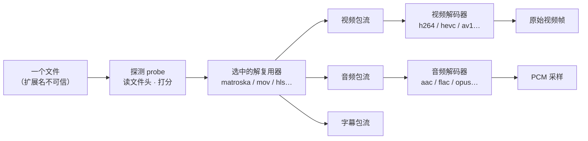

# K8 · 多格式播放的原理：为什么一个播放器能播几十种文件

> **结论先说**
>
> 播放器不是"为每种格式写一套"，而是把"格式"拆成**两个正交的维度**：
> **容器**（盒子）与 **编码**（盒子里东西的压缩方式）。
> 于是 "N 种容器 × M 种编码"不必要写 N×M 份实现，只要 **N + M 份**。
>
> 剩下的唯一难题是"**怎么知道这个盒子是什么**"—— 答案**不是扩展名**，
> 而是**读文件头内容、让每个解复用器各自打分、取最高分**。
>
> **本机实测**：把真 mp4 改名成 `.mkv`，识别结果仍是 mp4 系列；把真 mkv 改名成 `.mp4`，
> 识别结果仍是 `matroska` ⇒ **内容压倒扩展名**。

---

## 1 第一件事：容器 ≠ 编码

`mkv`（Matroska）只是一个**盒子**。它里面可以是：

| 盒子里能装的 | 例子 |
| --- | --- |
| 视频编码 | H.264 · HEVC · AV1 · VP9 · MPEG-4 · ProRes … |
| 音频编码 | AAC · FLAC · Opus · Vorbis · AC-3 · PCM … |
| 字幕 | SRT · ASS · PGS（图形字幕，本质是图片） |
| 轨道数 | 1 条视频 + 8 条音频 + 20 条字幕（蓝光原盘就长这样） |

**实测一个文件的内部结构**：

```bash
ffprobe -v error -show_entries stream=index,codec_type,codec_name -of csv=p=0 clip.mp4
# 0,h264,video
# 1,aac,audio
```

⇒ 这是"一个 mp4 盒子，装着 1 条 H.264 视频流 + 1 条 AAC 音频流"。
所以"我能播 mp4"这句话**不完整** —— 准确说法是"我能**拆开** mp4，**并且**我能解 H.264 和 AAC"。

### ⇒ 「能播什么」永远是两个清单的交集

| 清单 | 本产物实测规模 | 怎么量的 |
| --- | --- | --- |
| 能**拆**的盒子（demuxer） | **54 个** | `nm -gU libavformat.a \| grep -oE "_ff_[a-z0-9_]+_demuxer" \| sort -u \| wc -l` |
| 能**解**的编码（decoder） | **203 个** | 同上，换成 `libavcodec.a` / `_decoder` |

⚠️ 这就是为什么 **`mkv` 能播、`png` 不能播**（见 §5）：不是"mkv 比 png 高级"，而是
**盒子（matroska demuxer）在清单里，而 png 的盒子（image2）不在**。

---

## 2 二维正交：为什么不是 N×M



**不做这层抽象会付出什么**：假设要支持 10 种容器、20 种编码。
- 笨办法（每种组合一份实现）：**200 份**，且每加一种容器要乘 20。
- 正交办法：**10 个解复用器 + 20 个解码器 = 30 份**，每加一种容器只 +1。

这也是 FFmpeg 能"什么都能播"的全部秘密 —— 它**不神奇**，它只是把这两件事分开写了，
并且**把清单写得足够长**（全量 FFmpeg 的 demuxer/decoder 是**几百个**量级）。

---

## 3 怎么知道它是哪种容器：探测（probe）

### 3.1 不是看扩展名（双向实测）

```bash
# 实验 1：真 mp4，改名成 .mkv
cp clip.mp4 exp1-fake.mkv && ffprobe -v error -show_entries format=format_name -of default=nw=1 exp1-fake.mkv
# → format_name=mov,mp4,m4a,3gp,3g2,mj2      ← 扩展名 .mkv 被无视

# 实验 2：真 mkv，改名成 .mp4
ffmpeg -i clip.mp4 -c copy -t 3 exp2.mkv && mv exp2.mkv exp2-fake.mp4
ffprobe -v error -show_entries format=format_name -of default=nw=1 exp2-fake.mp4
# → format_name=matroska,webm                ← 扩展名 .mp4 被无视
```

### 3.2 机制：每个解复用器自带一个"探针"，谁给的分高谁上

`libavformat` 里每个 demuxer 都要实现 `read_probe` —— 输入是"文件开头的一段字节"，输出是**分数**。

mkv 的探针极其干脆（源码 `libavformat/matroskadec.c`）：

```c
static int matroska_probe(const AVProbeData *p) {
    if (AV_RB32(p->buf) != EBML_ID_HEADER)   // 0x1A45DFA3，EBML 魔数
        return 0;                            // 前 4 字节不对 ⇒ 0 分，直接出局
    ...
}
```

调用方是 `av_probe_input_format3()`（`libavformat/format.c`）：**遍历所有已注册的 demuxer**，
每个调一次 `read_probe`，取最高分。

**扩展名也参与，但只是个加分项**：源码里有 `AVPROBE_SCORE_EXTENSION` 这个较低分档 ——
所以"扩展名对得上"只是让它**更容易赢**，而"内容对得上"的分更高。这就是 §3.1 两个实验能成立的原因。

### 3.3 插件表：新格式是怎么"加进来"的

每个 demuxer 是一个**全局对象**（`ff_matroska_demuxer` / `ff_mov_demuxer` / …），
在 `libavformat/allformats.c` 里集中声明：

```c
extern const FFInputFormat  ff_matroska_demuxer;
extern const FFInputFormat  ff_mov_demuxer;
```

⇒ 加一种格式 = 写一个 `read_probe` + `read_header` + `read_packet` 的对象，挂进表。
**上层播放器一行不改。** 这与 [`docs/01`](../docs/01-KSPlayer-设计思想与整体评估.md) 里 KSPlayer 的
"思想 1（把会变的部分关进协议里）"是**同一种手法**，只是层次不同。

---

## 4 解码器怎么选：靠流头里的一个编号

解复用器拆出来的**每条流**都带一个 `codec_id`（编码编号）。播放器拿这个编号去查解码器
（`avcodec_find_decoder(codec_id)`），不需要"猜"。

**同一个编码可能有两条实现**，这也是容易混的一点：

| 编码 | 实现 1（软解） | 实现 2（硬解） |
| --- | --- | --- |
| H.264 | `h264`（CPU 算） | `h264_videotoolbox`（苹果芯片算，见 [`K4`](K4-图形栈-Metal与硬解.md)） |

它们**不是两种格式**，而是同一个 `codec_id` 下的两种实现 ⇒ 所以它是个**配置项**
（我们的产物里那行 `setOption(handle, "hwdec", "videotoolbox")`），不是"多支持了一种格式"。

---

## 5 「源码里有」≠「产物里有」 ⭐

这是本项目**最容易误判**的一条。看这个实测对照：

| demuxer | 源码里有声明吗 | 产物里有实现吗 |
| --- | --- | --- |
| `image2`（图片序列） | ✅ `allformats.c` 里有 `extern const FFInputFormat ff_image2_demuxer;` | ❌ **0 个符号** |
| `matroska` | ✅ | ✅ 1 个 |
| `mov` | ✅ | ✅ 1 个 |
| `hls` | ✅ | ✅ 1 个 |
| `rtsp` | ✅ | ✅ 1 个 |

判据（一条命令即可自证）：

```bash
nm -gU <构建树>/libavformat.a | grep -c "_ff_image2_demuxer"     # → 0
nm -gU <构建树>/libavformat.a | grep -c "_ff_matroska_demuxer"   # → 1
```

**机制**：源码里那个 `extern` 声明是**无条件的**（所有 demuxer 都写在那儿），
但**是否真的编进去**由构建配置的 `--enable-*` 白名单决定（见 [`K2`](K2-构建面-产物是怎么造出来的.md)）。

⇒ **判定"我们能不能播 xxx"的唯一依据是产物符号表 / 白名单，不是 FFmpeg 的官方能力表。**
这条同样适用于 decoder：`png` / `gif` / `tiff` / `webp` 都不在我们的 decoder 清单里 ⇒ **图片播不了**。

---

## 6 一次 mkv 播放的完整拆解

把 [`K1`](K1-概念底-这些东西分别是什么.md) 的 10 步落到"格式"这个视角上：

| 步 | 发生什么 | 落在哪个组件 |
| --- | --- | --- |
| 1 | 读文件头若干字节 | IO 层（网络源则是 stream 层） |
| 2 | 所有 demuxer 的 `read_probe` 打分 ⇒ **判定是 matroska** | `av_probe_input_format3` |
| 3 | `matroska_read_header`：读出**轨道清单**（1 条 h264 + 1 条 aac + 语言/分辨率…） | matroska demuxer |
| 4 | 循环取包：视频包 / 音频包分别入队 | `matroska_read_packet` |
| 5 | 按包上的 `codec_id` 找解码器 | `avcodec_find_decoder` |
| 6 | 解码 ⇒ 视频出 YUV 帧 / 音频出 PCM | `h264`（或 VideoToolbox）· `aac` |
| 7 | 时钟决定"这帧何时上屏" | libmpv（见 [`K3`](K3-运行面-一帧像素的旅程.md)） |
| 8 | 渲染上屏 | `vo=gpu-next` → Vulkan → MoltenVK → Metal |

**第 3 步值得单独记住**：所谓"轨道清单"就是 demuxer 的产物 ——
这也是为什么字幕/多音轨/多码率切换在架构上全都属于**同一类事**（都是从 `track-list` 读出来的）。

---

## 7 自己验一遍

```bash
# ① 看某文件里到底装了什么
ffprobe -v error -show_entries stream=index,codec_type,codec_name -of csv=p=0 <file>

# ② 证明"看内容不看扩展名"
cp real.mp4 fake.mkv && ffprobe -v error -show_entries format=format_name -of default=nw=1 fake.mkv

# ③ 证明"源码里有 ≠ 产物里有"（需要构建树；路径见 K2）
nm -gU <构建树>/libavformat.a  | grep -oE "_ff_[a-z0-9_]+_demuxer"  | sort -u | wc -l   # 54
nm -gU <构建树>/libavcodec.a   | grep -oE "_ff_[a-z0-9_]+_decoder"  | sort -u | wc -l   # 203
```

---

## 8 术语表

| 术语 | 一句话 |
| --- | --- |
| **容器 / 盒子** | mkv / mp4 / avi 这类"装东西的盒子"，决定**结构**不决定**画质** |
| **编码** | 盒子里内容被压缩的方式（H.264 / HEVC / AV1 / AAC…），决定**怎么解** |
| **解复用（demux）** | 把盒子拆成"视频包 / 音频包 / 字幕包"的流 |
| **解复用器（demuxer）** | 干上面这件事的组件。**一个容器配一个** |
| **解码器（decoder）** | 把压缩包还原成原始帧。**一个编码配一个**（硬解常另有一份） |
| **probe / 探测** | "读文件头 + 打分"猜出这是哪种容器。**不看扩展名** |
| **EBML / 魔数** | Matroska 系文件开头的固定字节（`0x1A45DFA3`），即它的"指纹" |
| **codec_id** | 流头里记录的编码编号，用它查解码器 |
| **白名单裁剪** | 构建时只把需要的 demuxer/decoder 编进产物（本产物：54 / 203） |
