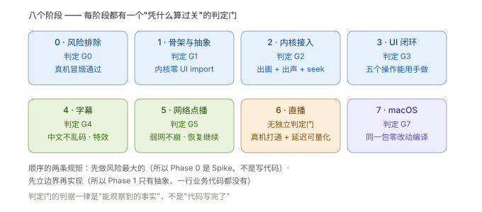

# A · 阶段路线：八个阶段与它们的判定门

> **结论先说**
>
> 这条路线有**两条规矩**贯穿始终：
>
> 1. **先做风险最大的** —— 所以第一个阶段是"验证 libmpv 在 iOS 上到底行不行"（Spike），
>    而**不是**"先写一个能跑的 App"。
> 2. **先立边界再实现** —— 第二个阶段**只有抽象与骨架**，业务代码一行都没有。
>
> 除 **Phase 6** 外，每个阶段都有一个**判定门（Gate）**，判据一律是「**外部能观察到的事实**」，
> 而不是「代码写完了」。（Phase 6 是唯一的例外：没有独立门，判据由两条代理指标承担 —— 见下文，那里写清了"为什么可以没有"。）
>
> 这是整套方法里最值钱的一点：**没有判定门的阶段，等于没有结束。**

---

## 用法

| 你想 | 看 |
| --- | --- |
| 知道"每一步该产出什么、凭什么算过关" | 本文（各阶段小节） |
| 知道"每个岔路口怎么选" | [`B-决策清单`](B-决策清单.md) |
| 知道"内核怎么选" | [`C-三种内核`](C-三种内核.md) |
| 知道"许可与产物怎么处理" | [`D-产物与授权`](D-产物与授权.md) |
| 知道"别人踩过的坑（别再踩）" | [`E-最容易做错的地方`](E-最容易做错的地方.md) |

---

## Phase 0 · 风险排除（Spike，**不写产品代码**）

| 项 | 内容 |
| --- | --- |
| **目标** | 用最小成本确认"这个路线在目标平台上成立" |
| **关键产出** | 产物能不能造出来 · 能不能在真机上跑起来 · 相关事实记录（不写任何产品代码） |
| **判定门** | **G0**：目标架构的切片存在，且**真机冒烟通过** |
| **实际走到哪** | 自建动态 LGPL-2.1 产物（含真机切片）· 模拟器 + 真机都出画面 · 顺带把"授权"这条从风险变成事实 |
| 🎯 **可迁移** | ⭐ **Spike 的产物是"事实"，不是代码** —— 这个阶段交付的应该是"这条路行/不行 + 一份证据"，代码可以全部丢掉 |

> **为什么它必须是第一个**：如果这条腿是断的，后面所有阶段都要重做。
> 而"能不能在真机上跑"这件事，**读文档永远得不到答案** —— 只有跑一次才知道。
> 我们实际在 Phase 0 就撞上了"产物缺少某类框架引用""`install_name` 指向构建树"这类
> 只有真机才会暴露的问题（详见 [`E`](E-最容易做错的地方.md)）。

---

## Phase 1 · 骨架与内核抽象（**零 UI 依赖**）

| 项 | 内容 |
| --- | --- |
| **目标** | 把"内核与 UI 编译期隔离"从**约定**变成**物理事实** |
| **关键产出** | 可跑测试的骨架包 + 内核边界（协议 / 注册表 / 假内核 / 状态机 / 时间模型） |
| **判定门** | **G1**：测试全绿 **且** 内核包**零 UI 框架引用** |
| **实际走到哪** | 立了协议 + 假内核 —— 于是一整套"不碰播放器也能测"的能力从第一天起就有了 |
| 🎯 **可迁移** | ⭐ **抽象的检验标准是"能不能违反它"**：G1 的判据是"内核包里出现 `import SwiftUI` 就算不过" —— 这是**机器可查**的，不靠自觉 |

> 参考实现在这一点上是反例：它的内核与 UI **没有编译期隔离**，后果是
> **整个仓库只有 1 个测试文件、8 个 `@Test`**（详见 [`E`](E-最容易做错的地方.md) §一·1 与 `../docs/01` L285）。

---

## Phase 2 · 内核接入（让真画面出来）

| 项 | 内容 |
| --- | --- |
| **目标** | 把播放器内核接上，走通**一条真实链路** |
| **关键产出** | 能播本地文件的适配层 + 对应的 mock 化单测 |
| **判定门** | **G2**：**出画 + 出声 + 能 seek**（三件都要，且 seek 要落在正确位置） |
| **实际走到哪** | 出画 ✅ · seek 精确 ✅ · 出声那一次因样例**只有视频轨**未覆盖（后来由 `P2-T12` 给样例补 **AAC 44100 Hz 音轨**补上 —— 不是换了个"有声音的源"，是**造了一个可控的音轨**） |
| 🎯 **可迁移** | ⭐ **判定门要写"三件都要"而不是"能播"** —— "能播"是最容易自欺的判据（画面出来了，但声音不同步、seek 落偏，用户马上就发现） |

---

## Phase 3 · UI 最小闭环（**严格限定件数**）

| 项 | 内容 |
| --- | --- |
| **目标** | 能用手操作 |
| **关键产出** | 严格限定的几件：播放/暂停 · 时间 · 进度条 + 拖拽 · 全屏 · 文件选择 |
| **判定门** | **G3**：在目标环境里把这几个操作**都做一遍** |
| **实际走到哪** | 5 件套齐；后来 UI 自动化被移除、又恢复 —— ⚠️ 恢复的是 **4 条确定性用例**（不依赖媒体/网络），不是原来的 5 条（见 `../docs/03` 的 📌 2026-10-16） |
| 🎯 **可迁移** | ⭐ **用"件数"钉死范围**。UI 是唯一会无限膨胀的层 —— 不写清"第一期只做这 5 件"，它会吃掉后面所有阶段 |

---

## Phase 4 · 字幕

| 项 | 内容 |
| --- | --- |
| **目标** | 能看字幕（含特效字幕） |
| **关键产出** | 轨道枚举 / 选择 / 开关 / 延迟调节；**外挂**与**内挂**两条路 |
| **判定门** | **G4**：中文不乱码 · 特效字幕能渲染 · 延迟可调 |
| **实际走到哪** | 达成；并记下"字幕由播放器画在最上层"这个 UI 约束（`wid` 嵌入的固有取舍，见 `../docs/02` §4 风险 3） |
| 🎯 **可迁移** | ⭐ **判定门里要有一个"中文/非 ASCII"用例**。这类问题（编码、字体、断行）不会在英文样例上暴露 |

---

## Phase 5 · 网络点播

| 项 | 内容 |
| --- | --- |
| **目标** | 能看在线内容 |
| **关键产出** | 网络源播放 + 请求头注入 + **弱网行为** |
| **判定门** | **G5**：弱网下**不崩** · **有缓冲提示** · **恢复后自动继续** |
| **实际走到哪** | 三条全达成（真机 + 可控限速服务器）· 后来"可切清晰度"作为 G5 口径的**欠账**补了一张票 |
| 🎯 **可迁移** | ⭐ **"弱网"必须自己能造** —— 没有可控弱网时得出的任何"通过/不通过"，
都是**把环境的能力缺口伪装成产品缺陷**。造环境的开关要写进工具里（限速 / 挂住 N 秒 / 回放请求头） |

---

## Phase 6 · 直播

| 项 | 内容 |
| --- | --- |
| **目标** | 能看直播，且延迟可量化 |
| **关键产出** | 协议打通 + **延迟指标** + 一组默认参数 |
| **判定门** | ⚠️ **没有独立判定门** —— 判据实际是两条：「真机打通」+「延迟可量化且优化到可接受量级」 |
| **实际走到哪** | 打通 ✅ · 定义了两个指标并给基线 ✅ · 调参后产品侧落后量 −65% ✅ · **代价也量化了**（抖动变多） |
| 🎯 **可迁移** | ⭐ **延迟这类指标必须先把"口径"定下来**：端到端 与 播放器内部**不可比**；而且**必须把它切成段**（服务端段 / 产品段），否则归因不到自己头上。口径的定义见 `../docs/15`，分段与代价见 `../docs/16`；"把环境固有开销当产品缺陷"这条 → [`E`](E-最容易做错的地方.md) §二·6 |

---

## Phase 7 · 第二平台（macOS）

| 项 | 内容 |
| --- | --- |
| **目标** | 同一个包在第二个平台跑起来 |
| **关键产出** | 平台 target + 平台差异收口 |
| **判定门** | **G7**：同一个 SPM 包在另一个平台**零源码改动**编译通过 |
| **实际走到哪** | 达成 —— 但要**写清边界**：这是「**编译面**」的达成，不代表"该平台能真实播放"（产物只有 iOS 切片）。⚠️ 第二个坑也得写明：**包本身零改动**，但 Demo 侧要挂一个 **stub 内核**（`MacOSStubKernel`）才跑得起来 —— "零改动"说的是**包**，不是**整个仓库** |
| 🎯 **可迁移** | ⭐ **达成口径要写边界**。"零改动编译"与"功能可用"是两件事，
不写清就会出现"文档说达成了、用户一试发现不能播"这种最伤信任的落差 |

---

## 附一：判定门的三条写法规矩

| # | 规矩 | 反例（真实踩过） |
| --- | --- | --- |
| 1 | 判据必须是**外部可观察的事实**（能播 / 能测 / 能构建） | "适配层写完了" —— 不可观察，等于没判据 |
| 2 | **一个阶段一个门**，并写清"达成口径的边界" | G7 若只写"macOS 达成"，会被读成"macOS 能放片" |
| 3 | 门不过 ⇒ **要么回补、要么明确记录"带病前进"** | 静默跳过 ⇒ 半年后没人知道这里缺一块 |

---

## 附二：追补票不是计划失败，而是判据写对了的证据

本项目的实例（都发生在"阶段已关闭之后"）：

| 追补的票 | 起因 | 说明 |
| --- | --- | --- |
| **可切清晰度** | `G5` 的口径里本来就有这一条，交付时**只算了欠账** | 判据是事实 ⇒ 事实把欠账照出来了 |
| **起播延迟** | 上一阶段记下的"起播未达标"缺口 | 缺口被**显式记录**，所以能被追 |
| **HTTPS 行为** | `Phase 0` 登记的风险项，一直悬着 | 风险登记表让"忘掉的项"变成"待办的项" |

⇒ **两个习惯**：① 未达标的项**如实记进缺口清单**（不假完成）；② 风险在登记后要有**归属的票**。

---

## 附三：如果只记一句话

> **每个阶段结束前问一次：「这件事，别人怎么复核？」**
> 答不出来，说明这个阶段还没有判定门 —— 也就还没有结束。
