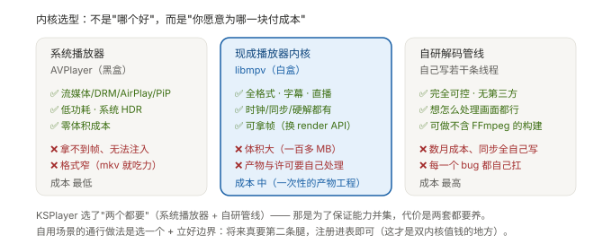

# C · 三种内核：能力、成本、以及该选谁

> **结论先说**
>
> 播放器内核只有三种选择。它们**不是优劣关系，而是"成本付在哪里"的关系**：
>
> | # | 内核 | 你付什么 | 你得到什么 |
> | --- | --- | --- | --- |
> | ① | **系统播放器**（AVPlayer 之类） | 几乎零成本 | 流媒体/DRM/投屏齐全，但**是黑盒**：帧只能按时间取样去要、格式窄 |
> | ② | **现成播放器内核**（libmpv 这类） | 一次性的**产物工程**成本 | 全能 + 可拿帧（白盒） |
> | ③ | **自研解码管线** | 数月成本 + 全部 bug | 完全可控、零第三方 |
>
> 而**真正的分水岭是"渲染管线在谁手里"** —— 它决定你能对画面控制到什么程度（不只是"拿不拿得到"）。

---

## 1 能力矩阵

| 能力 | ① 系统播放器 | ② 现成内核（libmpv） | ③ 自研管线 |
| --- | --- | --- | --- |
| **格式覆盖**（mkv/avi/全音频编码…） | ❌ 窄 | ✅ 取决于产物白名单 | ✅ 取决于你编了什么 |
| **字幕**（SRT / ASS 特效 / 图形字幕） | ⚠️ 部分，特效受限 | ✅ 完整 | ⚠️ 全自己写 |
| **网络**（HLS / DASH / RTSP / RTMP） | ⚠️ 以 HLS 为主 | ✅ 全部 | ⚠️ 全自己写 |
| **DRM**（受保护内容） | ✅ 强项 | ❌ 不支持 | ❌ 不支持 |
| **投屏 / AirPlay** | ✅ | ❌ | ❌ |
| **原生画中画** | ✅ | ❌（依赖系统播放器链路） | ❌ |
| **系统 HDR 通路** | ✅ | ⚠️ 用自己的色调映射 | ⚠️ 自己映射 |
| **功耗** | ✅ 最低 | ⚠️ 较高 | ⚠️ 看实现 |
| **⭐ 能否拿到每一帧** | ⚠️ 默认拿不到；有 **`AVPlayerItemVideoOutput`** 这条"按时间拉帧"的通道（见 §2） | ⚠️ 默认拿不到，**换 render API 可以** | ✅ 天然在你手里 |
| 接入成本 | **最低** | 中（产物工程，一次性） | **最高**（数月） |
| 维护成本 | 低（系统在维护） | 低-中（跟着上游走） | 高（每个 bug 都是你的） |
| 许可复杂度 | 无 | ⚠️ 取决于内核（见 [`D`](D-产物与授权.md)） | 取决于你用了什么 |

---

## 2 ⭐ 为什么"渲染管线在谁手里"是分水岭

这一栏值得单独讲 —— 因为它决定你的产品**能不能做某些事**：

| 内核 | 帧在哪 | 你能做什么 |
| --- | --- | --- |
| ① 系统播放器 | **在系统进程里**：默认只给你一个"正在播放的图层"，另有 `AVPlayerItemVideoOutput` 可按播放时间**拉**帧 | ⚠️ **拉得到帧**（滤镜 / 3D / AI 技术上做得了），但**时序与画质不由你** —— 渲染管线仍是系统的；受保护内容（DRM）拉不到 |
| ② libmpv（默认 `wid` 嵌入） | 在播放器内部，**被直接画到你的图层上** | ❌ 连"按时间取一帧"都没有，只有画面 |
| ② libmpv（**render API**） | **交给你**（纹理或像素缓冲） | ✅ 想做什么都行 |
| ③ 自研管线 | 天然在你手里 | ✅ |

> **真正的分水岭不是"拿不拿得到一帧"，而是"渲染管线在谁手里"**：
> ① 给你的是**按时间取样的副本** —— 要帧得自己去要，节奏跟着播放器走，画质与色彩处理也由它定；
> ② + render API 给你的是**每一帧 + 由你决定怎么画**。
> 所以顺序是：先问"我要不要控制**画面出场的每一帧**"，
> 要 ⇒ ① 只能应付轻量的旁路处理，正解是 ② 上 render API 或 ③（展开见
> [`../knowledge/K6`](../knowledge/K6-浏览器在线视频-怎么变成可处理的帧.md) §3）。

---

## 3 双内核：它值钱的地方**不是"两个"，而是"注册表"**

参考实现用了"两个内核"（系统播放器 + 自研管线）。看它为什么这么选：

| 动因 | 说明 |
| --- | --- |
| 能力**取并集** | 系统播放器有 DRM/投屏，自研管线有格式与可控 —— 单靠任一个都残缺 |
| **成本按需支付** | 日常内容走系统播放器 ⇒ 自研管线那条最贵的路**只在需要时才被使用** |
| 失败降级 | 一个内核不行，切到另一个 |

**但真正让它成立的是"注册表"**（不是"写了两个内核"）：

> 参考实现后来往注册表里塞了**第三个内核**时，**上层一行没改**。
> 也就是说：**双内核的真正收益是"加内核的成本被压到 O(新增实现)"**，
> 而不是"我现在有两个内核"。

**代价也要说清**：两套要走 —— 测试要覆盖两套、行为差异要处理两套、构建体积也是两套。

---

## 4 判据：什么场景选哪个

| 你的场景 | 选 | 为什么 |
| --- | --- | --- |
| 在线视频 App（要 DRM / 投屏 / 低功耗） | **① 系统播放器** | 这些能力只有它有，自研不划算 |
| 本地 / 全能播放器（要 mkv、字幕、直播） | **② libmpv** | 白送全套格式与字幕；自己写等于重造 |
| 要对每一帧做事（滤镜 / 2D→3D / AI / 合成） | **② libmpv + render API** | 帧交给你；省掉重写解码管线 |
| 极致定制 / 不能背大体积依赖 / 有严格许可约束 | **③ 自研管线** | 只有在"依赖本身是问题"时才值得 |
| 能力面必须**同时**覆盖"受保护内容"和"全格式" | **双内核** | 但这要求你**先有注册表** |

---

## 5 我们与参考实现的分歧（以及为什么两者都对）

| | 参考实现 | 我们 |
| --- | --- | --- |
| 选择 | 双内核（系统播放器 + 自研管线） | 单内核（libmpv） |
| 原因 | 它是**框架**，能力面必须取并集 | 我们是**自用 + 上架**，"全格式 + 可控"是核心 |
| 代价 | 两套都要养（它自认这是"精力全投功能广度"的结果） | 放弃 DRM/投屏/原生 PiP（已写进**放弃清单**） |

⇒ **两者都不错，因为它们的"刚需"不同。** 这也是为什么 [`B`](B-决策清单.md) 里
我把"判据"那一列标为最该抄的东西。

---

## 6 一句话

> **选内核 = 选"你愿意为哪一块付成本"，而不是选"哪个更好"。**
> 顺序永远是：先列刚需 → 再看每种内核在哪条刚需上残缺 → 最后才看成本。
