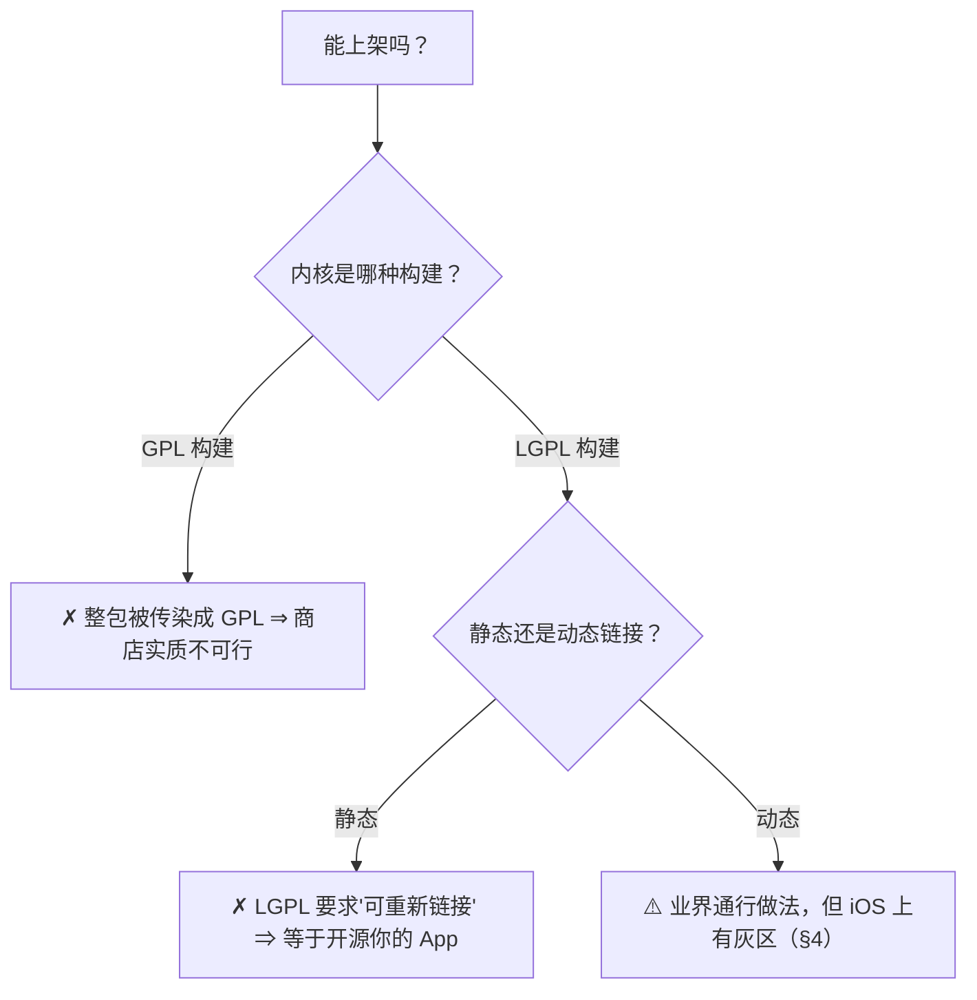

# D · 产物与授权：唯一"一开始就必须想清"的外部约束

> **结论先说**
>
> **许可只在分发时触发。** 自用随便；一旦要上架，**全部义务立刻生效**。
>
> 而这里有个反直觉的事实：**把 GPL 带上来的通常不是 FFmpeg，是播放器内核本身**
> —— FFmpeg 默认就是 **LGPL-2.1+**（只有开了 `--enable-gpl` 才变 GPL）；
> 而 mpv / libmpv **默认是 GPLv2+**。
>
> ⇒ 所以"能不能上架"这个问题，**答案在你构建产物的那一刻就已经定了** ——
> 不是等法务看完才知道。

---

## 1 判定树：什么决定"能不能上架"

**要点**：两个条件（**LGPL 构建** + **动态链接**）**缺一不可**，而且要**同时**满足。
现有产物常常只满足一半 —— 见 §2。

---

## 2 现成产物为什么常常不能用（"错配"）

上一节的两个条件是**正交**的。看两类常见的现成产物：

| 现成产物 | 动态？ | 宽松许可？ | 结论 |
| --- | --- | --- | --- |
| 某 "FFmpegKit" 系里的 **`libmpv.framework`**（社区常用） | ✅ 动态（带 `_CodeSignature`） | ❌ **该产物是 GPL 构建**（`--enable-version3`） | 与上架冲突（实测见 `docs/02` B2） |
| 某 "MPVKit" 系（上游脚本默认产出） | ❌ **静态库**（`ar archive`） | ✅ LGPL（`-Dgpl=false`） | 静态 ⇒ LGPL 的重新链接路径不成立 |

> ⚠️ **别把这两行读成"某系一律 GPL / 一律静态"** —— 它们说的是**我们当时审到的那两个具体产物**
> （2026-10-13 实测）。同名前缀的物料里 GPL 档与 LGPL 档都有；**判据永远是那个产物自身**：
> `otool -D` 看链接方式、库自报的许可文本看档位 —— **不是看名字，也不是看 README**。

⇒ **在我们调研的那两个产物上**，没有现成的能同时满足，这就是必须自建产物的全部理由。
（自建的做法与结果见 [`../knowledge/K2`](../knowledge/K2-构建面-产物是怎么造出来的.md)。）

---

## 3 为什么值得为"避开 LGPLv3"换掉整条 TLS 链

| 版本 | 它的实际内容 | 对移动端的影响 |
| --- | --- | --- |
| **LGPL-2.1** | 只有"可替换库"这一条核心义务 | 对 App 相对友好 |
| **LGPLv3** | = **GPLv3 + 附加许可** ⇒ 继承了 GPLv3 的**反技术措施条款**与 **Installation Information** 要求 | ⚠️ 对 iOS 极不友好（安装信息要求与商店机制冲突） |

**我们的做法**：TLS 后端从 GnuTLS 换成**系统自带的安全框架**（SecureTransport = `Security.framework`）
⇒ **v3 依赖链整条消失**，许可压回 LGPL-2.1。

⚠️ **精确说法**：**把 v3 带上来的不是 gnutls 本身**（它自己是 LGPL-2.1+），
而是它的依赖 **`nettle` / `gmp`（LGPLv3+ / GPLv2+）** —— 这两个在 FFmpeg 的
`EXTERNAL_LIBRARY_VERSION3_LIST` 里，被链进来就必须 `--enable-version3`，
于是整包被拖成 v3（报错原文见 `docs/07` §3.2）。**换掉的是"整条链"，不是一个库的名声。**

> 🎯 **可迁移**：许可版本不是"声明"出来的，是**依赖链**决定的。
> 想降许可版本，就要找出"哪个依赖带进来的"，然后**换掉它** —— 而不是在 README 里写一句。

---

## 4 ⚠️ iOS 上的灰区：**动态 ≠ 合规**

**这是本项目唯一一条许可级风险，必须写在最显眼处。**

| 环节 | 事实 |
| --- | --- |
| LGPL 合规的枢纽 | **"用户能替换库"（re-linking 必须可能）** |
| 但商店下发的 App | 是**加密 + 平台签名**的 ⇒ 用户就算拿到库源码，**也无法替换 App 内的那一份** |
| ⇒ 结论 | **动态链接是必要条件，不是充分条件** |
| 能做的 | 业界标准的"**尽力合规**"：动态库 + 提供库源码 + 提供可重链接材料 + 许可文本 |
| 真实风险来源 | **不是平台审核，是上游权利人投诉** —— 历史上有播放器因权利人（而非平台）投诉下架的案例 |
| ⚠️ 对外表述纪律 | **只能宣称"已尽力合规"，不得宣称"已确保合规"** |

> 🎯 **可迁移**：遇到"看起来无解"的合规灰区，
> 正确动作不是"假装它不存在"，也不是"因此放弃上架"，而是：
> **写清风险 + 做该做的动作 + 规范对外表述**。三者缺一不可。

---

## 5 三条红线（什么会让你瞬间不能上架）

| 若发生 | 后果 |
| --- | --- |
| 产物改回 **GPL 构建** | 整包被传染成 GPL ⇒ 商店实质不可行 |
| 产物改成**静态链接** | 只能交"可重链接材料" ⇒ 等于要开源 App |
| 把**参考实现的代码文本**抄进产品 | 触发 GPL 传染（**只能借思想，不能复制代码**） |

⇒ 这三条要写进**工程约束**（我们写成硬性条目 + 每次构建后的符号级对账）。

---

## 6 显式放弃清单（选了单内核就要认）

**这不是遗漏，是决策** —— 半年后不要把它当成 bug：

| 放弃的能力 | 影响 |
| --- | --- |
| **AirPlay / 投屏** | 不能投到电视 / 音箱 |
| **DRM** | 不能播受保护内容 |
| **原生画中画** | 系统的画中画依赖"系统播放器"链路 |
| **系统 HDR 通路** | HDR 只能用播放器自己的色调映射，不走系统 |
| **低功耗优势** | 不经系统解码/渲染管线，功耗高于系统播放器 |
| **"不含大依赖的精简构建"** | 体积大（但授权影响已收敛：LGPL + 动态 ⇒ 代价是"要交源码"，不是"不能上架"） |

> ⚠️ **注意**：**"能上架"不在本清单里** —— 它是被选定的**目标**，不是被放弃的东西。
> 一旦"上架"从目标变成"放弃"，产物策略（LGPL + 动态）就全部失效了 —— 所以这两件事必须写在一起。

---

## 7 分发时要交什么 · 要付钱给谁

| 问题 | 答案 |
| --- | --- |
| **要交什么** | ① 库的**对应源码**（含你对上游的补丁）② 许可文本与说明 ③ 保证"用户可以替换库"（**尽力**，见 §4） |
| **要付钱给谁** | **开源许可不用付任何人**（GPL/LGPL 已经授权你使用） |
| ⚠️ 唯一要留意的钱 | **编解码专利池**（H.264 / HEVC 等，商业分发时可能触发）—— **它与开源许可无关**，是另一件事 |

> 🎯 **可迁移**：把"开源许可"与"专利许可"**当成两件事**分别处理。
> 混在一起谈，会出现"我已经用 LGPL 了所以没问题"这种危险结论。

---

## 8 依赖管理：从一次真实事故得出的四条硬规则

参考实现曾经用 git submodule 装播放器产物，结果导致"通过包管理器安装"彻底失败
（issue #811：SSH URL + 沙盒路径互相打架），最后**整段删掉 submodule**。

| # | 规则 | 为什么 |
| --- | --- | --- |
| 1 | `.gitmodules` 里**永远写 https，不写 `git@`** | 消费者没配 SSH key ⇒ `Host key verification failed` |
| 2 | **不要用 submodule 装大二进制依赖** | 大产物应当走 `.binaryTarget(url:checksum:)` 或普通包依赖 |
| 3 | 想同时支持"我改源码"和"别人直接吃包" ⇒ 用 **`package(path:)` 条件分支 + gitignore** | 本地源码优先、远端兜底 |
| 4 | **不要依赖"当前目录"推路径** | 包管理器在 checkout 沙盒里，当前目录可能是空串；要用 `#filePath` 并处理 `/checkouts/` 场景 |

---

## 9 产物工程的五条硬约束

| # | 约束 | 为什么 |
| --- | --- | --- |
| 1 | 产物必须是 **LGPL 构建 + 动态链接** | §1 判定树 |
| 2 | **构建脚本化、可原样重跑** | LGPL 要交"构建方式"，不能是"我在 IDE 里点了两下"产出的包 |
| 3 | **产物二进制不入 git**，入库的是**构建方式**（脚本 + 补丁 + 证据） | 几百 MB 的二进制会让仓库线性膨胀 |
| 4 | 每次构建后做**"配方 ↔ 产物"对账**（符号级） | 曾经出现过"产物里有、配方里没有"的改动（见 [`../knowledge/K2`](../knowledge/K2-构建面-产物是怎么造出来的.md) §5） |
| 5 | 产物的**合法性用命令自查**，不靠记忆 | `otool -D` 看链接路径 · `nm` 看符号 · 许可文本要看库自报 |

---

## 10 一句话

> **"能不能上架"不是法务问题，是构建配置问题。**
> 你构建产物时那两个开关（许可档 · 链接方式）决定了答案；法务只是把它念出来。
